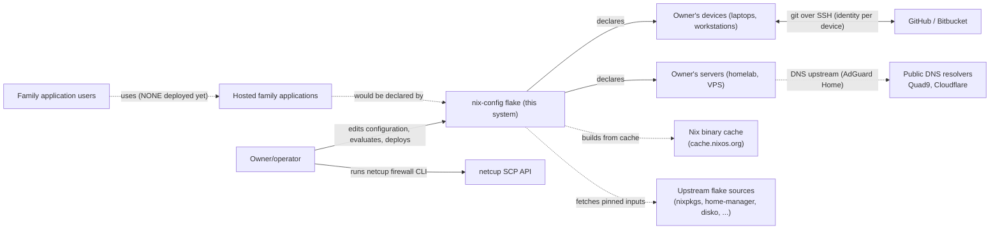
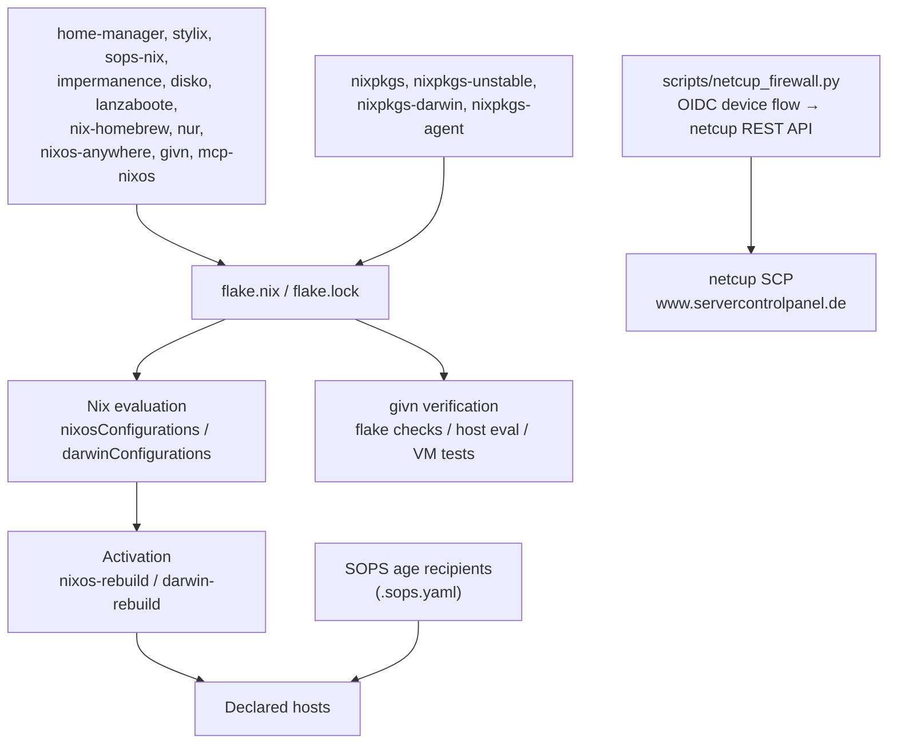

# 3. Context and Scope

## Business context

The owner/operator is the only human actor in the delivered configuration. The
family application users exist as confirmed stakeholders but have **no interface
yet**: the repository deploys no application they could use. The business
context therefore consists of one operator-facing interface and a set of
external services the configuration depends on.

Solid arrows are implemented; dotted arrows are external dependencies that are
partly or wholly **not** yet exercised.

| Partner / user | Input to system | Output from system |
|---|---|---|
| Owner/operator | Desired host/device state (Nix modules), deployments | Host configurations, system generations, assertions, test results |
| Owner's devices | Git operations against private repositories | Correct identity selection and access decisions, fail-closed |
| GitHub / Bitbucket | Repository access per identity | Accepted or denied SSH authentication; no data flows back into the configuration |
| Public DNS resolvers (Quad9, Cloudflare DoH) | DNS answers | AdGuard Home upstream resolution (**Declared**, not verified on hardware) |
| Nix binary cache, upstream flake sources | Evaluated/pinned dependencies and prebuilt closures | Reproducible generations |
| netcup SCP | Firewall policy state of the VPS account | Applied external firewall policies, backups of that state |
| Family application users / outside recipients | — | **Intended** app access; nothing deployed in the working tree |
| Hosted family applications | — | **Intended**; no application is configured or deployed |

## Technical context

Technical interfaces that exist in the repository, with their direction and the
strength of evidence for each.

| Interface | Technology / Protocol | Direction | Status |
|---|---|---|---|
| Flake inputs (`nixpkgs` 26.05, `nixpkgs-unstable`, `nixpkgs-agent`, `rust-overlay`, `home-manager`, `stylix`, `sops-nix`, `impermanence`, `disko`, `lanzaboote`, `nix-homebrew`, `nur`, `nixos-anywhere`, `givn`, `mcp-nixos`, `mac-app-util`, Homebrew taps) | Nix flakes, immutable pinned revisions (`flake.lock`); the Rust distribution's component tarballs are hash-pinned fixed-output downloads | In | Declared |
| Model servers (`context7`, `kagi-search`) | HTTP MCP endpoint and a stdio MCP command; the key is read from the host's sops material at connect time | Out (agent → service) | Declared on `thiniel` and `J6G6Y9JK7L`; a key-less device still starts the agent (observed by `integration-agent-tooling`); an actual server connection is not exercised |
| Git remote access from devices | SSH with an explicit per-identity key (`github-personal`, `github-company`, `github-client001`, `bitbucket-client002`) | Out | Verified in a VM (`integration-ssh-identity-selection`) |
| Security-key SSH authentication from `thiniel` | FIDO2 security key with non-resident handle files; token-only normal connections; named file-key fallback | Out (device → GitHub/declared hosts) | Declared; the VM e2e is planned, and the real-token/backup gates are operator-run |
| Secret material | SOPS YAML encrypted to age recipients; age key from a host SSH key (adlerkopf, cupix001) or a key file (thiniel, macOS) | In at activation | Declared; live decryption not audited |
| Host administration | OpenSSH, key-only, password/login-shell disabled (adlerkopf, nixos-vm-minimal, thiniel) | In | Declared; VM-tested for `nixos-vm-minimal` and `adlerkopf` |
| Fleet deployment | `nixos-rebuild --target-host` / `darwin-rebuild`; the Colmena CLI is installed but no hive is declared | Out | Declared; no deployment recorded in the working tree. The `colmena` input and the empty `colmenaHive` output were withdrawn by the change `quiet-configuration-evaluation` so that `nix flake check` reports no output it cannot interpret; the first server registers both again |
| netcup external firewall | Python CLI over OIDC device flow + REST (`scp_client`) | Out | Declared; run manually from a dev shell |
| DNS resolution | AdGuard Home with DNS-over-HTTPS upstreams | Out | Declared; not verified on hardware |
| givn specification workflow | `.feature` files bound to native targets; `givn commit` attribution | Local | Verified (hooks + `scripts/givn-spec-trace.py` are wired) |
| Nix MCP server (`.mcp.json`) | `nix run .#mcp-nixos` | Local | Declared |

The first stage adds a security-key path for the personal identity on `thiniel`; the file-backed identity remains a named fallback. The context gains no new external partner, and the work MacBook and work identities remain unchanged. The repeatable proof is a VM with a virtual FIDO2 authenticator; the physical token and backup restore are operator-run gates.

### Scope boundaries

In scope: the flake, host system modules, Home Manager user profiles and
feature modules, reusable option modules, the assertion/unit/integration test
suite, the Python support tooling (`scripts/netcup_firewall.py`,
`scripts/scp_client/`, `infra/firewall/`, `infra/http/`), and the `givn`
specification artifacts.

Out of scope: the applications the family would use, the network hardware
(router, DHCP, port-forwards — all manual per the runbook), the netcup account
state itself, third-party software behaviour, and any data stored on the hosts.
Vendor-side effects of the `netcup_firewall.py` tool (live account firewall
state) are outside this repository.
