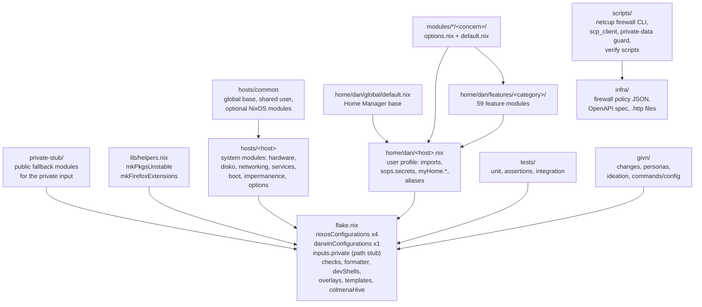

# 5. Building Block View

Static decomposition of the repository. Levels here are: the flake and its
outputs (L1), the composition layers (L2), and the individual reusable modules
and test layers (L3).

## Level 1 — System overview

| Building block | Responsibility |
|---|---|
| Flake (`flake.nix`, `flake.lock`) | Declare inputs, all host configurations, dev shells, packages, formatter, checks, overlays, the host template, and the (empty) Colmena hive. The only entry point. |
| Private-input stub (`private-stub/`) | The public fallback for the `private` flake input: one no-op module per host that asserts the host's declared network values are documentation-range placeholders or empty, so a clean clone and CI evaluate without private access. Owner: [ADR-0001](adr/ADR-0001-private-data-strategy.md). *Intended: introduced by the change `private-data-remediation`.* |
| Helpers (`lib/helpers.nix`) | `mkPkgsUnstable` (unstable package set with `allowUnfree`) and `mkFirefoxExtensions` (categorised addon sets for the Firefox profiles). |
| Shared NixOS base (`hosts/common/`) | `global/` sets timezone, locale, Nix experimental features, trusted users, `allowUnfree`; `users/dan.nix` is the shared non-root user; `optional/` holds opt-in modules (`networkmanager`, `virtualisation`, and an empty `docker.nix`). |
| Host system modules (`hosts/<host>/`) | Per-machine NixOS or nix-darwin declarations: hardware, disk layout, networking, boot/loader, services, persistence lists, typed host options. |
| User profiles (`home/dan/<host>.nix`) | The Home Manager surface of one host: the feature import list, declared `sops.secrets`, `myHome.*` declarations, shell aliases, and in the Darwin case `targets.darwin` app-linking settings. |
| Home Manager base (`home/dan/global/default.nix`) | `home.stateVersion`, htop, Home Manager self-management. |
| Option modules (`modules/<kind>/<concern>/`) | Reusable option + default pairs. Present concerns: `home-manager/ssh`, `home-manager/persistence`, `nixos/persistence`. |
| Feature modules (`home/dan/features/**`) | 59 modules rendering one concern each from host declarations, platform conditionals, and declared secrets. |
| Tests (`tests/`) | Three present layers (`unit`, `assertions`, `integration`); the documented `deploy` layer does not exist. |
| Support tooling (`scripts/`, `infra/`) | Python CLI and generated OpenAPI client for the netcup SCP firewall, the private-data guard `private_data_hygiene.py`, firewall policy definitions, `.http` request collections, VM build/deploy scripts, and the givn verification scripts. |
| Specification workflow (`givn/`) | Active change artifacts, promoted personas, the ideation topic, givn config/commands and hooks. |

### Declared hosts

| Host | System | Role (as declared) | Composition |
|---|---|---|---|
| `adlerkopf` | x86_64-linux | Home server / edge node | `hosts/adlerkopf` + `disko` + `lanzaboote` + Home Manager with only the global profile. |
| `cupix001` | x86_64-linux | netcup VPS (edge gateway role) | `hosts/cupix001` + `disko` + Home Manager with only the global profile. In the working tree it is a skeleton: no services, no networking, no persistence enabled. |
| `thiniel` | x86_64-linux | Owner's Linux laptop (ThinkPad X270) | `hosts/thiniel` + `nixos-hardware` X270 + `stylix` + Home Manager with the largest feature set (41 imports). |
| `nixos-vm-minimal` | aarch64-linux | Minimal test/provisioning VM | `hosts/nixos-vm-minimal` + `disko`; its own standalone Home Manager profile (no feature imports). |
| `J6G6Y9JK7L` | aarch64-darwin | Owner's work macOS workstation | `hosts/J6G6Y9JK7L` + `mac-app-util` + `nix-homebrew` + `stylix` + Home Manager with 28 feature imports. |

## Level 2 — Composition layers

### `hosts/common` (shared NixOS base)

**Responsibility:** hold the NixOS settings that are identical on every Linux
host, and the shared non-root user definition.

| Element | Responsibility |
|---|---|
| `global/default.nix` | `documentation.nixos.enable = false`, `allowUnfree`, `time.timeZone = "Europe/Berlin"`, `i18n.defaultLocale = "en_US.UTF-8"`; imports `global/nix.nix`. |
| `global/nix.nix` | `experimental-features = [ "nix-command" "flakes" ]`, `trusted-users = [ "root" "@wheel" ]` (the latter is required for remote `nixos-rebuild`). |
| `users/dan.nix` | `users.users.dan` — `isNormalUser`, `wheel`, plus `networkmanager` when NetworkManager is enabled. |
| `optional/networkmanager.nix` | `networking.networkmanager.enable = true`. Imported only by thiniel. |
| `optional/virtualisation.nix` | libvirtd + virt-manager. Imported only by thiniel. |
| `optional/docker.nix` | Empty (comments only); **imported by no host**. |

The Darwin host does not import `hosts/common` at all.

### `modules/` (reusable option + default pairs)

| Module | Options declared | Default behaviour |
|---|---|---|
| `nixos/persistence` | `mySystem.persistence.{enable,root}` | When enabled, binds `/etc/nixos`, `/var/log`, `/var/lib/nixos`, `/var/lib/systemd/coredump` and the files `/etc/machine-id`, `/var/lib/sops-nix/key.txt` from `root` (default `/persist/system`). |
| `home-manager/persistence` | `myHome.persistence.{enable,root}` | When enabled, persists user directories (`dev`, `Projects`, caches, `.config/sops/age`, `.config/netcup-scp`, opencode/omp state) and `.bash_history` from `root` (default `/persist`). |
| `home-manager/ssh` | `myHome.ssh.{personalIdentityFile,includedConfigs}` | No default behaviour; `personalIdentityFile` has no default, so a host that reaches private repositories must state its key. |

### `home/dan/features/**` (feature modules by category)

| Category | Modules | Notes |
|---|---|---|
| `cli/` (14) | ansible, cloud-tools, deploy-tools, fish, git, kitty, shell-utils, sops, sops-age-key, ssh, starship, vim, yazi, zsh | `git` and `ssh` render identity surfaces from `myHome.ssh` and sops secret presence. |
| `development/` (16) | claude-code, containers (+5 submodules), fnm, formatters, givn, go, jdk, nodejs, omp, opencode, python-tools | `containers.nix` is an orchestrator over 5 submodules. |
| `linux/` (11) | fonts, fuzzel, gnome-keyring, gtk-qt, hypridle, hyprland, hyprlock, kanshi, mako, waybar, wlsunset | Imported only by thiniel. |
| `macos/` (2) | aerospace, defaults | Imported only by the Darwin host. |
| `productivity/` (16) | browser, emacs, emacs-doom, firefox-company, firefox-personal, keepassxc, libreoffice, mac-tools, maestral, messaging, mpv, owncloud, sweethome3d, vscode, vscode-fhs, zathura | Several guard their persistence block with `lib.mkIf config.myHome.persistence.enable`. |

Two modules are **not** reachable from any host profile: `features/productivity/emacs.nix` (the Doom variant is used instead) and `features/productivity/vscode.nix` (commented out on the Mac; `vscode-fhs` is used on thiniel). `features/linux/impermanence.nix` referenced by `CLAUDE.md` does not exist in the current tree.

### Per-host user profiles

| Profile | Feature imports | `sops.secrets` | `myHome` declarations |
|---|---|---|---|
| `home/dan/J6G6Y9JK7L.nix` | 28 | 14 (`git/{personal,company,client001,client002}/{name,email,folder}`, `context7/api-key`, `kagi/api-key`) | `myHome.ssh` (personal key + 3 included configs) |
| `home/dan/thiniel.nix` | 41 | 5 (`git/personal/*`, `context7/api-key`, `kagi/api-key`) | `myHome.ssh.personalIdentityFile`; `myHome.persistence.enable = true` |
| `home/dan/adlerkopf.nix` | 1 (global only) | none | none |
| `home/dan/cupix001.nix` | 1 (global only) | none | none |
| `home/dan/nixos-vm-minimal.nix` | 0 (standalone) | none | none |

## Level 3 — Selected building blocks

### `home/dan/features/cli/ssh.nix`

**Responsibility:** render the device's SSH client configuration from the host's
identity declaration and the secret material the device holds.

| Element | Responsibility |
|---|---|
| `programs.ssh.enableDefaultConfig = false` | No Home Manager default host block; the file is fully declarative. |
| `"github-personal"` block | Always rendered; `IdentityFile` from `myHome.ssh.personalIdentityFile`. |
| `"github-company"`, `"github-client001"`, `"bitbucket-client002"` blocks | Rendered only where `config.sops.secrets ? "git/<identity>/name"`; key paths are literals in this module. |
| `programs.ssh.includes` | = `myHome.ssh.includedConfigs`, rendered before the managed entries. |
| `"*"` block | `AddKeysToAgent = yes`; on Darwin additionally `UseKeychain`, `IgnoreUnknown = UseKeychain`, `IdentitiesOnly = true`. |
| `services.ssh-agent.enable` | Enabled on Linux only (`!isDarwin`). |
### `home/dan/features/cli/git.nix`

**Responsibility:** render the Git identity surface: a base `~/.gitconfig` with
conditional includes per identity, and one `~/.config/git/<identity>` profile
per declared identity, each pinning `core.sshCommand` to the device's declared
identity file with `IdentitiesOnly=yes`.

### `tests/` (present verification layers)

| Building block | Responsibility |
|---|---|
| `tests/unit/default.nix` + 12 files | Aggregate `lib.debug.runTests` cases into check `unit-helpers` (all systems). |
| `tests/assertions/` | 17 `*-invariants.nix` modules adding `config.assertions`, aggregated by `tests/assertions/default.nix`; imported by thiniel, cupix001, adlerkopf and nixos-vm-minimal, while the Darwin host and Mac profile import their own two files. |
| `tests/integration/default.nix` + 4 files | `pkgs.testers.runNixOSTest` derivations exposed as checks `integration-vm-minimal-ssh`, `integration-adlerkopf`, `integration-ssh-identity-selection`, `integration-private-data-separation` (Linux only). Each test boots a purpose-built synthetic machine that declares the services under test; they do **not** import the host configurations. *`integration-private-data-separation` is intended: the change `private-data-remediation` adds it.* |

`tests/deploy/` (pytest-testinfra) is documented in `CLAUDE.md` and
`docs/GIVN-VERIFICATION.md` but does not exist; the `@deploy:` binding tag
therefore has no resolvable target today.
