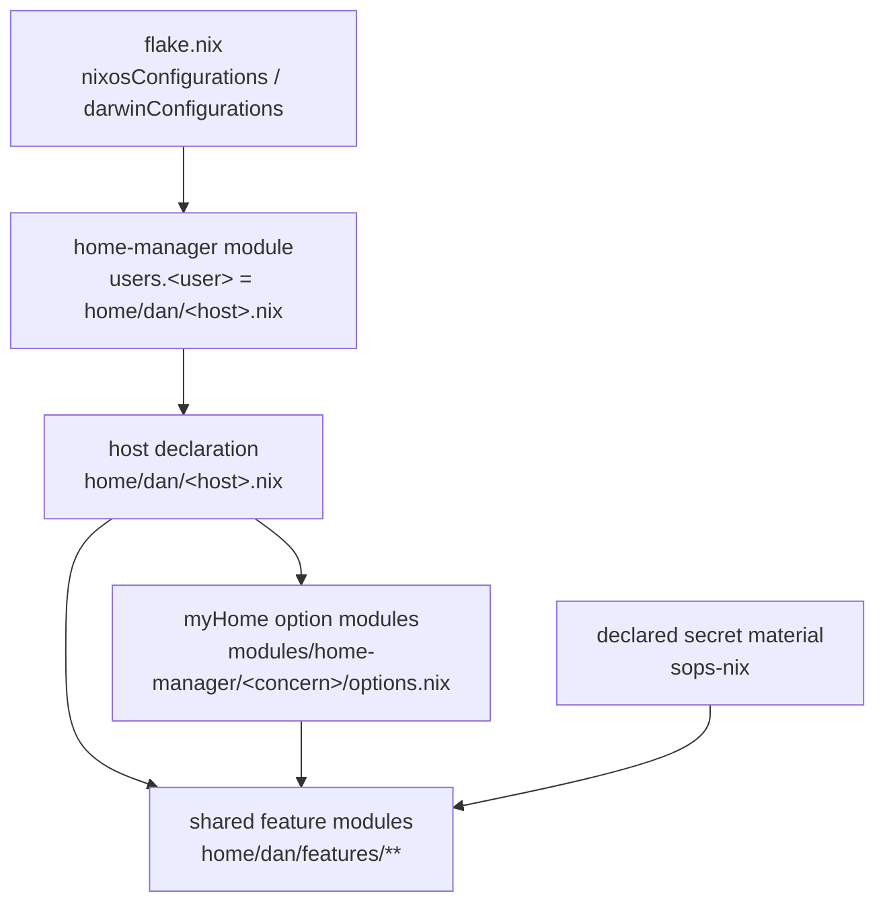

# 5. Building Block View

<!-- The static decomposition of the system into building blocks (modules,
     components, subsystems, packages, classes) and their dependencies.
     Present at the level of granularity that is architecturally significant. -->

## Level 1 — System overview

| Building block | Responsibility |
|---|---|
| Host configuration (`hosts/<host>`) | Map one machine to its NixOS or nix-darwin module and its home-manager user module. |
| Host user module (`home/dan/<host>.nix`) | Declare what this device holds: enabled feature modules, secret material, `myHome.*` declarations, host aliases. |
| `myHome` option modules (`modules/home-manager/<concern>/options.nix`) | The interface a host declaration fills and shared feature modules read. |
| Shared feature modules (`home/dan/features/**`) | Render a concern's configuration from the host declaration and the declared secret material. |

## Level 2 — Key building blocks

### `myHome.ssh` option declaration

**Responsibility:** declare which identity material this device holds and which
manually maintained `ssh_config` files it includes.

**Contained elements:**

| Element | Responsibility |
|---|---|
| `personalIdentityFile` | The private key of the device's personal identity; has no default, so a device that reaches private repositories states the key it holds. |
| `includedConfigs` | Manually maintained `ssh_config` files, included before the managed connection entries; defaults to none. |
