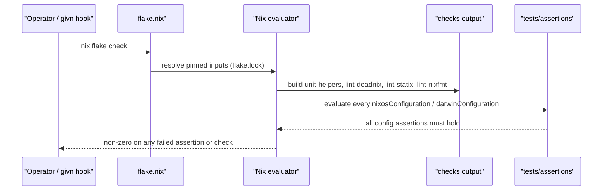
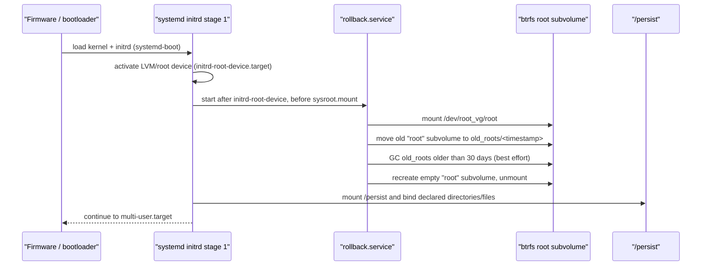
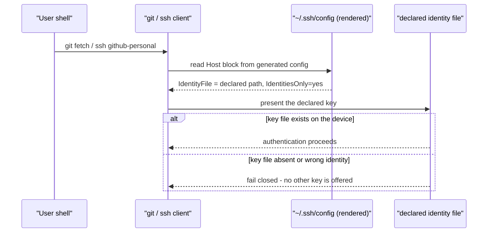
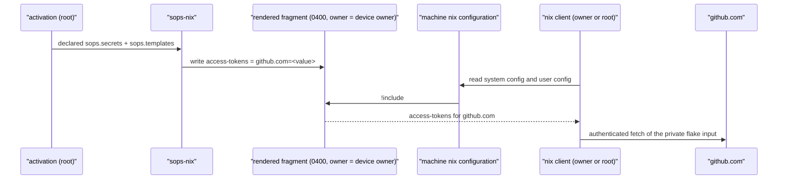
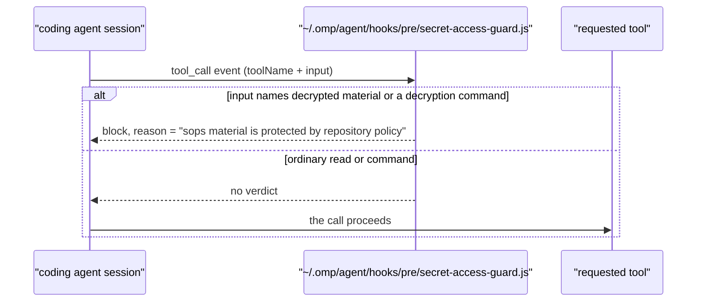

# 6. Runtime View

The runtime flows that matter for this system. Each scenario states its trigger,
the cooperating building blocks, and the strength of evidence. Nothing in this
chapter is a product runtime in the usual sense: the "runtime" is Nix
evaluation, Home Manager activation, system boot, and the native verification
targets.

## Scenario: Repository validation (`nix flake check`)

**Trigger:** A change is proposed, or `scripts/givn-verify.sh` runs as a givn
post-hook (`givn/commands.yaml`).



**Steps:**

1. Nix reads `flake.nix` and resolves inputs from `flake.lock`.
2. For each system in `[ x86_64-linux, aarch64-linux, aarch64-darwin ]` the
   `checks` output provides `unit-helpers` (a `runCommand` that fails unless all
   `lib.debug.runTests` cases pass), the three lint derivations,
   `private-data-defaults` (the declared host network defaults are placeholders
   or empty), `private-data-hygiene` (the guard over the recorded tree plus its
   built-in reject fixtures) and `unit-agent-secret-guard` (the agent's guard
   hook driven with synthetic tool calls).
3. For Linux systems the six `integration-*` checks are added
   (`integration-vm-minimal-ssh`, `integration-adlerkopf`,
   `integration-ssh-identity-selection`, `integration-private-data-separation`,
   `integration-agent-tooling`, `integration-managed-file-displacement`); they are
   not built by `nix flake check` in the non-e2e scope.
4. Every host configuration is evaluated, firing the imported assertion modules.

**Notes / verified behaviour:** the wiring is present and is the repository's
own gate. `@host:<name>` scenarios bind to the host evaluation; `@check:<name>`
scenarios bind to a specific check. A target that does not resolve is a hard
traceability failure (`scripts/givn-spec-trace.py`). The integration checks
require a Linux builder with KVM; `scripts/givn-verify-e2e.sh` fails loudly
instead of reporting a false pass on a non-Linux host.

## Scenario: Private operational values at evaluation and deploy time

**Trigger:** `nix flake check` on a clean clone, or a host deploy.

```mermaid
sequenceDiagram
  participant Dev as "Operator / CI"
  participant Flake as "flake.nix"
  participant Priv as "inputs.private"
  participant Stub as "private-stub module"
  participant Real as "nix-private module"
  participant Host as "host configuration"

  Dev->>Flake: nix flake check
  Flake->>Priv: resolve the default (path:./private-stub)
  Priv->>Stub: no-op module + placeholder assertion
  Stub->>Host: assert the declared network values are documentation-range
  Note over Dev,Host: a deploy overrides the input
  Dev->>Flake: nixos-rebuild switch --flake .#<host> --override-input private git+file:///…/nix-private
  Flake->>Priv: resolve the override
  Priv->>Real: nixosModules.&lt;host&gt; with the real values
  Real->>Host: systemd.network gets the real address, gateway and resolvers
```

**Steps:**

1. `flake.nix` declares `inputs.private` with the default `path:./private-stub`
   and includes `inputs.private.nixosModules.<host>` in the matching host's
   `modules` list.
2. With the default, the stub module is active: it adds no values and asserts
   that the host's declared network values are documentation-range placeholders,
   so `nix flake check` evaluates with placeholders and no private access.
3. A deploy passes `--override-input private git+file:///home/dan/dev/PRIVATE/nix-private`;
   the private flake's module supplies the real values, the stub is absent, and
   `hosts/<host>/networking.nix` renders `systemd.network` from them.
4. The private-data guard runs over the recorded tree (the check), over the
   staged paths (the pre-commit hook) and in CI.

**Notes / verified behaviour:** the mechanism is verified by
`@e2e @check:integration-private-data-separation`, which boots a machine whose
network values are supplied from outside the repository and asserts the booted
interface carries them. A forgotten override evaluates the stub, which is
indistinguishable from a clean clone's evaluation, so the stub assertion cannot
catch it; what refuses such a deploy is the deploy path's preflight in the
per-host rebuild alias — an operator process control, not a repository check.
The `git+file://` constraint that forces this shape is recorded in
[chapter 2](02-architecture-constraints.md) and
[ADR-0001](adr/ADR-0001-private-data-strategy.md).

## Scenario: Boot with impermanence (thiniel)

**Trigger:** the machine is powered on.



**Steps:**

1. `hosts/thiniel/default.nix` declares `boot.initrd.systemd.services.rollback`
   with `requiredBy = [ "initrd.target" ]`, `after =
   [ "initrd-root-device.target" "local-fs-pre.target" ]`, `before =
   [ "sysroot.mount" ]`.
2. The script renames the existing `root` subvolume into `old_roots/<mtime>`,
   deletes aged-out roots recursively (always non-fatal via `|| true`), then
   creates a fresh `root` subvolume.
3. Persistent state is re-bound from `/persist` (declared in
   `hosts/thiniel/default.nix` and `modules/nixos/persistence`).

**Notes:** the wipe guarantees a deterministic root; it also means any state not
declared in a persistence list is intentionally lost on reboot. The scripted
stage-1 mechanism this replaces is removed in nixpkgs 26.11, so the systemd form
is a dated migration obligation ([chapter 11](11-risks-and-technical-debt.md)
R-006). On `adlerkopf` the equivalent outcome is produced by an initrd service
that resets `@root` from the `@root-blank` snapshot created by the disko
`postCreateHook`; both are **declared** and guarded by assertions, and the
adlerkopf VM check asserts the same service shape on a synthetic machine and
does not boot the real adlerkopf configuration.

## Scenario: Identity selection before an SSH connection

**Trigger:** a Git operation or `ssh github-personal` on a device.



**Steps:**

1. `home/dan/<host>.nix` declares `myHome.ssh.personalIdentityFile` (the
   file-backed identity) and, where the device carries a security key, the
   ordered `myHome.ssh.tokenIdentityFiles`.
2. `home/dan/features/cli/ssh.nix` renders `~/.ssh/config` from that
   declaration: the token list on the normal entries when declared, otherwise
   the file identity; plus one host block per declared work identity
   (`config.sops.secrets ? "git/<identity>/name"`).
3. `home/dan/features/cli/git.nix` points each identity profile's
   `core.sshCommand` at the token list when declared, otherwise the file
   identity. The named `git-file-fallback` wrapper overrides with the file
   identity.
4. At use time, SSH presents only the declared identities
   (`IdentitiesOnly=yes`); the file key is not offered on a token entry.

**Notes / verified behaviour:** `tests/integration/ssh-identity-selection-test.nix` boots a QEMU VM with a token-less file-key device, asserts `github-personal` resolves to `~/.ssh/id_ed25519`, and asserts that no work-identity block and no `config.d/*` include are rendered. The work MacBook keeps that path. The `thiniel` token-list path is asserted by `thiniel-security-key-invariants` and exercised by the security-key VM e2e; it is not the same fixture. The failure mode is fail-closed because nothing guarantees that a declared key file exists — the declaration is proven on the device, not at evaluation time. Which identities a device holds is a per-host declaration; the choice and its rejected alternative are recorded in `givn/changes/host-specific-ssh-identities/design.md`.

## Scenario: Security-key authentication and the named fallback

**Trigger:** a Git operation or `ssh <declared-host>` on `thiniel` while the personal identity is represented by a non-resident security-key handle.

```mermaid
sequenceDiagram
  participant U as "Owner"
  participant S as "thiniel ssh"
  participant H as "non-resident handle file"
  participant K as "security key"
  participant R as "remote host"

  U->>S: git push / ssh declared-host
  S->>H: read the daily handle file
  S->>K: request signature
  K-->>U: touch prompt
  U->>K: touch
  K-->>S: signature
  S->>R: present token public identity
  alt public identity authorized
    R-->>S: accept
  else rejected or revoked
    R-->>S: reject; the file-backed identity is not tried
  end
```

**Steps:**

1. `thiniel` declares the daily Swissbit and the backup Solo 2 as token identities, each with its own non-resident handle file.
2. The normal SSH entries (`github-personal`, the declared hosts) offer the token identities only, daily first and backup second.
3. A token-held signature requires a touch; `verify-required` is not used, so no PIN is requested for daily use.
4. If the daily key is absent, the backup token is offered. The file-backed identity is not offered automatically; it is reachable only through `ssh-file-fallback` / `git-file-fallback`.
5. A rejected daily credential is not retried with the file-backed identity; the backup token may be offered.

**Notes / verification:** the configuration and selection rules are asserted by `tests/assertions/thiniel-security-key-invariants.nix`, the unit check `unit-security-key-identity`, and the fleet check `security-key-fleet-authorizations`. The VM e2e `integration-security-key-authentication` uses a virtual FIDO2 authenticator (P-256) and a controlled pinentry approval; the real-token path and the backup-token path are operator-run gates recorded in `backup-drill.md`. A stolen token alone cannot authenticate without its handle file; token plus handle file is protected by touch only, and the file-backed identity remains, so this flow does not claim stolen-laptop resistance.

## Scenario: Revocation after a lost security key

**Trigger:** the owner determines that a daily or backup security key is lost.

```mermaid
sequenceDiagram
  participant U as "Owner"
  participant S as "thiniel ssh"
  participant R as "remote host"

  U->>S: ssh with the remaining credential
  S->>R: authenticate
  U->>R: revoke the lost public identity
  alt remote confirms removal
    R-->>U: no longer authorized
  else failure or unreachable
    R-->>U: still authorized; reported, not success
  end
```

The owner revokes the lost public identity at every declared host that authorized it. A failed, unreachable, or unverified revocation is reported and is not treated as removed. The remaining credential and the file-backed identity stay available. The unit check `unit-security-key-identity` covers the plan and per-remote result; the VM e2e `integration-security-key-revocation` confirms the success path; the real remote revocation is an operator-run gate recorded in the change review.

## Scenario: Secret materialisation at activation

**Trigger:** a system generation is activated.

```mermaid
sequenceDiagram
  participant Act as "NixOS / Home Manager activation"
  participant Sops as "sops-nix"
  participant Key as "host age key"
  participant Run as "/run/secrets or ~/.config/sops-nix"

  Act->>Sops: for each declared sops.secrets entry
  Sops->>Key: read host age key
  alt host is a recipient (per .sops.yaml)
    Sops->>Run: write plaintext for the consuming service
    Sops-->>Act: secret present; dependent unit may restart
  else host is not a recipient
    Sops-->>Act: decryption fails; the declared secret is unusable
  end
```

**Steps:**

1. `sops.defaultSopsFile` names the host's `secrets.yaml`; recipients are fixed
   in `.sops.yaml` per path regex.
2. The host key is either an SSH host key on the persistent volume
   (`adlerkopf`, `cupix001`) or a dedicated key file (`thiniel`
   `/var/lib/sops-nix/key.txt`, macOS `~/Library/Application Support/sops/age/keys.txt`).
3. Secrets are consumed either through `config.sops.placeholder` inside a
   `sops.templates` file or read directly by the consuming unit from the
   decrypted path.

**Notes:** no secret payload was read to produce this documentation, and no live
decryption was observed. `.sops.yaml` gives `adlerkopf` and `cupix001` the
**same** age recipient value; whether that is intentional is unknown
([chapter 11](11-risks-and-technical-debt.md) R-007). thiniel exposes its key
file to the user session through `features/cli/sops-age-key.nix`
(`mkOutOfStoreSymlink`), which makes describing it as "inaccessible to the user"
wrong for that host.

## Scenario: GitHub credential supply to a nix client

**Trigger:** a nix invocation on a build machine fetches from the GitHub host.



**Steps:**

1. The machine opts in and the value sits encrypted in the machine's own
   `secrets.yaml` under `github/access-token`.
2. Activation decrypts and renders the one-line fragment; the value never enters
   a store path or the generated `nix.conf`. On thiniel the fragment is written
   by **system** activation as root to
   `/run/secrets/rendered/nix-github-access-tokens` (the sops-nix installer
   creates `/run/secrets.d/<generation>` and its secret directories mode `0751`,
   so an account that owns a `0400` file inside can traverse to it and no other
   account can read it). On the work MacBook the home-manager module renders it
   to `~/.config/sops-nix/secrets/rendered/nix-github-access-tokens` when the
   owner's session starts — the machine's existing pattern for `git/*`,
   `context7` and `kagi`.
3. The machine's configuration learns of the file through `!include`: on thiniel
   the generated system `nix.conf` (`nix.extraOptions`), on the Mac the owner's
   user configuration (home-manager) and root's
   `/var/root/.config/nix/nix.conf` (an activation script), because nix-darwin
   does not manage `nix.conf` there.
4. The owner's client and root's client both read the fragment; a client that
   cannot read it is unaffected — `!include` tolerates a missing or unreadable
   file, so an account that does not hold the credential keeps working
   unauthenticated instead of failing.

**Notes:** evidence is the change `github-fetch-credential`; the
`integration-github-fetch-credential` check boots a machine with the Linux shape
(system-level rendering, no session), asserts the fragment's owner and mode, both
clients' `nix config show` output, and that a second local account cannot read
it. The MacBook's render timing is confirmed on the machine because that host
cannot be booted from a Linux builder ([chapter 11](11-risks-and-technical-debt.md)
R-029).

## Scenario: A coding-agent tool call meets the secret-access guard

**Trigger:** the coding agent asks to run a tool (`read`, `grep`, `bash`,
`eval`).



**Steps:**

1. `home/dan/features/development/omp.nix` installs the guard as a regular file
   in the agent's user directory during activation; the file also exists in the
   repository as the project hook `.omp/hooks/pre/secret-access-guard.js`.
2. The agent loads the hook and calls it for every tool call, in every approval
   mode — a block is unconditional, including under "yolo".
3. The guard refuses a read of `/run/secrets/*`, a `sops/age/` path or
   `/var/lib/sops-nix/`, and refuses `sops`, `age -d`/`--decrypt` and
   `ssh-to-age` in command position, including through a launcher
   (`bash -c`, `env`, a subprocess array, `Bun.$`).

**Notes / verified behaviour:** the verdict table is proven by the
`unit-agent-secret-guard` check, which loads the tracked hook and drives it with
synthetic tool calls (refusals and allow-cases); placement and the agent's real
start are observed by the `integration-agent-tooling` check in a booted VM. What
is **not** proven here is a refusal inside a live agent session — a session needs
a model provider, so no target exercises that path. The guard is the
machine-enforced half of the rule that agents never decrypt secret material
([chapter 8](08-crosscutting-concepts.md), QS-004).

## Scenario: DNS resolution through AdGuard Home (declared, not proven)

**Trigger:** a LAN client sends a DNS query to adlerkopf.

**Steps (as declared in `hosts/adlerkopf/services/adguard.nix`):**

1. AdGuard Home listens on port 53 on the LAN address and loopback.
2. Queries resolve through DNS-over-HTTPS upstreams (Quad9, Cloudflare); the
   five `.lan` rewrites answer with the host's LAN address.
3. The admin password hash is injected into `AdGuardHome.yaml` by a systemd
   `preStart` that reads the SOPS secret (`yq-go`) after the module wrote the
   file.

**Notes:** there is no assertion, unit test, or VM test that exercises AdGuard
Home; the `adlerkopf` integration check only asserts sshd, caddy, and the
firewall. Treat this scenario as **declared only**.

## Scenario: Deployment to a fleet host (declared, not exercised here)

**Trigger:** the operator runs a rebuild from a workstation — the runbook's
default is `nixos-rebuild switch --flake .#adlerkopf --target-host dan@<host> --sudo`.
For `adlerkopf` and `cupix001` the command also carries
`--override-input private git+file:///home/dan/dev/PRIVATE/nix-private`, so the
host is built with its real values rather than the stub's placeholders.

**Steps:** build the closure on the workstation (or on the host after the
bootstrap workaround), copy it, activate the new generation, and confirm the
declared assertions. Rollback is `nixos-rebuild --rollback` or selecting a
previous generation in systemd-boot.

**Notes:** the runbook (`docs/ADLERKOPF-DEPLOY-RUNBOOK.md`) records the
one-time bootstrap problem (the remote Nix daemon does not trust `dan` until
`trusted-users` is active) and the TPM2/Secure Boot chicken-and-egg when
`secure-boot.nix` is enabled before keys exist. No such deployment is recorded
in the working tree; Colmena remains an intended alternative, but the change
`quiet-configuration-evaluation` withdrew its empty hive output and its input, so
nothing registers a node until the first server is provisioned.
