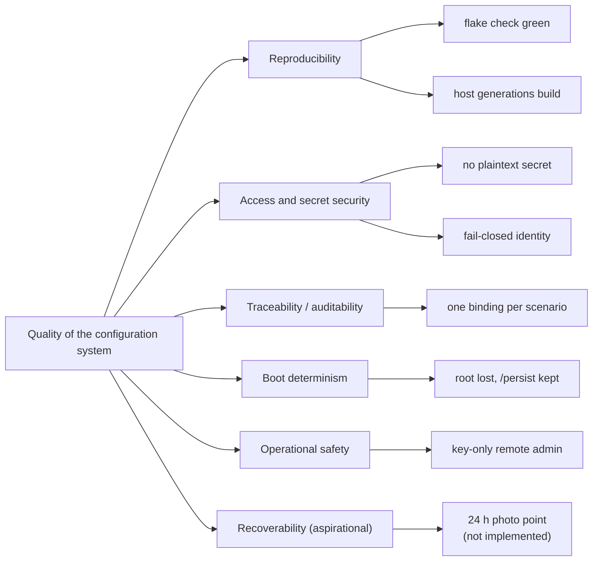

# 10. Quality Requirements

Measurable quality scenarios. They refine the quality goals of
[chapter 1](01-introduction-and-goals.md). "Metric" names the observable that
decides the scenario, and where a metric is **not** met today it is stated as a
gap, not hidden.

## Quality tree

## Quality scenarios

| ID | Quality attribute | Scenario | Metric / acceptance criterion | Status |
|---|---|---|---|---|
| QS-001 | Reproducibility | A change is proposed. | `nix flake check` and `scripts/givn-verify.sh` succeed: all four NixOS configurations and the Darwin configuration evaluate, and `unit-helpers`, `lint-deadnix`, `lint-statix`, `lint-nixfmt`, `private-data-defaults`, `private-data-hygiene` and `flake-output-contract` pass. | Met by the wiring; the operational values come from the overridable `private` input, whose public default is the in-tree stub, so a clean clone evaluates with placeholders and no private access. |
| QS-002 | Reproducibility | A host generation must be buildable from the flake alone. | `nix eval --raw .#nixosConfigurations.<host>.config.system.build.toplevel.drvPath` resolves for each host. | Met for all five configurations (`adlerkopf`, `cupix001`, `thiniel`, `nixos-vm-minimal`, `J6G6Y9JK7L`); the operational values arrive through the `private` input, not a non-committed file. `adlerkopf` was blocked before this change and is fixed by it (R-017). |
| QS-003 | Secret security | The operator commits a configuration change. | No plaintext secret appears in the change: each `hosts/<host>/secrets.yaml` is SOPS-encrypted and every host that declares `sops.secrets` has an age recipient for that path in `.sops.yaml`. | Met by inspection of the committed files; live decryption was not exercised. |
| QS-004 | Secret security | An agent runs tooling in this repository. | No `sops`/`age`/`ssh-to-age` invocation and no read of a decrypted path occurs. | Met by process rule (`CLAUDE.md`) plus the `omp` secret-access guard; not machine-enforced for every agent. |
| QS-005 | Access security | A device opens a connection to a private repository. | Exactly one identity is offered (`IdentitiesOnly=yes`); the offered key is the device's declared key. | **Verified** by `integration-ssh-identity-selection` for thiniel; declared and asserted for `J6G6Y9JK7L`. |
| QS-006 | Access security | A device is asked for an identity whose material it does not declare. | No connection entry and no Git profile for that identity is rendered (`lib.optionalAttrs (config.sops.secrets ? "git/<identity>/name")`). | Met at evaluation time (`thiniel-invariants`, `J6G6Y9JK7L-invariants`). |
| QS-007 | Boot determinism | thiniel reboots. | The root subvolume is recreated and every declared persistent path (`/persist`, `/nix`, `/var/log`, the per-host persistence list) survives. | Declared and guarded by `thiniel-boot-invariants` / `thiniel-impermanence-invariants`; not observed on a live boot in this repository. |
| QS-008 | Boot determinism | adlerkopf reboots without console access. | LUKS unlocks via TPM2 (passphrase slot retained) and lanzaboote-verified UKIs are the only boot entries. | Declared and asserted at evaluation time; **no boot test exercises adlerkopf's real configuration** (the `integration-adlerkopf` check boots a synthetic machine, and the `vmMode` variant is not materialized by any flake attribute). |
| QS-009 | Operational safety | The operator applies a server change remotely. | Activation succeeds with key-only SSH and no sudo password prompt (`security.sudo.wheelNeedsPassword = false`), `PasswordAuthentication = false`, `PermitRootLogin = "no"`. | Asserted for `adlerkopf` and `nixos-vm-minimal`; for the live host this depends on the documented one-time `trusted-users` bootstrap. |
| QS-010 | Traceability | A change delta is written. | Every scenario carries exactly one resolvable binding tag; every `@e2e` scenario binds to a VM/host/deploy target. | Enforced by `scripts/givn-spec-trace.py` in the `tasks`/`review` hooks; a `@deploy:` tag currently has no target. |
| QS-011 | Maintainability | A `.nix` file is changed. | `nixfmt` formatting and `deadnix`/`statix` cleanliness hold across the repository. | Wired as checks `lint-nixfmt`, `lint-deadnix`, `lint-statix`. |
| QS-012 | Recoverability (**aspirational**) | A hosted application loses its server. | A usable recovery point no older than the 24-hour target exists, including coherent application state and bootstrap. | **Not implemented.** No backup job, no destination, no retention. The only recorded stances are the restic plan (target TBD) and thiniel's explicit deferral. |
| QS-013 | Reproducible working environment (**aspirational**) | The owner must return to a usable work context on a device. | The intended tools, required working state at an approved version, and permitted usable identities are present and usable. | **Partly implemented**: tools/settings and identity selection exist; the coding agent's version floor is now supplied and asserted (QS-014), while the rest of the required state/version inventory is open (Q16) and no backup/restore path exists for working data. |
| QS-014 | Reproducible working environment | A coding agent on a device falls behind its upstream source. | The agents on every device that carries them are at or above their accepted version floors (`omp` `18.10`; OpenCode `2.0.28`, both checked 2026-10-13), asserted at evaluation time and observed on a booted VM. | Met for `thiniel` and `J6G6Y9JK7L` (host assertions + `integration-agent-tooling`, which carries both agents). The floors are deliberate minima refreshed by the owner, not a tracking schedule; the newest upstream release is deliberately not chased (design D1). |
| QS-015 | Reproducibility / declarativeness | The operator runs a flake check or builds a host. | The evaluation prints no diagnostic to triage: the personal laptop's two superseded defaults are stated explicitly, both booted-device checks pair their Home Manager with a package set from the same release, and every declared flake output is one the checker interprets. | **Met** — `tests/assertions/thiniel-hm-invariants.nix` (the release's own superseded-default predicate) and the `flake-output-contract` check; each fixture asserts its own pairing. The compositor keeps the release's superseded conf format deliberately ([chapter 11](11-risks-and-technical-debt.md) TD-015). |

## What is deliberately not claimed

- No scenario asserts uptime, latency, or throughput: there is no running
  service in the repository to measure.
- No scenario asserts that a secret decrypts on a live host: live decryption is
  a human-only operation and was not audited.
- The recovery scenarios (QS-012, QS-013) are the two confirmed requirements
  from ideation that the current architecture cannot yet satisfy. They are listed
  as quality requirements — not as met criteria — so the baseline does not imply
  a capability that does not exist.
