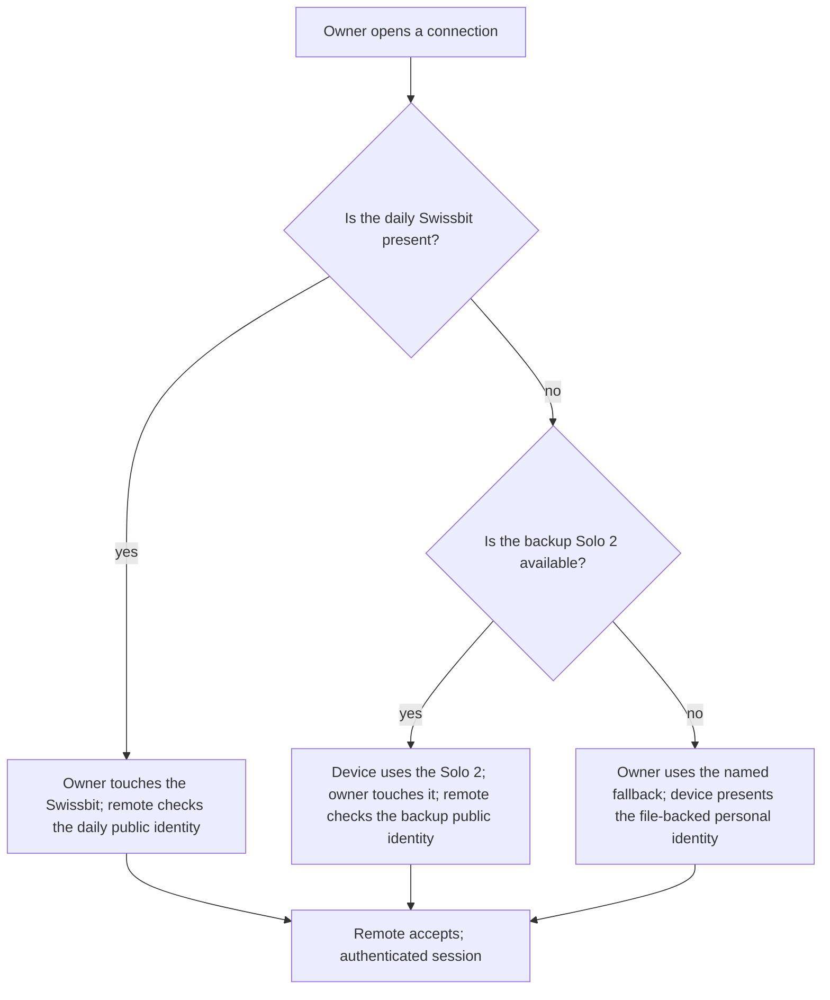

# Security-key remote identity

Status: ideation handoff complete 2026-10-17; the seed is now proposed by the active change `security-key-remote-identity`. This record edits no configuration and performs no enrollment, authentication, revocation, or secret operation. It describes confirmed planning decisions and the change seed. D1–D5 were answered in the proposal on 2026-10-20; D6–D8 remain open.

## Purpose

The owner holds two FIDO2 security keys — a Swissbit iShield Key and a Solo 2 — but no declared device behavior uses them. The first stage makes the personal identity on the Linux laptop `thiniel` usable through the token for GitHub and the servers that already trust that identity. The file key stays as a fallback. Local login, WebAuthn, SOPS age, and disk unlock are later stages.

The first stage deliberately proves the token path before taking on lockout risk. It does **not** claim that a stolen device or copied home directory yields no usable SSH identity, because the file key remains on `thiniel`. That guarantee is deferred to a later stage that removes the file key after a recovery mechanism exists.

## What the owner chose

| Decision | Record |
|---|---|
| All four token surfaces are in scope, one stage at a time | Q1 |
| The first stage is remote identity | Q2 |
| The first stage covers the personal identity on `thiniel` only | Q3 |
| The Swissbit is the daily key; the Solo 2 is the separately stored backup | Q4 |
| The overall threat model is staged; the first stage does not claim theft resistance | Q5, revised by Q7 |
| The existing file key stays on `thiniel` as the fallback | Q6 |
| The stolen-device guarantee moves to a later stage that removes the file key | Q7 |
| The SSH handle is non-resident; no `verify-required`; two tokens, each with its own handle file | Q8 |

The full options, gains, costs, examples, and rejected alternatives are in the [question ledger](../../givn/ideation/secure-token-keys/questions.md).

## First stage in one picture

The daily key is preferred when present. When it is absent, the backup Solo 2 is used automatically. The file-backed identity is used only through the named fallback; the device never substitutes it for a token silently. A rejected daily credential may be followed by the backup, but the file-backed identity is never automatic.

The first stage uses **non-resident** handles. The token holds the device key; the handle exists only in the handle file on `thiniel`. Each token has its own handle file, and both are backed up encrypted. There is no `-O resident` and no `-O verify-required`; daily use is touch-only. A stolen token alone cannot authenticate without its handle file. A stolen token plus its handle file is protected by touch only. Because the file-backed personal identity remains, the stage still does not claim stolen-laptop resistance.

## How a credential becomes usable

Two acts are separate:

1. **Enrollment** creates a personal-identity credential on a specific security key and records its non-resident handle file in the identity declaration. The private key never leaves the key; the handle file is required to use it. `ssh-keygen -K` with either token must return no keys.
2. **Remote authorization** grants that credential's public identity at a remote host. Enrollment alone grants no access.

The daily and backup keys are separate enrollments and separate remote authorizations. The backup is not a copy. The file-backed personal identity is retained as the first-stage fallback; it is not theft resistance.

A token-held authentication requires user presence on the security key. A declined or missed presence prompt establishes no session.

## Recovering a lost key

Losing a key is not the same as leaving it at home. The owner:

1. assesses which key is lost and identifies its public identity;
2. authenticates to each affected remote with the remaining credential — the other security key, or the file-backed personal identity;
3. revokes the lost public identity at every remote that authorized it;
4. asks each remote to confirm that the lost public identity is no longer authorized.

A failed, refused, unreachable, or unverified revocation is not success. The lost public identity remains treated as authorized until the remote confirms removal. Losing both security keys while `thiniel` remains is covered by the file-backed personal identity; losing both keys and the device is outside this stage.

A lost or unreadable handle file while the token remains is **not** a lost key. It makes that token's credential unusable; use the other token or re-enroll. It is not a reason to revoke a public identity at the remote.

## The two use cases

| Use case | Actor's goal | Contract | Future permanent leaf |
|---|---|---|---|
| Authenticate to a remote host (`authenticate-to-remote-host`) | The owner authenticates to a remote host with the personal identity through the daily key, the backup, or the file fallback | [Contract](../../givn/ideation/secure-token-keys/use-cases/authenticate-to-remote-host.md) | `givn/specs/authenticate-to-remote-host/usecase.md` |
| Recover a lost security key (`recover-lost-security-key`) | The owner revokes a lost key's public identity at every remote that authorized it | [Contract](../../givn/ideation/secure-token-keys/use-cases/recover-lost-security-key.md) | `givn/specs/recover-lost-security-key/usecase.md` |

Enrollment, remote authorization, retention of the file-backed personal identity, and the both-keys-unavailable path are setup or failure subfunctions, not additional leaves. The two leaves are reviewed; no new persona is proposed. The existing [owner/operator persona](../../givn/personas/owner--operator.md) is the review lens; the family application-user persona is unaffected.

## Domain language

All eleven confirmed terms are in the durable [glossary](../arc42/12-glossary.md):

| Term | One-sentence meaning |
|---|---|
| Security key | A FIDO2 hardware authenticator the owner holds; not a software or OAuth token. |
| Daily security key | The carried Swissbit used for routine authentication. |
| Backup security key | The separately stored Solo 2, registered as its own credential. |
| Enrollment | Creating a credential on a key and recording its key handle in the identity declaration. |
| Token-held personal identity | A personal identity whose private key is held by a security key. |
| Key handle | The on-disk reference to a token-held credential; here it is non-resident and exists only in the handle file, not in the token. |
| Enrolled credential | One key's token-held identity, represented by its public identity and key handle. |
| File-backed personal identity | The retained private-key-file identity used as the first-stage fallback. |
| Remote authorization | The grant at a remote host that admits a public identity. |
| Remote host | GitHub or a server that authenticates the public identity. |
| Public identity | The public half of an enrolled credential, presented for authorization. |

The detailed definitions, contrasts, anti-terms, first uses, and collision checks are in the [topic term record](../../givn/ideation/secure-token-keys/domain-terms.md). The durable terms are confirmed vocabulary; they do not prove token behavior is implemented.

## What is not in this stage

- Device privilege authentication (`sudo`/login), WebAuthn account enrollment, SOPS age, and disk unlock.
- The work Mac (`J6G6Y9JK7L`) and all work identities.
- A claim of theft resistance while the file key remains on `thiniel`.
- Recovery when both security keys and the device are lost.
- Remote account recovery, a third token, or an offline recovery key.
- Commands or resources used inside the authenticated session; the remote's own access rules govern them.
- Local deletion of a lost key's credential record; revocation is at the remote.

## Open inputs for the proposal

- **Answered (D1):** one key from `thiniel` represents the user; every declared host that accepts the user's SSH key and the personal GitHub account are in the authorization and revocation set. The work Mac and work identities remain out of scope.
- **Answered (D2):** the iShield Key 2 family shares the same FIDO2 functions; the base iShield Key 2 FIDO2 is sufficient. Try `ed25519-sk` first and fall back to `ecdsa-sk` on `invalid format` or `feature not supported`. Neither is post-quantum-safe; OpenSSH's PQ-hybrid key exchange protects session confidentiality, and non-resident keys can be replaced later.
- **Answered (D3):** the declared NixOS hosts and the local client use OpenSSH `10.5p1`, which supports FIDO `-sk` keys; GitHub supports FIDO SSH authentication keys. Apple's `ssh` lacks FIDO support, but the work Mac is out of scope.
- **Answered (D4):** `libfido2` is the runtime dependency for FIDO2/udev; `solo2-cli` and Swissbit's iKM/iKMcli are one-off firmware/management tools, not host dependencies.
- **Answered (D5):** normal `ssh`/`git` connections are token-only; the retained file key is available through a named fallback command/alias. Automatic fallback and SSH-order selection are rejected because they can silently use the file key.
- **Open (D6):** the native target that proves token-held authentication, including `ssh-keygen -K` returning no keys and a token without its handle file failing. Test needed.
- **Open (D7):** the later recovery mechanism that permits removing the file key. Out of scope for this change.
- **Open (D8):** the encrypted handle-file backup medium and procedure. Required, not yet selected.

## Change seed

One seed, [security-key-remote-identity](../../givn/ideation/secure-token-keys/changes/security-key-remote-identity.md), covers both use cases and is now `Status: proposed by security-key-remote-identity`. Its guarantee:

> On `thiniel`, the personal identity authenticates to the personal GitHub account and the servers that trust it with the daily Swissbit security key, the separately stored Solo 2 backup, or the retained file-backed personal identity; the handles are non-resident, the daily key is preferred, daily token use is touch-only, and no credential is substituted silently. A stolen token alone cannot authenticate without its handle file. When a key is lost, the owner continues with the remaining credential and revokes the lost public identity at every remote that authorized it.

One seed, not two: shipping authentication alone would leave the lost-key revocation rule untrue, and recovery alone cannot reach the remotes. The seed has no dependency on another seed. It is input to `/givn-propose`; it is not a proposal or a started change.

## Acceptance checks and risks

The first stage is not done until these are exercised, not merely configured:

- Login with the token inserted and a touch succeeds.
- Login without a touch fails.
- Using the token on a machine without its handle file fails.
- `ssh-keygen -K` with either token returns no keys.
- The backup token authenticates independently of the daily token.
- Restoring access with the backup token takes under 15 minutes.
- 0 keys are readable with `ssh-keygen -K`.

Risks:

- Losing a handle file makes that token unusable even when the token is present. The other token and the encrypted handle-file backup are the mitigation.
- If an attacker obtains both the token and its handle file, touch is the only barrier. `verify-required` would add a PIN where the token supports it reliably, but the first stage does not use it.
- Malware on the laptop can request signatures while the token is inserted; the touch limits this to actions the owner confirms. This is not source-backed.
- Non-resident handles are not portable to a machine that lacks the handle file. The owner confirmed portability is not needed.

## Evidence and limits

- No security key was enrolled; no token-held key authenticated; no remote authorization was revoked; no `ssh-keygen -K` check was run.
- The declared hosts and local client use OpenSSH `10.5p1`; the Swissbit Ed25519 support remains **not verified** and is tested by the first key creation, with `ecdsa-sk` as fallback.
- The ten event-storming canvases were rendered with Mermaid CLI 12 and Chromium 155 and inspected for syntax and layout; the enrollment and daily-authentication canvases were re-rendered after Q8. That is diagram proof, not authentication proof.
- The existing `integration-ssh-identity-selection` check proves file-key identity resolution in a booted VM. It does not prove a token-held authentication. A future change must bind each scenario to a target that can actually prove it and disclose the platform limit.

## Source records

The [session](../../givn/ideation/secure-token-keys/session.md), [Frame](../../givn/ideation/secure-token-keys/frame.md), [event storming](../../givn/ideation/secure-token-keys/eventstorming.md), [reviewed cut](../../givn/ideation/secure-token-keys/use-case-definitions.md), [contracts](../../givn/ideation/secure-token-keys/use-cases/), [terms](../../givn/ideation/secure-token-keys/domain-terms.md), and [questions](../../givn/ideation/secure-token-keys/questions.md) preserve the research, decisions, reviews, and approvals.

## Handoff records

- **Mapping:** each reviewed `!` use case maps to its own future permanent leaf, as shown above.
- **Persona choice:** no new persona and no promotion; `owner--operator` is reused.
- **Term promotion:** all eleven confirmed terms were promoted to the durable glossary on 2026-10-17.
- **Seed:** one ready seed, `security-key-remote-identity`; it starts no change.
- **Publication:** this document and the seed are the Handoff outputs.
- **Post-Handoff decision:** Q8 (non-resident handles, no `verify-required`, two tokens) was added after the first Handoff and applied to the Frame, event storming, contracts, seed, and this document.
