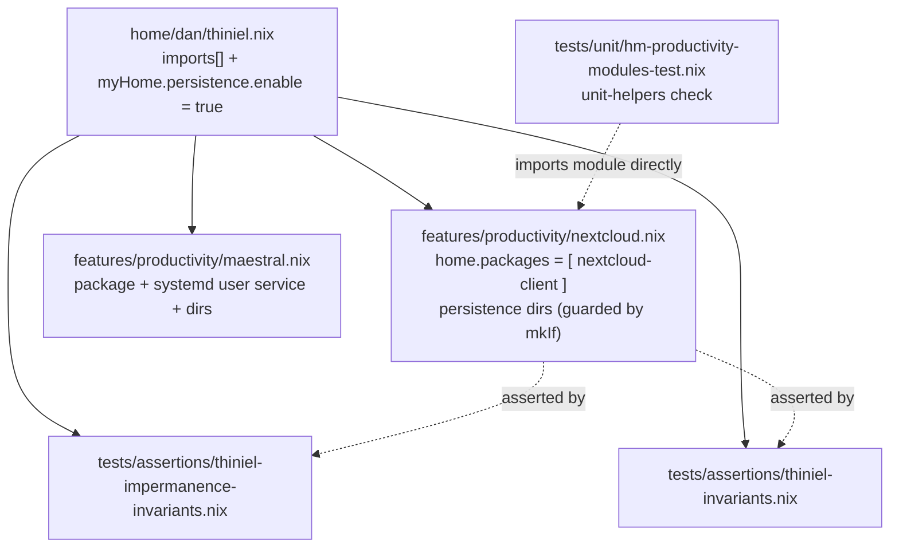

# Plan: Replace the ownCloud desktop client with the Nextcloud desktop client

**Status**: DRAFT — awaiting human approval. Nothing may be implemented before approval.
**Host in scope**: `thiniel` only (the sole importer of the module).
**Requested by user**: "remove owncloud and replace it with nextcloud" — removal and
replacement are explicitly requested together (AGENTS.md "Import Wiring" exception applies
to the *pair*; see D5 for why the plan still splits them into two atomic steps).

---

## Business Context

`home/dan/features/productivity/owncloud.nix` installs `owncloud-client` and persists
`~/.config/ownCloud` + `~/.local/share/ownCloud` for the thiniel laptop. The user wants the
Nextcloud desktop client instead. The ownCloud client is superseded by the Nextcloud
desktop client for the intended use (file sync against a Nextcloud/ownCloud-compatible
server); keeping both would install two tray-resident sync daemons competing for a single
sync root.

Two secondary problems this change touches:

1. The module inventory documentation is **already wrong** about this directory:
   `docs/arc42/05-building-block-view.md:100` claims 16 files and `CLAUDE.md:246` claims a
   10-file list; both omit `maestral`, `libreoffice`, `messaging`, `mpv`, `vscode-fhs`,
   `zathura`. The migration is the moment to correct the arc42 count (16 → 16: one file
   removed, one added).
2. A TODO comment in `hosts/thiniel/default.nix:576` names ownCloud as the sync tool. After
   the swap it names a package the host no longer installs.

No test in the repository currently imports or asserts the ownCloud module, so the removal
is invisible to CI unless this plan adds coverage. That is the main quality risk: a silent
regression (e.g. an import left dangling) would still evaluate because Home Manager resolves
`imports` lazily only on evaluation — a stale import path would fail evaluation loudly, but
an *unwired* module would not fail at all. The new assertions close that gap.

## Acceptance Criteria

1. `home/dan/features/productivity/owncloud.nix` no longer exists; `nextcloud.nix` does.
2. `home/dan/thiniel.nix` imports `./features/productivity/nextcloud.nix` exactly once and
   imports no `owncloud.nix`.
3. `config.home-manager.users.dan.home.packages` on thiniel contains a package whose
   `pname` is `nextcloud-client` and contains no package whose `pname` is `owncloud-client`
   (both proven by evaluation-time assertions).
4. `home/dan/features/productivity/nextcloud.nix` declares exactly three persistence
   directories under `config.myHome.persistence.root` — `.config/Nextcloud`,
   `.local/share/Nextcloud`, `owncl` — and nothing else.
5. The module declares **no** `systemd.user.services` block (D2).
6. `nix flake check` passes, including the `lint-deadnix`, `lint-statix` and `lint-nixfmt`
   checks.
7. `nixos-rebuild build --flake .#thiniel` succeeds.
8. `docs/arc42/05-building-block-view.md:100` lists `nextcloud` (not `owncloud`) with the
   correct file count, and `CLAUDE.md:246` lists `nextcloud`.

## Technical Analysis

### Current state (verified)

```
home/dan/thiniel.nix:44   imports  ./features/productivity/owncloud.nix   (only importer, repo-wide)
home/dan/thiniel.nix:96   myHome.persistence.enable = true
modules/home-manager/persistence/options.nix:10-17   myHome.persistence.{enable,root}, root default "/persist"
```

The module is a 19-line `lib.mkMerge [ { home.packages = [...] } (lib.mkIf …persist) ]`. No
test file under `tests/` mentions `owncloud`; `tests/unit/default.nix` aggregates
`hm-productivity-modules-test.nix` into the `unit-helpers` check, and the two thiniel
assertion modules are imported by `tests/assertions/default.nix` and gated on
`config.networking.hostName == "thiniel"`.

### Component view after the change



### Decision D1 — single renamed file `nextcloud.nix`, delete `owncloud.nix`  (CONFIRMED)

**Alternative A (chosen): rename.** Delete `owncloud.nix`, add `nextcloud.nix` with the same
`{ config, lib, pkgs, ... }:` signature and the same `mkMerge`/`mkIf` shape.

- Alphabetical order is preserved: `nextcloud.nix` sorts after `maestral.nix` and before
  `sweethome3d.nix`, i.e. it occupies exactly the slot `owncloud.nix` occupied at
  `home/dan/thiniel.nix:44`. The import line changes but does not move.
- Zero churn in unrelated files; the module stays a leaf (`home.packages` + persistence),
  which is what the surrounding modules do.
- Trade-off: git history for the persistence declaration does not follow the rename
  automatically; a `git log --follow` is needed. Acceptable.

**Alternative B (rejected): keep `owncloud.nix` and edit its body.** Leaves a file named
after a client the host no longer installs — permanently misleading inventory, and it would
force a later rename anyway.

**Alternative C (rejected): one combined `cloud-sync.nix` holding both clients.** Couples two
independent tools, makes the persistence guard harder to read, and breaks the
one-module-per-tool convention used by every other file in `features/productivity/`.

### Decision D2 — no `systemd.user.services` block  (mirror owncloud, NOT maestral)

**Alternative A (chosen): package + persistence only**, i.e. the shape `owncloud.nix` has
today.

Reasoning:

1. **The client already owns its autostart.** The Nextcloud desktop client ships a
   `nextcloud.desktop` autostart entry (and a tray icon) that starts `nextcloud --background`
   inside the graphical session. A Home Manager `systemd.user.services` unit would be a
   *second*, competing starter; the Qt client is not a foreground-daemon design like Maestral
   (`maestral start --foreground` / `maestral stop`), so there is no faithful `ExecStart`/
   `ExecStop` pair to write.
2. **GUARD §maestral does not generalise.** Maestral's unit exists because maestral is a CLI
   daemon that needs an explicit supervisor. Copying it "for symmetry" would invent a contract
   the package does not have — and a 5 s `Restart = "on-failure"` loop on a Qt GUI that exits
   on `SIGTERM` produces restart churn.
3. **Impermanence fragility.** A user unit with `After=graphical-session.target` +
   `WantedBy=graphical-session.target` depends on session-target propagation from the
   compositor (Hyprland here). If the unit starts before the session bus/keyring is reachable,
   the client fails to reach the Secret Service and asks for re-authentication — the exact
   failure mode that loses sync credentials. Deferring start to the client's own autostart
   keeps that ordering out of our configuration.
4. **Simplicity wins per `SOLID`/composition**: the module declares only what the repo must
   own (which package, which state survives reboot).

**Alternative B (rejected): mirror maestral's unit.** Listed for completeness: buys
supervision/`Restart`, at the cost of (a) inventing a daemon contract, (b) a double-start with
the shipped autostart, (c) session-target ordering risk under Hyprland, (d) a persistence
surface the tests then have to characterise. **If the user later wants supervized start, that
is a separate change with its own red/green cycle** — `nextcloud --background` would be the
`ExecStart`, and the plan would drop the autostart entry to avoid the double start.

### Decision D3 — persistence directories: `.config/Nextcloud`, `.local/share/Nextcloud`, `owncl`

| Path | Why |
|---|---|
| `.config/Nextcloud` | The client's `nextcloud.cfg` — account list, sync roots, and the per-account sync journal *pointer*. Wiped on reboot without this → every reboot re-runs the account wizard. |
| `.local/share/Nextcloud` | The sync journal / `.sync_*.db` files and the client's local state. Losing it forces a full re-scan (slow, and can surface spurious conflict files). |
| `owncl` | The user-confirmed local sync folder (`~/owncl`), mirroring maestral's `"Dropbox"` entry. **Value given explicitly by the user — do not substitute the client default.** |

**Case sensitivity is the trap.** The Linux client uses capital-N `Nextcloud` for the config
and state directories (`~/.config/Nextcloud`, `~/.local/share/Nextcloud`); ownCloud used
lowercase `ownCloud`. Guessing from the old entries would persist the wrong paths and silently
lose the config, so the values above are treated as a *verification item* in Phase N-2 (a
one-line `ls` on the live host), with the exact correction procedure spelled out there.

**User-confirmed sync folder: `~/owncl`** (answered 2026-11-05, twice, deliberately). This is
*not* the client default and it does **not** exist yet on disk. It replaces every `"Nextcloud"`
sync-folder entry in this plan — D3's table, N-1e, N-2, and the acceptance criteria.

The reason this value is load-bearing rather than a harmless default: under impermanence an
unlisted sync root lives on the ephemeral root subvolume and is **wiped at reboot**. The
"persisting an unused path is harmless" argument only runs in one direction — omitting a *used*
path is destructive. `~/owncl` is therefore declared as a hard requirement, not an assumption.

The lowercase `owncl` spelling is close to the dead `ownCloud` paths and is a transcription risk
when editing. The module must declare exactly `"owncl"`.

Config/state paths (`.config/Nextcloud`, `.local/share/Nextcloud`) are unaffected and remain
capitalised per the client's own convention; they stay a Phase N-2 verification item because a
wrong config path causes user-visible damage.

### Decision D4 — tests: unit test in the productivity suite + one assertion in each thiniel assertion file

Nextcloud has no behaviours worth an integration VM test (no service, no daemon, no
credentials flow we own), so the right layers are:

- **Unit** (`tests/unit/hm-productivity-modules-test.nix`): module shape — package present,
  persistence directory list exactly as specified, **no** systemd unit (this is the assertion
  that makes D2 non-negotiable rather than a comment). Mirrors the existing maestral block
  (lines 234-268) including the `normalizeModule` import harness (lines 110-122).
- **Assertions / wiring** (`tests/assertions/thiniel-invariants.nix:122`, NixOS-level, hostName-gated): host evaluation
  actually installs `nextcloud-client` **and** no longer installs `owncloud-client`. This is
  the assertion that would catch an "orphan edit": module rewritten but import forgotten.
- **Assertions / persistence** (`tests/assertions/thiniel-impermanence-invariants.nix`):
  the three directories reach thiniel's `home.persistence."/persist".directories` with the
  host's real `myHome.persistence.enable = true` (the unit test deliberately mocks that flag
  to `false`, so it *cannot* cover this).

Explicitly **not** asserted: the desktop file / autostart entry, tray behaviour, or the
`myHome.persistence.enable = false` branch of the module. They are outside the module's
contract.

### Decision D5 — ordering: tests first, three atomic steps, one red per green

AGENTS.md forbids test + implementation in one step. The natural red is the *import failure*:
the unit suite imports the module path directly, so a not-yet-existing `nextcloud.nix` fails
`unit-helpers` at evaluation ("path does not exist") — the same red style the repo already uses
for `vscode-fhs` (`tests/unit/hm-modules-test.nix:399`). That red can only be produced by
adding **both** the unit test and the assertion edits in one test-only step, because touching
either `tests/unit/` or `tests/assertions/` triggers the same evaluation failure and there is
no meaningful intermediate state to observe. This is one *test* step, not a test+implementation
step.

The import swap in `home/dan/thiniel.nix:44` stays its own step (AGENTS.md "Import Wiring").
The pair "create module" + "import module" is what the user requested together, so the workflow
is not suspended — it is only *sequenced*: create → verify green-by-unit → wire → verify green
host-wide. That sequencing is what proves the assertions in
`thiniel-invariants.nix` / `thiniel-impermanence-invariants.nix` are doing work (they must be
red at the end of Phase N-3 and green at the end of Phase N-4).

### Decision D6 — on-disk ownCloud state: NOT in this plan's code, but one documented post-apply command

Confirmed on the live host at plan-review time (2026-11-05):

- `~/.config/ownCloud/` is **not** empty — it contains `owncloud.cfg` (434 bytes, mtime
  2026-11-05 20:45). Stale credentials/account config from the client.
- `~/.local/share/ownCloud/` is empty.
- Neither path is currently mount-covered (`findmnt` returns no entries), and Nextcloud has no
  state yet (`~/.config/Nextcloud`, `~/.local/share/Nextcloud`, `~/Nextcloud` all absent).

Consequence: the cleanup command must be `rm ~/.config/ownCloud/owncloud.cfg` followed by
`rmdir` of the two directories — **never** a recursive delete. The contents of `owncloud.cfg`
must be reviewed before removal, and the file should be retained (moved aside) for one reboot in
case an account needs re-export. A bare `rm -r` of an empty-but-mount-point-shaped path is
unnecessary; `rmdir` fails loudly if anything unexpected is inside, which is the desired safety
property.

---

## Phase 0: Validation Strategy (BEFORE any implementation)

### Affected hosts

| Host | Effect |
|---|---|
| `thiniel` | Affected — only importer of the module. |
| `J6G6Y9JK7L` (Darwin) | Not affected — does not import the module. |
| `cupix001`, `adlerkopf`, `nixos-vm-minimal` | Not affected — import only the global profile. |
| CI on other systems | `unit-helpers` is evaluated for **every** system in `checks`; the unit test imports the module with mock pkgs, so a mistake in the module breaks checks on all systems, not just Linux. Expect failures attributed to `checks.<any>.unit-helpers`. |

### Cheap-first validation ladder (use at every step)

```bash
# 1. fast evaluation of every output, no builds — the primary red/green signal
nix flake check --no-build

# 2. only the unit-test derivation (evaluates + runs the runTests list)
nix build .#checks.x86_64-linux.unit-helpers

# 3. the two thiniel assertion modules are part of the host configuration;
#    assertions fire on evaluation of the host's toplevel:
nix eval .#nixosConfigurations.thiniel.config.system.build.toplevel.drvPath

# 4. repository linters (also present as flake checks lint-deadnix/lint-statix/lint-nixfmt)
deadnix --fail home/dan/features/productivity/nextcloud.nix
statix check home/dan/features/productivity/
nixfmt --check home/dan/features/productivity/nextcloud.nix

# 5. full validation before declaring a phase done
nix flake check

# 6. host build (does not touch the running system)
sudo nixos-rebuild build --flake .#thiniel
```

Expected pass conditions per command are listed in each phase; the global expectations are
"exit 0", `nix flake check` reporting no failed checks, and `nextcloud-client` appearing in the
host's home-manager package list.

### Rollback path

| Level | Action |
|---|---|
| Per-step, pre-switch | Revert the step's file edits (`git checkout -- <file>` / `git restore`). Derivation-level changes only; nothing on disk moved yet. |
| Post-switch (client/config) | `sudo nixos-rebuild switch --rollback` — restores the previous generation and its home-manager generation, re-installing `owncloud-client`. **The ownCloud persistence entries come back with the old generation**, so ownCloud state is reachable again as long as the post-apply cleanup (Final Phase, optional) has not run. |
| Post-apply cleanup already done | Re-create the two subvolumes by switching back and reboot, or accept that ownCloud state is gone (it was empty). |
| Sync credentials | Unaffected — Nextcloud credentials live in `~/.config/Nextcloud` + the login keyring; neither is destroyed by this change. |

### Dangerous-category flags

| Category | Applies? | Why / mitigation |
|---|---|---|
| Boot | No | No bootloader/kernel/initrd change. |
| Network | No | No firewall/interface/DNS change. |
| Filesystem | **Low-moderate** | Persistence *directory list* changes → on the next activation, impermanence **unmounts** the two `ownCloud` bind mounts. Because those paths are currently empty, no data loss. If they are NOT empty, this becomes data loss — Phase N-0 verifies emptiness **before** the switch. |
| Authentication | No | No SSH/sudo/PAM change. |
| Secrets | No | No sops/age change. |

**Approval gate**: Phase N-6 (apply) requires explicit user approval, and `nixos-rebuild test`
(not `switch`) is used first so a bad activation reverts on reboot.

---

## Phase N-0 — Pre-flight inspection of the live host (read-only, no repo changes)

Purpose: turn the two assumptions (capitalised config paths; sync root) and the one risk
(non-empty ownCloud dirs) into facts before anything is edited.

```bash
# 0a. Do the empty ownCloud bind mounts contain anything?
ls -la ~/.config/ownCloud ~/.local/share/ownCloud

# 0b. Does an ownCloud sync root exist outside the persisted paths?
ls -d ~/ownCloud 2>/dev/null && du -sh ~/ownCloud

# 0c. Record the current generation for rollback
sudo nixos-rebuild list-generations | head -5
```

**Gate**: if 0a shows anything other than `.`/`..`, or 0b shows a populated `~/ownCloud` sync
root, **stop** and report before continuing — the persistence-list edit would unmount data.

**Validation**: none (read-only). Record the three outputs in the plan's Current Status.

---

## Phase N-1 — RED: add the tests (test-only edits, no module, no import)

Files touched: `tests/unit/hm-productivity-modules-test.nix`,
`tests/assertions/thiniel-invariants.nix`,
`tests/assertions/thiniel-impermanence-invariants.nix`.
Explicitly **not** touched: anything under `home/` or `hosts/`.

### N-1a. Unit test harness — insert after the maestral harness (after line 122, before `in`)

```nix
  # nextcloud.nix — signature is `{ config, lib, pkgs, ... }:`
  nextcloudModule = normalizeModule (
    import ../../home/dan/features/productivity/nextcloud.nix {
      pkgs = mockPkgsLinux;
      inherit lib;
      config = {
        myHome.persistence = {
          enable = false;
          root = "/persist";
        };
      };
    }
  );
  nextcloudPkgNames = builtins.map (p: p.pname or p.name or "") nextcloudModule.home.packages;
```

Note: `normalizeModule` drops the `mkIf` branch because the mock sets `enable = false`, so
`nextcloudModule` has **no** `home.persistence` attribute. The persistence list is therefore
tested through the same mechanism maestral's persistence is not tested at all — by
re-importing with `enable = true`, kept as one small extra harness binding:

```nix
  nextcloudPersistDirs =
    (
      normalizeModule (
        import ../../home/dan/features/productivity/nextcloud.nix {
          pkgs = mockPkgsLinux;
          inherit lib;
          config = {
            myHome.persistence = {
              enable = true;
              root = "/persist";
            };
          };
        }
      )
    ).home.persistence."/persist".directories;
```

### N-1b. Unit tests — insert after the maestral block (after line 268, before the firefox-personal block)

```nix
  # ── nextcloud ─────────────────────────────────────────────────────────────

  testNextcloudPackagePresent = {
    expr = builtins.elem "nextcloud-client" nextcloudPkgNames;
    expected = true;
  };

  testNextcloudNoOwncloudPackage = {
    expr = builtins.elem "owncloud-client" nextcloudPkgNames;
    expected = false;
  };

  # Decision D2: the Qt client owns its autostart; the module must not add a unit.
  testNextcloudNoSystemdService = {
    expr = nextcloudModule ? systemd;
    expected = false;
  };

  testNextcloudPersistDirs = {
    expr = nextcloudPersistDirs;
    expected = [
      ".config/Nextcloud"
      ".local/share/Nextcloud"
      "owncl"
    ];
  };
```

### N-1c. Header comment — `tests/unit/hm-productivity-modules-test.nix:4`

```nix
# Covers: browser.nix, keepassxc.nix, maestral.nix, nextcloud.nix, firefox-personal.nix
```

### N-1d. Host assertion — `tests/assertions/thiniel-invariants.nix`, insert after the maestral assertion (after line 121)

```nix
        {
          assertion = hmHasPkg "nextcloud-client";
          message = "thiniel: the Nextcloud desktop client must be installed via Home Manager";
        }
        {
          assertion = !(hmHasPkg "owncloud-client");
          message = "thiniel: the ownCloud client must be gone; it is replaced by nextcloud-client";
        }
```

### N-1e. Persistence assertions — `tests/assertions/thiniel-impermanence-invariants.nix`, insert after the maestral block (after line 121)

```nix
        # Nextcloud desktop client persistence
        {
          assertion = hmHasDir ".config/Nextcloud";
          message = "thiniel: .config/Nextcloud must be persisted for Nextcloud account and sync config";
        }
        {
          assertion = hmHasDir ".local/share/Nextcloud";
          message = "thiniel: .local/share/Nextcloud must be persisted for the Nextcloud sync journal";
        }
        {
          assertion = hmHasDir "owncl";
          message = "thiniel: the ~/owncl sync folder must be persisted";
        }
```

### N-1 validation — must FAIL, and for the intended reason

```bash
nix flake check --no-build
```

**Expected**: FAIL. The failure text must name
`tests/unit/hm-productivity-modules-test.nix` and report a missing path
`home/dan/features/productivity/nextcloud.nix` ("path … does not exist"). Any other failure
(syntax, `undefined variable`, assertion text) means the test edit itself is wrong — fix before
continuing.

Note: the thiniel assertions in N-1d/N-1e do **not** get to fire in this phase, because the
unit-test evaluation failure short-circuits the check before host evaluation. That is expected;
they are proven red in Phase N-3.

**Does not touch**: `home/**`, `hosts/**`. **Rollback**: `git checkout -- tests/`.

---

## Phase N-2 — GREEN (part 1): create `home/dan/features/productivity/nextcloud.nix`

New file, full contents:

```nix
{
  config,
  lib,
  pkgs,
  ...
}:
lib.mkMerge [
  {
    home.packages = with pkgs; [
      nextcloud-client
    ];
  }
  (lib.mkIf config.myHome.persistence.enable {
    home.persistence.${config.myHome.persistence.root}.directories = [
      ".config/Nextcloud"
      ".local/share/Nextcloud"
      "owncl"
    ];
  })
]
```

Notes for the implementer:

- Keep all four lambda args (`config`, `lib`, `pkgs`, `...`). `config` and `lib` are used,
  `pkgs` is used via `with pkgs;`. `deadnix --fail` rejects unused args **but** `...` and the
  function-form args are fine as long as each named arg is referenced — all three are.
- No `systemd.user.services` (D2). If a reviewer asks for one, that is a new change.
- Formatting must be `nixfmt`-clean (no trailing whitespace, two-space indent, list items on
  their own lines).

### N-2 validation — unit green, host assertions still red

```bash
nix build .#checks.x86_64-linux.unit-helpers      # PASS
nix eval .#nixosConfigurations.thiniel.config.system.build.toplevel.drvPath   # FAIL (assertion)
deadnix --fail home/dan/features/productivity/nextcloud.nix                   # PASS
statix check home/dan/features/productivity/                                  # PASS
nixfmt --check home/dan/features/productivity/nextcloud.nix                   # PASS
```

**Expected**: `unit-helpers` PASSES (4 new tests + the pre-existing suite). The `nix eval` of
the thiniel toplevel **FAILS** with the message
`thiniel: the Nextcloud desktop client must be installed via Home Manager` — that is the
assertion from N-1d doing its job, and it is the red for the wiring step. Also expect
`thiniel: the ownCloud client must be gone` may pass or fail here (the import still points at
`owncloud.nix`, so `owncloud-client` is still installed → that assertion FAILS too; either
message is acceptable evidence, capture whichever appears).

**Rollback**: `rm home/dan/features/productivity/nextcloud.nix`.

---

## Phase N-3 — GREEN (part 2): swap the import and delete `owncloud.nix`

This is the "Import Wiring" atomic step (AGENTS.md). Two mechanical operations that must land
together to leave the tree evaluable — replacing the import with a dangling target or deleting
the file it points at are both evaluation errors, so they are one step.

1. `home/dan/thiniel.nix:44` — line-for-line replacement, position unchanged:

```nix
    ./features/productivity/nextcloud.nix
```

2. Delete `home/dan/features/productivity/owncloud.nix`.

### N-3 validation — everything green

```bash
nix flake check --no-build                                 # PASS
nix eval .#nixosConfigurations.thiniel.config.system.build.toplevel.drvPath   # PASS
grep -rn "owncloud" home/ tests/ modules/                 # no matches
```

**Expected**: `nix flake check --no-build` PASSES — the thiniel assertions from N-1d and N-1e
now evaluate and hold. `grep` finds nothing under the code trees. (`hosts/` and `docs/` are
handled in N-5.)

**Rollback**: `git checkout -- home/dan/thiniel.nix` and
`git checkout -- home/dan/features/productivity/owncloud.nix` (or `git revert` the step).

---

## Phase N-4 — Documentation: correct the inventory in the same change

Rationale: the product name disappears from the tree here; leaving `owncloud` in the live
inventory makes the arc42 building-block view lie about the imported module set. These are
docs-only edits bundled with the functional change on purpose — they are part of "the module
is renamed", not independent work.

### N-4a. `docs/arc42/05-building-block-view.md:100` (live inventory — replace the whole row)

Directory reality after the change: 16 files (`owncloud.nix` out, `nextcloud.nix` in), still
16. Row lists all 16: browser, emacs, emacs-doom, firefox-company, firefox-personal,
keepassxc, libreoffice, mac-tools, maestral, messaging, mpv, **nextcloud**, sweethome3d,
vscode, vscode-fhs, zathura.

```markdown
| `productivity/` (16) | browser, emacs, emacs-doom, firefox-company, firefox-personal, keepassxc, libreoffice, mac-tools, maestral, messaging, mpv, nextcloud, sweethome3d, vscode, vscode-fhs, zathura | Several guard their persistence block with `lib.mkIf config.myHome.persistence.enable`. |
```

(Only the one word changes; the count 16 and the module list are otherwise already correct.)

### N-4b. `CLAUDE.md:246` (inventory row)

Replace `owncloud` with `nextcloud` in place:

```markdown
| `productivity/` | browser, emacs-doom, emacs, firefox-company, firefox-personal, keepassxc, mac-tools, nextcloud, sweethome3d, vscode |
```

Scope discipline: this row is **already incomplete** (omits maestral, libreoffice, messaging,
mpv, vscode-fhs, zathura). Do **not** fix that here — it is an unrelated correction and would
muddy this change's diff. Note it in the plan's Current Status as follow-up work.

### N-4c. `hosts/thiniel/default.nix:575-577` (TODO comment)

Current:

```nix
  # TODO(2026-04): Backup solution — evaluate restic or borgbackup for automated backups
  # ownCloud provides sync but not versioned backup
  # Priority: important but deferred — create tracking issue when ready
```

Replacement (product name and line 576's claim both need updating):

```nix
  # TODO(2026-04): Backup solution — evaluate restic or borgbackup for automated backups
  # Nextcloud desktop syncs files but does not provide versioned backup
  # Priority: important but deferred — create tracking issue when ready
```

### N-4d. Explicitly NOT updated (historical records — leave untouched)

| File | Why |
|---|---|
| `docs/impermanence-migration-plan.md:52,55,104,107,286` | Records the migration as it was performed; rewording makes the audit trail false. |
| `docs/plans/hyprland-catppuccin-latte-rice-plan.md:37,114,491` | Completed plan; historical. |
| `docs/plans/keepassxc-impermanence-fix-plan.md:161` | Completed plan; historical. |
| `givn/ideation/infrastructure-growth/frame.md:27,93` | Snapshot of the tree at ideation time; it quotes line numbers that would no longer resolve if edited. |

### N-4 validation — docs-only changes are exempt from red/green (CLAUDE.md)

```bash
nix flake check --no-build            # PASS, unchanged
grep -rn "ownCloud\|owncloud" --include='*.md' . | grep -v -e impermanence-migration-plan -e 'plans/hyprland' -e 'plans/keepassxc' -e 'givn/ideation'   # no matches
```

**Expected**: no remaining live references. **Rollback**: `git checkout -- <doc files>`.

---

## Phase N-5 — Full validation gate (before any switch)

```bash
# 1. everything, with builds
nix flake check                                  # PASS — all checks incl. lint-*

# 2. host build, no activation
sudo nixos-rebuild build --flake .#thiniel       # PASS

# 3. confirm the package really lands in the built home profile
nix path-info --derivation .#nixosConfigurations.thiniel.config.system.build.toplevel >/dev/null && \
  nix eval --raw .#nixosConfigurations.thiniel.config.home-manager.users.dan.home.path 2>/dev/null | head -1

# 4. confirm nextcloud-client resolves from the pinned set (cheap sanity)
nix eval --raw .#nixosConfigurations.thiniel.pkgs.nextcloud-client.pname   # → nextcloud-client
```

**Expected pass conditions**: `nix flake check` exit 0 with no failed checks (in particular
`unit-helpers`, `lint-deadnix`, `lint-statix`, `lint-nixfmt`, and the thiniel assertion set);
`nixos-rebuild build` exit 0; `nextcloud-client` present in evaluation.

**STOP HERE for explicit human approval before Phase N-6.**

---

## Phase N-6 — Apply & verify (DANGEROUS-CATEGORY ADJACENT: persistence list change)

Requires explicit user approval (Phase 0 gate: persistence/filesystem category).

```bash
# 1. transient activation — reverts at next reboot if anything is wrong
sudo nixos-rebuild test --flake .#thiniel

# 2. verify expectations on the live system
command -v nextcloud || nix-shell -p nextcloud-client --run 'command -v nextcloud'
test ! -e $(command -v owncloud || echo /nonexistent) && echo "owncloud gone"
ls -ld ~/.config/Nextcloud ~/.local/share/Nextcloud   # bind-mounted from /persist after login/relogin

# 3. log out and back in (or reboot) so the user unit/session and the mounts settle,
#    then confirm persistence took effect
findmnt -T ~/.config/Nextcloud
findmnt -T ~/.local/share/Nextcloud
findmnt -T ~/Nextcloud

# 4. durable activation once satisfied
sudo nixos-rebuild switch --flake .#thiniel
```

**Verify**:

- `nextcloud` binary present; `owncloud` gone.
- The three paths resolve under `/persist/...` (`findmnt -T` shows the btrfs subvolume).
- Launch the client once, add the account (browser flow), let it complete one sync; confirm
  the config appears in `~/.config/Nextcloud/nextcloud.cfg` and **survives a reboot**.

### Manual post-apply steps (the only ones, all optional)

1. **Retire the empty ownCloud bind mounts.** Only after Phase N-0 showed them empty **and**
   after step 3 above proved they are no longer mounted:

   ```bash
   sudo umount ~/.config/ownCloud 2>/dev/null; sudo umount ~/.local/share/ownCloud 2>/dev/null
   rmdir ~/.config/ownCloud ~/.local/share/ownCloud
   sudo btrfs subvolume list / | grep -i owncloud   # inspect; delete only the two empty ones
   ```

   Abort immediately if `ls -A` on either directory is non-empty. `rmdir` (not `rm -rf`) fails
   safely on a non-empty directory — keep it that way.

2. **Old ownCloud sync root.** If `~/ownCloud` still exists and is now redundant, move the data
   into `~/Nextcloud` (or archive it) by hand; this plan never deletes synced data.

3. **Re-authenticate.** The Nextcloud account login happens in the client wizard; no secret is
   managed by Nix.

---

## Current Status

| Phase | State | Notes |
|---|---|---|
| N-0 pre-flight inspection | not started | must record: emptiness of the two ownCloud dirs, existence of `~/ownCloud`, current generation |
| N-1 red tests | not started | expected failure: unit file missing `nextcloud.nix` |
| N-2 create module | not started | expected `unit-helpers` green, host assertion red |
| N-3 import swap + delete | not started | expected all green, `grep owncloud home/ tests/ modules/` empty |
| N-4 docs | not started | arc42 row word swap, CLAUDE.md word swap, hosts TODO line |
| N-5 full validation gate | not started | `nix flake check` + `nixos-rebuild build` |
| N-6 apply | **blocked on human approval** | `test` before `switch` |
| Post-apply cleanup | not started | optional, manual, `rmdir` only |

**Open items to resolve during N-0** (they can change N-2's persistence list):
1. Exact capitalisation on the live host: `.config/Nextcloud` and `.local/share/Nextcloud`.
2. The real sync root (assumed `~/Nextcloud`).

**Known follow-up work created by this plan (not in scope):** `CLAUDE.md:246` remains an
incomplete inventory of `features/productivity/` (missing maestral, libreoffice, messaging,
mpv, vscode-fhs, zathura).

---

## Risk List

| # | Risk | Likelihood | Impact | Mitigation |
|---|---|---|---|---|
| R1 | Persistence list edit unmounts ownCloud dirs that contain unsynced data | Low (dirs reported empty) | Data loss | Phase N-0 gate: verify empty before editing; `nixos-rebuild test` first; `--rollback` restores the old generation and its persistence entries |
| R2 | Wrong path capitalisation (`nextcloud` vs `Nextcloud`) silently loses config each reboot | Medium if unverified | Account re-setup every boot | Phase N-0 `ls`; the two config/state assertions encode the exact strings; live `findmnt` check in N-6 |
| R3 | Sync root is not `~/Nextcloud` | Medium | One stale/empty persistence entry (harmless) or an unpersisted real sync folder | Assumption stated in D3; corrected by a one-line edit in the module + 1 unit expectation + 1 assertion after N-0 |
| R4 | `unit-helpers` is evaluated on every system; a module typo breaks all checks | Low | CI red on all systems | `nix flake check --no-build` is the first command after each edit; `nixfmt`/`deadnix`/`statix` run on the new file |
| R5 | Reviewer "fixes" symmetric-looking asymmetry by adding a maestral-style systemd unit | Medium | Double start, restart churn, secret-service race under Hyprland | D2 records the decision; `testNextcloudNoSystemdService` makes it a test failure, not a style opinion |
| R6 | Someone edits the unit test but forgets the import swap ("orphan green") | Low | Unit suite passes, host still installs nothing new | N-1d/N-1e assertions are red at the end of N-2 and only green after N-3 — the plan's ordering makes the orphan state visible |
| R7 | Post-apply `rm -rf` on the old dirs destroys something | Low | Data loss | Plan mandates `rmdir` + emptiness check + explicit abort instruction; no destructive `home.activation` code anywhere |
| R8 | Historical docs get "corrected" | Low | Audit trail falsified | N-4d table lists exactly which files stay untouched |
| R9 | First client launch under impermanence cannot read the login keyring | Low | One re-auth prompt | No service is installed (D2), so the client starts last in the session; if it occurs, reboot once and re-auth — no config change needed |
