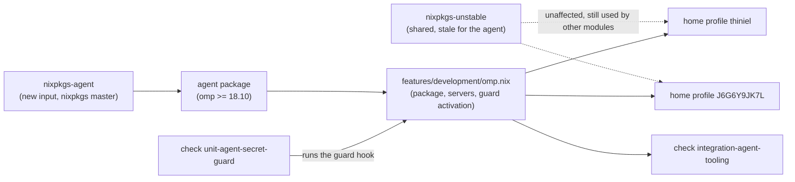

# Design: current-omp-release

The agent's own nixpkgs pin, the guard and server parity on the Mac, and the two
native targets that prove the new capability: a deterministic guard check and a
booted-VM check.

## Use-Case Traceability

Use case `reproduce-working-environment` (contract at
`givn/changes/current-omp-release/specs/reproduce-working-environment/usecase.md`).
Persona impact: `owner--operator` (the operator uses the agent on both devices
and judges whether the carried one is usable and current);
`family--application-user` is unaffected — no application surface changes.

| Use-case contract element | Technical decision | Bound verification target |
|---|---|---|
| New capability `current-agent-tooling` (capability ownership; interaction "a device carries the owner's coding agent") | The agent feature module is imported by both home profiles and takes its package from a dedicated pin | `@host:thiniel`, `@host:J6G6Y9JK7L` |
| Rule: the device's coding agent is at or above the accepted version floor | Floor assertion `18.10` in the assertion module of each agent-carrying host | `@host:thiniel`, `@host:J6G6Y9JK7L` |
| Rule: a device that carries the agent also carries its guardrails | The agent module's activation installs the secret-access guard as a regular file; the Mac's profile imports that module | `@host:J6G6Y9JK7L` (declared), `@check:integration-agent-tooling` (observed on a booted system) |
| Rule: currency is a floor, not a schedule | No timer, systemd unit or scheduled job is introduced; the pin is refreshed deliberately (see Decisions D1) | No scenario — a scope boundary realized by omission |
| Capability `current-agent-tooling` interaction, e2e | A booted Linux system runs the agent from the pin and reports the floor version | `@check:integration-agent-tooling` |
| Precondition: exact version requirements must be supplied before implementation (open: Q16) | This change supplies the agent's version requirement: floor `18.10`, refreshed by the owner | This design + the floor assertions; Q16 stays open for every other tool |
| Capability `permitted-identity-selection` (existing) | Unchanged — the agent package change does not touch identity rendering | Existing `@host:thiniel`, `@host:J6G6Y9JK7L` scenarios stay green |

## Architecture Impact

One new flake input feeds one package; the agent feature module consumes it
instead of the shared unstable package set, and the Mac's profile imports that
module for the first time.

| File | Change |
|---|---|
| `flake.nix` | New input `nixpkgs-agent`; per-system agent package; `ompPackage` in `home-manager.extraSpecialArgs` for `thiniel` and `J6G6Y9JK7L` (the consumer is a Home Manager user module, so the system `specialArgs` would not reach it); `checks.unit-agent-secret-guard` (all systems); agent package threaded into the integration aggregator |
| `home/dan/features/development/omp.nix` | Takes `ompPackage` instead of `pkgs-unstable`; keeps `pkgs` for coreutils; the `Model server (MCP server)` declaration and the guard activation are unchanged |
| `home/dan/J6G6Y9JK7L.nix` | Imports the agent feature module (new on the Mac) |
| `tests/assertions/thiniel-invariants.nix` | Agent present, version floor, and declared guard installation |
| `tests/assertions/J6G6Y9JK7L-invariants.nix` | Agent installed, version floor, declared servers, declared guard installation |
| `tests/unit/hm-dev-modules-test.nix` | Module instantiation updated to the new argument (`unit-helpers` stays green) |
| `tests/unit/agent-secret-guard.mjs` | New: guard verdict driver |
| `tests/integration/agent-tooling-test.nix` | New: booted-VM check |
| `tests/integration/default.nix` | Wires the new check and accepts the agent package |

## Technology Decisions

| Decision | Choice | Channel / source | Why |
|---|---|---|---|
| Where a current agent comes from | A dedicated nixpkgs pin | New flake input `github:NixOS/nixpkgs/master`, pinned by `flake.lock`; `omp` **18.10.0** (checked 2026-10-13 via `nix eval github:NixOS/nixpkgs/master#legacyPackages.<system>.omp.version`, and both the `x86_64-linux` and `aarch64-darwin` outputs resolve from `cache.nixos.org`) | D1/D2: the followed branch `nixpkgs-unstable` is at its head and still carries **18.8.4** (checked 2026-10-13), `nixos-unstable` carries **18.8.9** — below the floor; master carries the newest nixpkgs packaging |
| Input scope | A separate input, not the shared one | `nixpkgs-agent` | Rebasing `nixpkgs-unstable` would move the laptop's whole operating system (its system nixpkgs is that input) to a branch that is either too old for the floor or is master; a separate input keeps the blast radius at one package |
| Package plumbing | `ompPackage` in `extraSpecialArgs`; the module takes the package, not a package set | `flake.nix`, `lib/helpers.nix` untouched | The module needs exactly one package; keeping `pkgs` for coreutils avoids a second package-set argument and leaves every other `mkPkgsUnstable` call site alone |
| Servers and guard on the Mac | The same feature module as the laptop | Existing `.omp/agent/mcp.json` declaration and the `installOmpSopsGuard` activation in the module, both already platform-neutral (`$HOME`-relative, `coreutils/install`) | D3: parity, no second declaration to drift |
| Guard verdict check runtime | `bun` from the same pin as the agent | `pkgs` of the check comes from the agent's package set | The agent runs on bun (its nixpkgs package wraps the CLI in bun); running the verdict driver on the same runtime avoids a runtime-specific surprise |
| Guard verdict check input | A repo-tracked driver driving the tracked hook `.omp/hooks/pre/secret-access-guard.js` (git-tracked, checked) with synthetic `tool_call` events | New `tests/unit/agent-secret-guard.mjs`, wired in `flake.nix` | The hook's contract is "given a tool call, refuse or pass"; the driver asserts that contract deterministically, with no agent process, model or network |
| Booted-system check | `pkgs.testers.runNixOSTest` with an inline node and home-manager, following `integration-ssh-identity-selection` | `tests/integration/agent-tooling-test.nix` | The only native target that observes real activation and a real agent start; the repository has no `tests/deploy/` layer |
| Runners | Unchanged | `verify.command = ./scripts/givn-verify.sh`, `verify.e2e_command = ./scripts/givn-verify-e2e.sh` | No runner change is needed; the new check joins the existing `checks` output |

Version freshness: every version above was looked up on 2026-10-13 (upstream's
newest release is `18.10.3`, checked at its releases endpoint); no version in
this design is written from memory. The floor `18.10` is a deliberate floor, not
a claim about the newest release.

## Verification Binding

| Scenario title | Binding tag | Bound target (file / check / host) | Targeted run command | Expected RED failure mode |
|---|---|---|---|---|
| The personal laptop carries a current, guarded coding agent | `@host:thiniel` | `tests/assertions/thiniel-invariants.nix` (new floor assertion and new declared-guard assertion, fired by host evaluation) | `nix eval --raw .#nixosConfigurations.thiniel.config.system.build.toplevel.drvPath` | assertion "thiniel: Oh My Pi (omp) must be at version 18.10 or newer" fails: the agent is `18.8.4` |
| The work MacBook carries the personal laptop's current, guarded coding agent | `@host:J6G6Y9JK7L` | `tests/assertions/J6G6Y9JK7L-invariants.nix` (new assertions: agent present, floor, declared servers, declared guard installation) | `nix eval --raw .#darwinConfigurations.J6G6Y9JK7L.config.system.build.toplevel.drvPath` | assertion "J6G6Y9JK7L: the coding agent must be installed" fails: the Mac's profile imports no agent module, so no agent package is in `home.packages` |
| A decryption attempt is refused on a device that carries the guard | `@check:unit-agent-secret-guard` | `tests/unit/agent-secret-guard.mjs` via `checks.unit-agent-secret-guard` (wired in `flake.nix`) | `nix build .#checks.$(nix eval --impure --raw --expr builtins.currentSystem).unit-agent-secret-guard` | **characterization, not new behaviour** (see below): at wiring time the RED is the flake evaluation error "no `checks.<system>.unit-agent-secret-guard`"; because the hook and its verdicts already exist and this change does not modify them, the behaviour RED is demonstrated by mutation — invert one expected verdict (`cat .sops.yaml` expected to be refused) and observe the driver exit non-zero |
| Ordinary repository work passes the guard | `@check:unit-agent-secret-guard` | same target, allow-cases of the same driver | same command | same characterization RED: mutation of an allow-case (expect `sops -d f` to pass) must make the driver exit non-zero |
| A booted device starts its coding agent | `@e2e @check:integration-agent-tooling` | `tests/integration/agent-tooling-test.nix` via `checks.integration-agent-tooling` (wired in `tests/integration/default.nix` + `flake.nix`) | `nix build .#checks.<linux-system>.integration-agent-tooling` (e2e scope: `./scripts/givn-verify-e2e.sh`) | flake evaluation error: no such check; after wiring, the guest assertions (reported version, guard file as a regular file, no key material present) are the RED/GREEN locus |

The two guard scenarios are **characterization**: the guard hook and its verdict
table already exist and this change does not modify them — what this change adds
is the target that locks them and the installation of the same guard on the
Mac. Their traceability binding is therefore honest (the target proves the
scenario) while their RED cannot be a behaviour regression; the mutation step
above is what shows the driver can fail at all, and the Mac's half of the rule is
new behaviour proven by the host assertion and the booted check.

## Test Targets Added/Changed

| Target | Kind | Wiring | What it asserts |
|---|---|---|---|
| `unit-agent-secret-guard` | New `runCommand` check, all systems | `flake.nix` `checks` (all-systems block), `nativeBuildInputs = [ <agent pkgs>.bun ]`, driver `${./tests/unit/agent-secret-guard.mjs}` and hook `${./.omp/hooks/pre/secret-access-guard.js}` passed as store paths | Refusals: `read` of `/run/secrets/*` and of a `sops/age/` path; `bash` with `sops -d`, `cd /tmp && sops -d f`, `env sops -d f`; `eval` with a `sops` invocation; `ssh-to-age`; `age -d`. Passes: `grep -rn sops docs`, `cat .sops.yaml`, a read of an ordinary repository path, `echo`. Because this change does not modify the hook, the tasks step also performs the one-off mutation described in the binding table (invert one expected verdict, observe a non-zero exit) so the check's ability to fail is demonstrated |
| `integration-agent-tooling` | New `runNixOSTest`, Linux systems | `tests/integration/agent-tooling-test.nix` + `tests/integration/default.nix` + the flake's linux-systems block (which passes the agent package) | The guest boots, home-manager activation runs, the agent runs **by its declared store path** (`${ompPackage}/bin/omp --version`, PATH-independent) and reports at least 18.10; `~/.omp/agent/hooks/pre/secret-access-guard.js` exists as a regular file (not a symlink); no server key material exists under the user's `~/.config/sops-nix/secrets/` while the agent still starts |
| `unit-helpers` | Extended | `tests/unit/hm-dev-modules-test.nix` module instantiation | The agent module still renders the two declared servers with the new argument; existing agent cases stay green |
| `tests/assertions/thiniel-invariants.nix`, `tests/assertions/J6G6Y9JK7L-invariants.nix` | Extended | Imported by the respective home profile, firing under `@host:` evaluation | Both hosts assert the agent is installed, the version floor, and the declared guard installation; the Mac additionally asserts the declared servers |

## Decisions

- **Decides D2: a dedicated input `nixpkgs-agent` (`github:NixOS/nixpkgs/master`),
  consumed only by the agent.** Where realized: `flake.nix` (input + per-system
  agent package + `home-manager.extraSpecialArgs`), `home/dan/features/development/omp.nix`
  (`ompPackage`). Rejected alternatives: *rebase the shared
  `nixpkgs-unstable` input* — it carries only `18.8.9` on the branch that
  advances (`nixos-unstable`, checked 2026-10-13), which is below the floor,
  while following master would put the laptop's entire operating system on an
  unreleased branch to move one package; *a second helper next to
  `mkPkgsUnstable`* — two helpers with identical bodies, and the module needs a
  package rather than a package set; *renaming `mkPkgsUnstable` to a neutral
  `mkPkgs`* — 16 call sites and 3 unit-test cases churned by a change whose
  subject is the agent's version.
- **D1 (proposal, answered): nixpkgs-sourced freshness.** Realized by the pin
  above; rejected there: upstream's own flake (no binary cache holds its builds
  — checked for both its master revision and the `v18.10.3` tag) and upstream's
  release binaries (a prebuilt vendor binary plus this repository owning the
  Linux ELF/library work).
- **D3 (proposal, answered): full parity on the Mac.** Realized by importing the
  existing agent module into `home/dan/J6G6Y9JK7L.nix`.
- **Decides D4: the Mac carries no agent outside this configuration.** Answered
  by the operator on 2026-10-13: no `omp` binary exists on `J6G6Y9JK7L` other
  than the one this configuration will install, so no file outside the
  configuration is touched and the asserted floor describes the version the
  operator actually runs. Rejected: *removing a hand-installed binary* — nothing
  to remove; *leaving one in place* — the operator confirmed there is none, so
  the shadowing risk it carried does not exist. The implementation step still
  re-checks on the Mac (`command -v omp`) after activation, because the
  repository cannot observe that machine.

## Local Runnability

- **Local run command** (evaluation and assertions for both affected hosts):
  `nix flake check --no-build`, which also evaluates `checks` and every host
  configuration; `./scripts/givn-verify.sh` is the same scope as the change's
  gate.
- **Targeted runs** are the per-scenario commands in the Verification Binding
  table above.
- **VM runnability**: `integration-agent-tooling` boots a Linux node locally
  through `pkgs.testers.runNixOSTest` (interactive variant:
  `nix build .#checks.<linux-system>.integration-agent-tooling.driverInteractive`),
  the same shape as the existing `integration-ssh-identity-selection`. No `*-vm`
  host configuration is involved.
- **Anticipated obstacles, each with its fix**:
  - The agent's binary is not on the test driver's `PATH` (the driver runs as
    root; the agent is a Home Manager package of the test user), so the guest
    invokes it by the path of the package the device declares:
    `sudo -u test env HOME=/home/test ${ompPackage}/bin/omp --version`. That is
    PATH-independent and proves the declared package runs on a booted guest; the
    guest does **not** assert that a user login shell resolves the agent, which
    would test Home Manager's shell integration rather than the agent.
  - The agent writes state under `$HOME` on first run: the guest command sets
    `HOME` to the test user's home rather than letting it inherit root's home.
  - The agent's start could try to reach a model provider: `--version` exits
    before any session starts (verified on the laptop: `omp --version` prints
    `omp/18.8.4` and exits 0), so the check needs no network.
  - The check's closure is large (the agent unpacks to ~1.3 GiB plus bun), and a
    VM check is Linux-only: it is wired into the linux-systems `checks` block,
    not the all-systems one, and it runs in the e2e scope.
  - The guard must land as a *regular file* (the agent's hook discovery skips
    symlinks), so the guest asserts `-f` and rejects `-L`.
  - The Mac cannot boot from this machine: no scenario binds macOS runtime
    behaviour. The Mac's scenarios assert declared configuration, and the
    operator confirms the running agent at activation. This is a scope limit of
    the repository (no `tests/deploy/` layer), not a weaker assertion substituted
    for a scenario the design could have bound.

## Deployment & Rollback

The change adds a home-manager activation entry on the Mac (the guard
installation) and changes the agent package on both devices. It touches no
`boot.loader`, `networking`, `fileSystems`/disko, kernel module, firewall rule,
persistence list or `system.stateVersion` value; `hardware.nix` is untouched.

- Apply: `sudo darwin-rebuild switch --flake .#J6G6Y9JK7L` (Mac),
  `sudo nixos-rebuild switch --flake .#thiniel` (laptop).
- Rollback: `sudo darwin-rebuild rollback` (Mac) /
  `sudo nixos-rebuild switch --rollback` (laptop); both leave the guard file
  under `~/.omp/agent/hooks/pre/` in place, which is harmless — the previous
  generation simply stops managing it, and the agent only loads it if present.
- Verify before switching: `darwin-rebuild build --flake .#J6G6Y9JK7L` /
  `nixos-rebuild build --flake .#thiniel`.

## Secrets & Safety

- No new secret is declared and no `sops` file changes. The Mac's
  `context7/api-key` and `kagi/api-key` entries already exist in its `sops`
  block, and both servers read their key through the agent's `!command`
  indirection at connect time, so no key material enters the store.
- A missing or unreadable key drops that header or environment entry instead of
  sending a placeholder value, so a Mac secret store without those keys degrades
  one server rather than failing the activation. The verifiable half of that
  claim is now bound: the booted check starts the agent on a guest that holds no
  key material for either server and asserts it still starts, so a key-less
  device is proven not to break the agent. Which header a *failed* key read
  drops, and whether the agent retries, is upstream behaviour this repository
  does not test.
- Neither the new check nor the VM check reads secret material: the guard check
  drives the tracked hook with synthetic events, and the store carries no
  decrypted value.
- The change adds no ability to read secrets; it is the opposite — it extends the
  existing refusals to the second device.

## Risks

- **The pin goes stale again.** Accepted in D1: currency is a floor, refreshed by
  the owner; nothing here promises a schedule.
- **The pin moves to a bad build.** Refreshing `nixpkgs-agent` is deliberate; the
  floor assertions plus the booted-VM check catch Linux regressions, and the Mac
  is confirmed at activation.
- **The proposal's "in every approval mode" rests on inspection, not on a
  target.** The hook returns `{ block: true, reason: … }` unconditionally, which
  is what makes the refusal mode-independent, and the guard check asserts that
  return shape; no check sets or observes an approval mode, because a live
  session would need a model provider (TD-014 in the arc42 risk register records
  the same limit from the documentation side). The claim is kept in the proposal
  because it is a property of the hook's return value, not of a mode the
  configuration selects.
- **The guard's coverage is a declared glob set, and this repository's own
  decrypted secrets sit outside it.** The hook denies `/run/secrets/*`, a
  `sops/age/` path and `/var/lib/sops-nix/*`, but sops-nix places *user-side*
  secrets under `~/.config/sops-nix/secrets/`, which the globs do not match — so a
  `read` of, for example, the decrypted `context7/api-key` is not refused. This
  was found by the guard check itself (a case that named that path and passed);
  the case was corrected to the guard's declared set instead of pinning the gap
  as expected behaviour. Extending the guard is new behaviour and out of scope
  for this change; the finding is recorded in `design-review.md` for the operator
  to decide on a follow-up.
- **The guard driver's synthetic events drift from the agent's real event shape.**
  The driver mirrors the hook's own dispatch (`toolName` in
  `read|grep|bash|eval`, `input.path`/`input.command`/`input.code`); the booted
  check independently proves the hook is installed where the agent loads hooks
  from. A future agent release that changes the event shape would need the driver
  updated — recorded here as the known maintenance coupling.
- **Closure growth**: the agent adds ~1.3 GiB unpacked plus bun per device; that
  is the existing cost of the tool, now at a current version.
