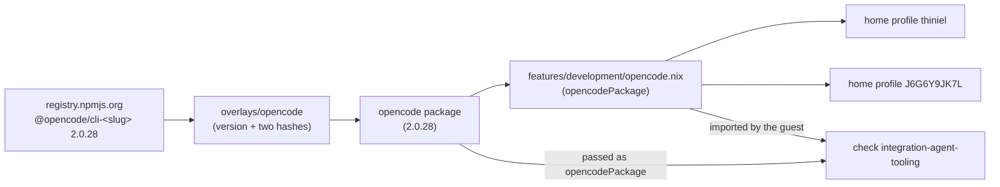

# Design: current-opencode-release

Refresh the repository's own OpenCode package to the newest upstream release,
assert the resulting version floor on both devices, and prove on a booted Linux
VM that the package actually starts.

## Use-Case Traceability

Use case `reproduce-working-environment` (contract at
`givn/changes/current-opencode-release/specs/reproduce-working-environment/usecase.md`).
Persona impact: `owner--operator` (the operator runs OpenCode on both devices and
judges whether the carried one is usable and current);
`family--application-user` is unaffected — no application surface changes.

| Use-case contract element | Technical decision | Bound verification target |
|---|---|---|
| Capability `current-agent-tooling`, extended to the second coding agent the devices carry | The OpenCode feature module is imported by both home profiles and takes its package from the repository's own overlay, refreshed to 2.0.28 | `@host:thiniel`, `@host:J6G6Y9JK7L` |
| Rule: the device's coding agent is at or above the accepted version floor | Floor assertion `2.0.28` in the assertion module of each OpenCode-carrying host | `@host:thiniel`, `@host:J6G6Y9JK7L` |
| Rule: currency is a floor, not a schedule | No timer, systemd unit, Renovate rule or CI bump is introduced; the pin is refreshed deliberately (D1) | No scenario — a scope boundary realized by omission |
| Capability interaction, e2e: a device carries the coding agent | A booted Linux system carries the package the devices declare and starts it | `@check:integration-agent-tooling` |
| Precondition: exact version requirements must be supplied before implementation (open: Q16) | This change supplies OpenCode's version requirement: floor `2.0.28`, refreshed by the owner | This design + the floor assertions; Q16 stays open for every other tool |
| Rule: a device that carries the coding agent also carries its guardrails | **Not extended to OpenCode** — the guardrails rule stays scoped to the guarded agent (omp); OpenCode's guardrails are a named out-of-scope boundary of this change (proposal) | No scenario; the omp guard scenarios stay as they are |
| Capability `permitted-identity-selection` (existing) | Unchanged — the package refresh does not touch identity rendering | Existing `@host:thiniel`, `@host:J6G6Y9JK7L` scenarios stay green |

## Technology Decisions

| Decision | Choice | Channel / source | Why |
|---|---|---|---|
| Where a current OpenCode comes from | The repository's own package (`overlays/opencode`), refreshed to `2.0.28` | Upstream's prebuilt per-platform npm archives (`registry.npmjs.org`, `@opencode/cli-<slug>`), hash-pinned; the file's own rule: "Bump version + both hashes to update" | D1 (proposal, answered): nixpkgs carries `1.19.0` only, so no package-set pin can serve the 2.x line; upstream's own Nix packaging would build from source with no advertised cache |
| Package version | `2.0.28`, measured 2026-10-13 at the npm registry (`@opencode/cli` `latest`; the platform archives `@opencode/cli-linux-x64` and `@opencode/cli-darwin-arm64` are both at `2.0.28` and the tarball URL the overlay builds resolves) | npm registry | The installed package is `2.0.22` (released 2026-10-02); the newest release is `2.0.28` (2026-10-13 08:16) |
| Package plumbing | The module takes the package: `opencode.nix` gains a **required** `opencodePackage` argument; each host passes its own `pkgs.opencode` (through the host module's `{ pkgs, ... }` arguments), the booted check passes the overlay's package | `home/dan/features/development/opencode.nix`, `flake.nix`, `tests/integration/agent-tooling-test.nix`, `tests/unit/hm-dev-modules-test.nix` | A Home Manager module argument **cannot** default to another argument: the module system resolves every formal through `_module.args` and fails with "attribute `opencodePackage` missing" (verified while implementing, with both `? pkgs.opencode` and `? null`), so the package is explicit at every consumer. The hosts' package set already carries the overlay, so their argument is their own `pkgs.opencode`; the booted guest's package set does not, so the check passes the package it was given. The same shape `omp.nix` uses |
| Package for the booted check | The opencode overlay applied to the check's own package set — `((import ./overlays/opencode) pkgs pkgs).opencode` — passed only for a system the overlay supports (`builtins.elem system opencodePkgs.opencode.meta.platforms`) | `flake.nix` linux-systems block, `tests/integration/default.nix` | The overlay's package depends on nothing but its platform attributes, so this keeps the integration tests' package set untouched rather than rebasing all five VM checks. The gating is required: the overlay ships prebuilt binaries for `x86_64-linux` and `aarch64-darwin` only, and forcing its package for `aarch64-linux` (the other system the integration block covers) fails evaluation — which `nix flake check --all-systems` would surface |
| Floor expression | `lib.versionAtLeast (lib.getVersion p) "2.0.28"` in both assertion modules, replacing `"2"` | `tests/assertions/thiniel-invariants.nix`, `tests/assertions/J6G6Y9JK7L-invariants.nix` | `"2"` compares as `2.0.0`, so it cannot see the eleven-day drift; the floor is the version the refreshed pin carries, which is exactly what a regression would undo |
| Booted check | Extend the existing `integration-agent-tooling` node to carry OpenCode beside omp | `tests/integration/agent-tooling-test.nix` | One VM boot proves both agents; a second VM check would double the e2e cost for the same assertion shape |

Version freshness: every version above was looked up on 2026-10-13 (npm registry
`@opencode/cli`, `@opencode/cli-linux-x64`, `@opencode/cli-darwin-arm64`); no
version in this design is written from memory. The floor `2.0.28` is the version
the pin carries, not a claim about the newest release at any later date.

## Architecture Impact

One package definition is refreshed; one module takes its package explicitly; two
assertion modules gain a tighter floor; one VM check carries a second agent.

| File | Change |
|---|---|
| `overlays/opencode/default.nix` | `version` `2.0.22` → `2.0.28`; both platform hashes replaced |
| `home/dan/features/development/opencode.nix` | Takes a required `opencodePackage`; `home.packages` uses it instead of `pkgs.opencode` |
| `tests/assertions/thiniel-invariants.nix` | OpenCode floor `"2"` → `"2.0.28"` (message updated) |
| `tests/assertions/J6G6Y9JK7L-invariants.nix` | OpenCode floor `"2"` → `"2.0.28"` (message updated) |
| `tests/integration/agent-tooling-test.nix` | Takes an optional `opencodePackage`; where supplied, the guest imports `opencode.nix` with it and the script asserts OpenCode starts at or above the floor (three-component version comparison) |
| `tests/integration/default.nix` | Accepts `opencodePackage` and forwards it to `agent-tooling-test.nix` |
| `tests/unit/hm-dev-modules-test.nix` | The OpenCode module instantiation passes `opencodePackage` |
| `flake.nix` | Both host modules take `{ pkgs, ... }` and pass `opencodePackage = pkgs.opencode`; the linux-systems block passes the overlay's package to the integration aggregator, but only for a system the overlay supports |
| `docs/arc42/*` | The twelve-chapter assessment in `arc42.md`: the glossary names both agents and both floors, the source list gains the hand-pinned prebuilt package, the risk register gains R-022, and chapters 1/2/4/5/7/9/10 carry the small edits listed there |

## Verification Binding

| Scenario title | Binding tag | Bound target (file / check / host) | Targeted run command | Expected RED failure mode |
|---|---|---|---|---|
| The personal laptop carries a current OpenCode | `@host:thiniel` | `tests/assertions/thiniel-invariants.nix` (floor assertion raised to `2.0.28`, fired by host evaluation) | `nix eval --raw .#nixosConfigurations.thiniel.config.system.build.toplevel.drvPath` | assertion "thiniel: OpenCode must be at version 2.0.28 or newer" fails: the package is `2.0.22` |
| The work MacBook carries the personal laptop's current OpenCode | `@host:J6G6Y9JK7L` | `tests/assertions/J6G6Y9JK7L-invariants.nix` (same raised floor, fired by host evaluation) | `nix eval --raw .#darwinConfigurations.J6G6Y9JK7L.config.system.build.toplevel.drvPath` | same assertion fails: the shared package is `2.0.22` |
| A booted device starts its OpenCode | `@e2e @check:integration-agent-tooling` | `tests/integration/agent-tooling-test.nix` via `checks.integration-agent-tooling` | `nix build .#checks.x86_64-linux.integration-agent-tooling` (e2e scope: `./scripts/givn-verify-e2e.sh`) | the guest runs `/nix/store/…-opencode-2.0.22/bin/opencode --version` and stops on "OpenCode reports …, below the floor 2.0.28" |

Both host scenarios share one implementation step (the pin refresh), so their two
REDs are observed together, before the refresh, and their GREEN together after
it. The booted scenario's RED is behavioural — a real boot, a real binary, a
reported version below the floor — not an evaluation error.

The booted check's floor comparison is **three-component** (`2.0.28`), not the
omp check's two-component form: `2.0.22` and `2.0.28` share major and minor, so a
two-component comparison would pass the pre-refresh binary and the scenario could
never go RED. The check asserts the parsed triple is at least `(2, 0, 28)`.

## Test Targets Added/Changed

| Target | Kind | Wiring | What it asserts |
|---|---|---|---|
| `tests/assertions/thiniel-invariants.nix` | assertion | aggregated by `tests/assertions/default.nix`, imported by `hosts/thiniel/default.nix`, fired on host evaluation | OpenCode is installed and its version is at least `2.0.28` |
| `tests/assertions/J6G6Y9JK7L-invariants.nix` | assertion | imported by `home/dan/J6G6Y9JK7L.nix` (home-manager module), fired on host evaluation | OpenCode is installed and its version is at least `2.0.28` |
| `integration-agent-tooling` | extended `runNixOSTest`, Linux | `tests/integration/agent-tooling-test.nix` + `tests/integration/default.nix` + the flake's linux-systems block (which now passes `opencodePackage` where the overlay supports the system) | The guest boots, home-manager activation runs, OpenCode runs by its declared store path (`${opencodePackage}/bin/opencode --version`) and reports at least `2.0.28`; the omp assertions of the same node stay green |
| `unit-helpers` | extended unit (`lib.debug.runTests`) | `tests/unit/hm-dev-modules-test.nix` via the flake's all-systems `unit-helpers` check | The OpenCode module still declares `opencode`, `bun` and `uv` and renders its config with the new required argument |

No unit *case* is added: the module's declared package name is already asserted
by `checks.unit-helpers` (`testOpencodeInPackages`), and the version floor is the
assertion modules' job. A unit case repeating the floor would duplicate the host
assertion against the same package attribute. The existing cases stay green with
the module's new required argument — the instantiation passes it.

## Secrets & Safety

- **sops targets**: none. This change wires no secret; the OpenCode module's
  existing `CONTEXT7_API_KEY` / `KAGI_API_KEY` reads are untouched.
- **`stateVersion` invariants**: `system.stateVersion` and `home.stateVersion` are
  not changed.
- **`hosts/<host>/hardware.nix`**: untouched.
- **Trust note**: the refreshed package is a prebuilt vendor binary fetched from
  `registry.npmjs.org` and pinned by sha512 per platform. The refresh replaces
  those two hashes; it adds no new source and no new fetch URL shape.
- **Preserved invariant**: the devices keep refusing an OpenCode older than the
  floor at evaluation time — the property this change is about.

## Deployment & Rollback

Not a dangerous area: no `boot.loader`, `networking`, `fileSystems`/disko,
impermanence, kernel or secret change. Recorded anyway because a package refresh
is applied on real hardware:

- **Apply command**: `sudo nixos-rebuild switch --flake .#thiniel` on the laptop;
  `sudo darwin-rebuild switch --flake .#J6G6Y9JK7L` on the Mac.
- **On-host verification**: `opencode --version` reports at least `2.0.28`.
- **Rollback**: `sudo nixos-rebuild switch --rollback` / `sudo darwin-rebuild
  rollback` returns to the previous generation; the package is not stateful, so
  nothing else must be undone.

## Blast Radius

- **Affected hosts**: `thiniel` and `J6G6Y9JK7L` (both import the module).
- **Package overlay applies to every host**, but only these two install
  OpenCode; the other hosts (`cupix001`, `adlerkopf`, `nixos-vm-minimal`) define
  the package without installing it, and nothing else in the tree reads
  `pkgs.opencode`.
- **Detectability**: a wrong checksum fails the build of the OpenCode derivation
  (fetchurl hash mismatch) — caught by any host build and by the booted check,
  not at activation time. A wrong version fails the two host assertions.
- **Recoverability**: both hosts are reached by an operator locally (the Mac) or
  by an on-host rebuild (the laptop); no remote-only path is involved.
- **Booted check**: Linux-only (`runNixOSTest`); the Mac's own launch stays
  confirmed on the machine during implementation, as this repository has no
  deploy-test layer.

## arc42 chapter impact

Assessed in `arc42.md` (all twelve rows). Chapters touched: `01` (the
requirement row names both floors), `02` (a new constraint: a package no channel
carries), `04` (new key decision 11), `05` (the OpenCode module's Level-3
entry), `07` (both hosts' coding-agent rows), `08` (the fourth package source),
`09` (a NOT_QUALIFIED candidate row), `10` (QS-014 generalised to both agents),
`11` (new risk R-022) and `12` (the "Coding agent", "Agent version floor" and
"Model server" entries). Chapters 3 and 6 are unaffected. No ADR is created: the
refresh is a value change inside an existing package definition, not an
architecturally significant decision.

## Decisions

- **D1 (proposal, answered 2026-10-13 by the operator): a current OpenCode comes
  from the repository's own prebuilt package.** Realized by refreshing
  `overlays/opencode/default.nix` (version `2.0.28`, both platform hashes) and by
  the two host floor assertions. Rejected: *upstream's own Nix packaging as a
  pinned input* — a lock update, but it builds OpenCode from source (its own Node
  dependency set) with no advertised binary cache, so every refresh compiles on
  each machine.
- **D2 (proposal, answered 2026-10-13 by the operator): no OpenCode exists on
  the Mac outside this configuration.** Nothing outside the configuration is
  touched, and the asserted floor describes the binary the operator runs. The
  task list keeps one re-check on the machine after activation
  (`command -v opencode` must resolve under the Nix store), because the
  repository cannot observe that machine itself. Rejected: *removing a
  hand-installed binary* — the operator confirmed there is none, so the action
  is unnecessary and would be destructive outside this change's scope;
  *leaving one in place* — the shadowing risk it priced does not exist here.
- **Decides the package-argument shape: required, not defaulted.** The Home
  Manager module system resolves every formal through `_module.args` and fails
  when a formal is absent, so `opencodePackage ? pkgs.opencode` (and `? null`)
  both break the hosts' evaluation with "attribute `opencodePackage` missing"
  — verified while implementing. Every consumer therefore passes the package
  explicitly: the hosts their own `pkgs.opencode`, the booted check the overlay's
  package. Rejected: *keeping `pkgs.opencode` inside the module* — the module
  would silently require the overlay to be applied by whoever imports it, the
  implicit coupling `omp.nix` was deliberately moved away from.
- **Decides the one open HOW question: where the booted check's package comes
  from.** The opencode overlay applied to the check's own package set, passed
  only where the overlay supports the system (see Technology Decisions).
  Rejected: *applying the whole repository overlay to the integration tests'
  package set* — it would rebase all five VM checks to make one package
  available; *adding an `aarch64-linux` platform to the overlay* — upstream
  publishes no such prebuilt binary for the platforms this change needs, and no
  ARM Linux host carries OpenCode.

## Open Technical Questions

None. Every question above is decided or carried with a named owner.
