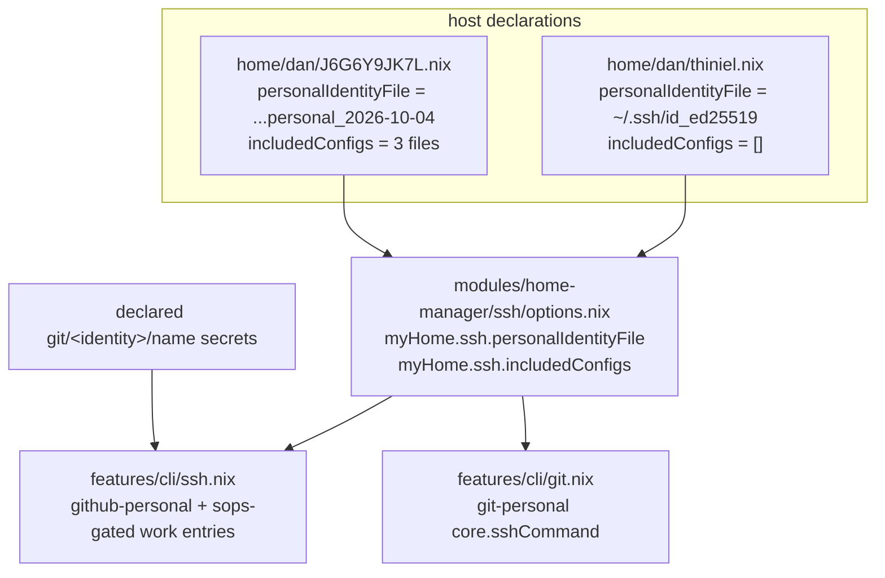

# Design: host-specific-ssh-identities

## Overview

The identity selection leaves the shared feature module and moves into a
per-host declaration. A host states which private key its personal identity
uses and which manually maintained ssh_config files it includes; the module
renders the connection entries from that declaration and renders an entry for a
work identity only where the host declares that identity's secret material.

Affected hosts: `thiniel` (Linux laptop, holds only `~/.ssh/id_ed25519`) and
`J6G6Y9JK7L` (work MacBook, holds the four per-purpose keys and the three
manually maintained include files). No other host imports the SSH feature
(`home/dan/adlerkopf.nix`, `home/dan/cupix001.nix` and
`home/dan/nixos-vm-minimal.nix` import only `global/default.nix`).

Observable end state on thiniel: the private-repository connection resolves to
`~/.ssh/id_ed25519`, the workspace identity configuration names the same key,
no company/client001/client002 connection entry is rendered, and no manually
maintained work-laptop ssh_config file is included. On the work MacBook the
rendered identity files, the three work connection entries and the three
includes are byte-identical to today's rendering.

## Use-Case Traceability

Owning use-case ID: `reproduce-working-environment`
Ideation source: `infrastructure-growth` (topic state retained; no seed is
stamped, because this change covers one condition of the seed
`usable-personal-work`, not its end-to-end deliverable)
Confirmed Persona IDs: `owner--operator` — the surface is the owner's own
device configuration and only the owner evaluates whether private-repository
access works there. `family--application-user` is not affected: no hosted
application, shared resource or access grant changes.

| Use-case contract element | Technical decision | Bound verification target |
|---|---|---|
| Rule: "State may be correctly present, retrieved from an authoritative source, restored from a suitable copy, or supported identity access re-established." | The device's own key is the identity source for private repositories; no key is copied between devices. | `@host:thiniel` |
| Rule: "Preserve owner-authorized scope; no arbitrary home-directory/credential cloning, extra resource rights, or employer/client-data authority follows from a profile reference." | Work identities are rendered only on a host that declares their secret material, so no client data authority follows from a profile reference. | `@host:thiniel`, `@host:J6G6Y9JK7L` |
| Rule: "Device/platform differences may be intentional; reproducing the selected usual context is not forcing Linux/macOS to be identical." | The personal identity path is a host declaration, not a platform branch. | `@check:unit-helpers` |
| Extension 2b: "The selected identity cannot be exported but supports permitted re-establishment" | thiniel already holds its own key; the change re-establishes usable identity access without moving the MacBook key. | `@host:thiniel` |
| Success guarantee: "required context available and usable" (identity condition) | `ssh -G github-personal` resolves to a file that exists on the device. | `@host:thiniel` plus the on-host confirmation after activation |
| Capability ownership: `permitted-identity-selection` | New option module `modules/home-manager/ssh/options.nix` + the rendering change in `home/dan/features/cli/ssh.nix` and `home/dan/features/cli/git.nix` | all four scenarios |

## Technology Decisions

| Decision | Choice | Channel / source | Why |
|---|---|---|---|
| Where the per-host identity declaration lives | new option module `modules/home-manager/ssh/options.nix` (`myHome.ssh.*`), wired into the Home Manager `sharedModules` of the hosts that import the feature | nixpkgs pin of the flake (`flake.lock`); no version-bearing package | Follows the existing `modules/home-manager/persistence/{options,default}.nix` convention: shared feature modules read a `myHome.*` option, the host sets it. Keeps `features/cli/ssh.nix` free of host names. |
| Personal identity key path | `myHome.ssh.personalIdentityFile`, a `str` with **no default** | — | A host that reaches private repositories must state the key it holds; a default would silently re-introduce the cross-device path. |
| Manually maintained include files | `myHome.ssh.includedConfigs`, `types.listOf types.str`, default `[ ]` | — | The three files are hand-maintained on the work MacBook only and have no Nix definition anywhere in the repository; the host that keeps them includes them. |
| Gating the work identity entries | `lib.optionalAttrs (config.sops.secrets ? "git/<identity>/name")`, the same gate `features/cli/git.nix` already uses for the `git-company`/`git-client001`/`git-client002` templates | — | Reuses an existing pattern instead of inventing a second notion of "host holds this identity"; a host has work identity configuration to connect with exactly when it declares that identity's secret material. thiniel declares none, so it renders none. |
| Workspace identity configuration | `features/cli/git.nix` renders `core.sshCommand` from `config.myHome.ssh.personalIdentityFile` | — | The private-workspace profile must name the same key as the SSH connection; one declared source feeds both. |
| Rendering mechanism | `programs.ssh.settings` / `includes` (home-manager `programs.ssh`, already in use) | nixpkgs (`home-manager-unstable`) | Existing option path; no change of renderer, no new module. |

No package, module or option in this change depends on a version number, so no
version lookup is recorded.

## Decisions

- Decides D1: **Declare work identity connections only where their secret
  material exists**; thiniel renders none, the MacBook keeps all three (plus
  the three includes). Realized in `home/dan/features/cli/ssh.nix` (sops-gated
  `lib.optionalAttrs` blocks) and in the host declarations
  (`home/dan/J6G6Y9JK7L.nix` states its three includes; `home/dan/thiniel.nix`
  states none).
- Decides D2: **thiniel's personal identity is `~/.ssh/id_ed25519`**, declared
  in `home/dan/thiniel.nix`; the MacBook declares
  `~/.ssh/id_ed25519_personal_2026-10-04` in `home/dan/J6G6Y9JK7L.nix`.
  Realized in both host user modules and consumed by the SSH feature and the
  git templates. This closes the owning use case's `(open: Q16)` qualifier for
  this device's personal identity only; the remaining state/source inventory
  stays open.

## Verification Binding

Suite runner (`verify.command`): `./scripts/givn-verify.sh`

| Scenario title | Binding tag | Bound target (file / check / host) | Targeted run command | Expected RED failure mode |
|---|---|---|---|---|
| The personal device reaches private repositories with the identity it holds | `@host:thiniel` | `tests/assertions/thiniel-invariants.nix`, fired by the thiniel configuration evaluation | `nix eval --raw .#nixosConfigurations.thiniel.config.system.build.toplevel.drvPath` | new assertions fail: the personal connection resolves to `~/.ssh/id_ed25519_personal_2026-10-04`, and the workspace identity configuration names the same foreign path |
| A device declares no connection for an identity whose material it does not hold | `@host:thiniel` | `tests/assertions/thiniel-invariants.nix`, fired by the thiniel configuration evaluation | `nix eval --raw .#nixosConfigurations.thiniel.config.system.build.toplevel.drvPath` | new assertions fail: `github-company`, `github-client001` and `bitbucket-client002` are present and `includes` is not empty |
| The work laptop keeps its per-purpose identity selection | `@host:J6G6Y9JK7L` | `tests/assertions/J6G6Y9JK7L-invariants.nix` (home-manager level), fired by the darwin configuration evaluation | `nix eval --raw .#darwinConfigurations.J6G6Y9JK7L.config.system.build.toplevel.drvPath` | new assertions fail: the MacBook's rendered include list is empty and it declares no include files, because the include list became a host declaration in the preceding scenario and the MacBook has not declared its three files yet. A false home-manager assertion was proven to fail this evaluation. |
| A booted device reaches private repositories with the identity it declares | `@e2e @check:integration-ssh-identity-selection` | `tests/integration/ssh-identity-selection-test.nix` → check `integration-ssh-identity-selection` (a `pkgs.testers.runNixOSTest` VM boot) | `nix build .#checks.$(nix eval --impure --raw --expr builtins.currentSystem).integration-ssh-identity-selection` | observed: the check exited 1 with the booted device's rendered `~/.ssh/config` dumped — it names `~/.ssh/id_ed25519_personal_2026-10-04` and the three work connection entries, so the resolution assertion fails |

The module-granularity form of scenario 1 is proven by the same scenario's RED
step in `tests/unit/hm-cli-modules-test.nix` (the check `unit-helpers`), which
is a faster target for exactly the behaviour scenario 1 asserts at host level.
It is not a separate scenario: it asserts no behaviour the host scenario does
not, and in `.feature` order it would already pass by the time it ran.

`@e2e` scope: the capability's end-to-end proof is the booted-device check
above, which the `@e2e` runner (`scripts/givn-verify-e2e.sh`) builds with every
other `integration-*` check. The `@e2e` tag sits on that scenario alone: an
`@e2e` `@host:` binding is legal, but the `@e2e` runner never builds a host
evaluation, so a host-bound `@e2e` scenario would be asserted yet unenforced.
The live confirmation of the same claim on the real device
(`ssh -G github-personal` after `nixos-rebuild switch`) is recorded as
implementation evidence in `tasks.md`, not as a second binding. The repository
has no deploy-test target (`tests/deploy/` does not exist) and
`scripts/givn-verify-e2e.sh` fails loudly on a non-Linux host, so the booted
check is the only end-to-end target that can be enforced here.

## Test Targets Added/Changed

| Target file | Kind | Wired in by | Covers scenarios |
|---|---|---|---|
| `tests/assertions/thiniel-invariants.nix` | assertion (NixOS-level, reads the `dan` home-manager config) | imported by `hosts/thiniel` via `../../tests/assertions`; also forced by `scripts/givn-verify.sh` step 4 | scenarios 1 and 2 |
| `tests/assertions/J6G6Y9JK7L-invariants.nix` | assertion (home-manager level; a false case was proven to fail the darwin toplevel evaluation) | imported by `home/dan/J6G6Y9JK7L.nix` | scenario 3 |
| `tests/unit/hm-cli-modules-test.nix` | unit (`lib.debug.runTests`) | flake `checks.unit-helpers` via `tests/unit/default.nix` | scenario 1 at module granularity (plus the changed git/ssh module mocks) |
| `tests/integration/ssh-identity-selection-test.nix` | VM (`pkgs.testers.runNixOSTest`) | flake `checks.integration-ssh-identity-selection` via `tests/integration/default.nix` | scenario 4 |

`tests/unit/hm-modules-test.nix` needs its ssh mock extended only because the
feature now reads a host declaration; it gains no scenario.

## Architecture Impact

New:

- `modules/home-manager/ssh/options.nix` — `myHome.ssh.personalIdentityFile`
  (no default) and `myHome.ssh.includedConfigs` (default `[ ]`).

Changed:

- `home/dan/features/cli/ssh.nix` — personal identity file from the
  declaration, includes from the declaration, work entries sops-gated.
- `home/dan/features/cli/git.nix` — the `git-personal` template's
  `core.sshCommand` uses the declared personal identity file.
- `home/dan/thiniel.nix` — declares `personalIdentityFile =
  "~/.ssh/id_ed25519"` and no includes.
- `home/dan/J6G6Y9JK7L.nix` — declares the MacBook's personal identity file and
  the three include files.
- `flake.nix` — adds the option module to the Home Manager `sharedModules` of
  the `thiniel` nixosConfiguration and the `J6G6Y9JK7L` darwinConfiguration,
  and passes the `home-manager-unstable` and `sops-nix` inputs into
  `tests/integration/default.nix` (the VM check needs the home-manager module
  and the sops option surface; the flake `checks` wiring itself is unchanged,
  `tests/integration/default.nix` stays the single place that names the
  `integration-*` checks).
- `tests/integration/default.nix` — adds the
  `integration-ssh-identity-selection` check.
- `tests/integration/ssh-identity-selection-test.nix` — new VM check.
- `tests/assertions/thiniel-invariants.nix`,
  `tests/assertions/J6G6Y9JK7L-invariants.nix`,
  `tests/unit/hm-cli-modules-test.nix`, `tests/unit/hm-modules-test.nix`.
- `docs/HOME-MANAGER.md` — the SSH section documents the per-host declaration
  instead of fixed key paths.

## Secrets & Safety

- No sops secret is added, moved or rewired. The change only *reads* the
  presence of already declared secrets (`git/company/name`,
  `git/client001/name`, `git/client002/name`) as the gate for the work
  connection entries; the `git-personal` template keeps its existing sops
  placeholders.
- No private key material is read, copied, generated or inspected. The change
  touches key *paths and names* only; `~/.ssh/id_ed25519` is referenced by name
  and never opened.
- `home.stateVersion` (25.11) and every `system.stateVersion` stay unchanged.
- `hosts/*/hardware.nix` is untouched.
- The rendered `~/.ssh/config` stays a home-manager store link
  (`~/.ssh/config -> /nix/store/.../home-manager-files/.ssh/config`); its
  content is rewritten, its ownership semantics are not.
- Invariant preserved: the work MacBook's resolved identity selection and its
  three includes are unchanged. Any deviation is a regression, asserted in the
  darwin invariants.

## Deployment & Rollback

The change does not touch `boot.loader`, `networking`, `fileSystems`/disko,
impermanence, the kernel or sops target wiring, but it rewrites a file the
owner's shell depends on and needs activation, so it is recorded:

- **Apply command:** `sudo nixos-rebuild switch --flake .#thiniel` on thiniel
  (the repository's own alias `nrs`); the work MacBook would apply with
  `sudo darwin-rebuild switch --flake .#J6G6Y9JK7L`. Nothing is deployed here
  to the MacBook — it is verified by evaluation only.
- **On-host verification:** on thiniel after activation,
  `ssh -G github-personal` reports
  `identityfile ~/.ssh/id_ed25519` and `identitiesonly yes`, and
  `~/.config/git/personal` contains
  `sshCommand = "ssh -i ~/.ssh/id_ed25519 -o IdentitiesOnly=yes"`.
- **Rollback:** `sudo nixos-rebuild switch --rollback` (restores the previous
  generation and its `home-manager-files` links), or boot the previous
  generation from the systemd-boot menu. thiniel's root is impermanence-wiped
  but the configuration and generations live outside it, so a rollback survives
  a reboot. The worst-case loss is a wrong identity path in `~/.ssh/config`,
  which fails closed (no key is presented) and never grants broader access.

## Blast Radius

Affected hosts: `thiniel` (rendered `~/.ssh/config`, `~/.gitconfig` include
target `~/.config/git/personal`) and `J6G6Y9JK7L` (evaluated only). A wrong
path renders a connection whose identity file does not exist: SSH fails with
"no such identity" and the access attempt is denied, not broadened. Detectable
immediately with `ssh -G github-personal` and `ssh -T git@github-personal`;
recoverable locally on thiniel without network access via
`nixos-rebuild switch --rollback`. Hosts that do not import the SSH feature are
untouched, and the option module is inert on them.

## arc42 Chapter Impact

- **05 Building Block View** — new options module; the SSH feature reads the
  host declaration.
- **08 Cross-cutting Concepts** — new concept: per-host identity declaration.
- **11 Risks and Technical Debt** — the failure mode of an identity file that
  is declared but absent (fails closed, silent until first connection).
- **12 Glossary** — terms identity declaration, identity file, identity
  material, personal identity, private workspace, work identity.
- **09 Architecture Decisions** — no ADR: the decision is reversible within
  this change, touches one component, and constrains no future boundary
  (falsification tests 1 and 2 fail the candidate, and `durable_consequence`
  with `lower_level_artifact` fail the gate). The rationale's single canonical
  destination is this design; the capability spec owns the observable
  behaviour, not the rationale.
- Chapters 01, 02, 03, 04, 06, 07, 10 — no impact; those chapters still hold
  their scaffold placeholders and are deliberately left untouched.

## Open Technical Questions

None. The two host declarations, the render mechanism and every bound target
are settled above.
