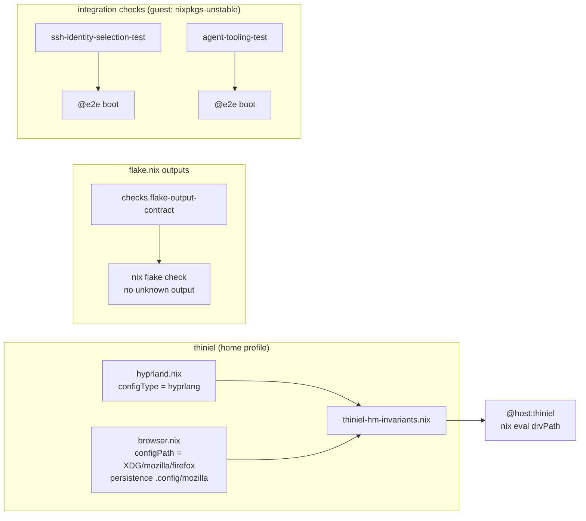

# Design: quiet-configuration-evaluation

## Scope

This change clears the four evaluation-warning causes of the personal laptop's
home profile, of the two booted-device checks, and of the flake's declared
outputs. It states two superseded settings explicitly (one of them with a
one-time relocation of live browser data), rebuilds two booted-device checks
from the pin their Home Manager follows, and withdraws the zero-node fleet hive.
It changes no host's network behaviour, no service, and no secret.

Runner commands are unchanged: `verify.command` = `./scripts/givn-verify.sh`
(non-`@e2e`), `verify.e2e_command` = `./scripts/givn-verify-e2e.sh` (`@e2e`,
builds every `integration-*` check). Confirmed in `givn/commands.yaml`.

## Use-Case Traceability

Owning contract: `publish-infrastructure-configuration` (permanent). New
capability: `quiet-configuration-evaluation`.

| Use-case contract element | Technical decision | Bound verification target |
|---|---|---|
| Rule: a setting whose release default the configuration superseded is stated explicitly at a value the operator chose | `wayland.windowManager.hyprland.configType = "hyprlang"` in `home/dan/features/linux/hyprland.nix`; `programs.firefox.configPath = "${config.xdg.configHome}/mozilla/firefox"` in `home/dan/features/productivity/browser.nix` | `@host:thiniel` via `tests/assertions/thiniel-hm-invariants.nix` |
| Rule: a value that relocates a device's data is carried out without discarding it | the browser profile moves `~/.mozilla/firefox` → `~/.config/mozilla/firefox`; the persistent set moves with it | `@host:thiniel` (declared state) + operator confirmation of the live move (task 4) |
| Rule: an evaluation reports no migration, release-mismatch or unrecognised-output diagnostic | explicit settings; fixtures rebuilt from the pin their Home Manager follows; fleet hive withdrawn | `@host:thiniel`, `@check:integration-ssh-identity-selection`, `@check:integration-agent-tooling`, `@check:flake-output-contract` |
| Flow step 4: yields a checkout that evaluates and passes its checks without any private value and reports no diagnostic to triage | the same four targets | `./scripts/givn-verify.sh` (runs `nix flake check --no-build` and every `@host:` assertion) |
| Success guarantee: every host builds and deploys | no host's behaviour changes except the laptop's browser profile location; the Mac and the stable hosts are untouched | `@host:thiniel`, `@host:J6G6Y9JK7L` (unchanged, still evaluated by the runner) |
| Minimal guarantee: an incomplete context is not reported as ready / data not silently discarded | the relocation copies before it deletes; the declared state is asserted; the live move is an operator step | `@host:thiniel` + operator confirmation |

Personas: `owner--operator` (confirmed 2026-10-11) is the actor who runs the
evaluations and owns the browsing data. `family--application-user` has no
surface here — no hosted application, shared resource, or access path changes.
This repository's interface is host configuration, not a rendered screen, so the
Persona record is `owner--operator` as review lens, not a scenario actor.

## Decisions

- **Decides D1 (proposal)**: the personal laptop's browser profile lives at
  `${config.xdg.configHome}/mozilla/firefox` — the release's current default.
  Realized in `home/dan/features/productivity/browser.nix` (`configPath` plus
  the persistence entry move); the live data move is an operator step in
  `tasks.md`. Rejected: pinning `".mozilla/firefox"` (clears the warning, keeps
  the superseded layout, defers the same data step).
- **Decides D2 (proposal)**: the compositor configuration format stays the
  conf format, stated explicitly as `"hyprlang"` — realized in
  `home/dan/features/linux/hyprland.nix`. Adopting `"lua"` would rewrite the
  settings tree into the release's Lua call form and the four assertion files
  that read its current shape, is unverifiable without a live compositor, and
  stays out of scope as its own change.
- **Decides D3 (proposal)**: the two booted-device checks build their guest from
  `nixpkgs-unstable.legacyPackages.<system>` — the pin `home-manager-unstable`
  follows — instead of the release set. This is proposal-D3 **option 1**
  (guest's package set from the pin the loaded Home Manager follows); it keeps
  `useGlobalPkgs = true` and the release check enabled, mirroring the two
  devices that carry these features (`thiniel`, `J6G6Y9JK7L`, both unstable).
  Realized in `flake.nix` (linux checks block), `tests/integration/default.nix`,
  and the two fixtures. Rejected: option 2 (`useGlobalPkgs = false` — changes
  the fixture's mode away from the devices' mode), option 3 (disabling the
  release check — silences the guard instead of fixing the pairing), and
  loading the release `home-manager` input in the two fixtures (clears the
  mismatch with no larger guest closure, but stops mirroring the two unstable
  devices those features actually run on).
- **Decides D4 (proposal)**: the `colmenaHive` output and the `colmena` flake
  input are withdrawn; the Colmena CLI package and the fleet aliases stay; the
  deployment plans gain the re-registration step. Realized in `flake.nix` plus
  the documentation updates below.

## Technology Decisions

| Decision | Choice | Channel / source | Why |
|---|---|---|---|
| Compositor format pin | `wayland.windowManager.hyprland.configType = "hyprlang"` | Home Manager `home-manager-unstable` (input, release `26.11`) | The option's value must be stated by the profile that predates the `26.05` transition. `"hyprlang"` renders the conf file the desktop reads today; `"lua"` rewrites the settings tree (out of scope, D2). |
| Browser profile location | `programs.firefox.configPath = "${config.xdg.configHome}/mozilla/firefox"`, applied only where `pkgs.stdenv.hostPlatform.isLinux` | Home Manager `home-manager-unstable` | The release's own current value (the warning names it). Absolute path is accepted by `home.file` (`isAbsolutePath` branch of the file type) and forces the wrapper's `appDataDir`, so the browser reads and writes the new directory. The setting lives in the shared browser feature, which the work MacBook also imports, so it is guarded: on darwin the profile stays at `Library/Application Support/Firefox` (asserted as a guard in `tests/assertions/J6G6Y9JK7L-invariants.nix`), which keeps the proposal's Out-of-Scope promise. |
| Browser persistence entry | `.mozilla` → `.config/mozilla` in the same feature module | imperative (Home Manager `home.persistence`) | The persistent set must cover the new directory or the browsing state is lost on the next root reset. |
| Booted-device guest package set | `nixpkgs-unstable.legacyPackages.<system>` for the two Home-Manager-based checks | `nixpkgs-unstable` (input, release `26.11`) | Only this pairing satisfies `home.enableNixpkgsReleaseCheck` while keeping the devices' `useGlobalPkgs = true` mode (D3). |
| Flake-output contract | a `checks.<system>.flake-output-contract` derivation asserting every declared top-level output is one of the repository's recognised outputs | `nixpkgs` (`nixpkgs-26.05`) | `nix flake check` warns on every top-level output outside its schema and offers no suppression (verified against a minimal flake, 2026-10-13); the contract makes the withdrawal enforced rather than incidental. The check reads `self.outputs`, because the flake-self attrset also carries `_type`, `inputs`, `narHash`, `outPath` and other bookkeeping names that are not outputs (verified: reading `self` directly made those the failure list instead of `colmenaHive`). |

No new overlay, package, or nixpkgs channel is introduced. Every version-bearing
choice is resolved by the flake's existing `flake.lock` pins
(`nixpkgs` = `nixos-26.05`, `nixpkgs-unstable` = `nixpkgs-unstable`,
`home-manager-unstable` = `home-manager` master, `home-manager` = `release-26.05`);
no version number is written from memory.

## Verification Binding

| Scenario title | Binding tag | Bound target (file / check / host) | Targeted run command | Expected RED failure mode |
|---|---|---|---|---|
| The personal laptop states its compositor configuration format | `@host:thiniel` | `tests/assertions/thiniel-hm-invariants.nix` (Home-Manager-level, imported by `home/dan/thiniel.nix`), fired by host evaluation | `nix eval --raw .#nixosConfigurations.thiniel.config.system.build.toplevel.drvPath` | the new assertion fails: the release reports the compositor format as resolved from its superseded default (`shouldWarn` true for `wayland.windowManager.hyprland.configType`); the format assertion (`"hyprlang"`) and the rendered-filename assertions already hold, so the diagnostic-cause assertion is the RED one |
| The personal laptop's browser profile lives under its XDG config directory and survives a root reset | `@host:thiniel` | `tests/assertions/thiniel-hm-invariants.nix` for the superseded-default predicate of `programs.firefox.configPath`, and `tests/assertions/thiniel-impermanence-invariants.nix` (NixOS level, its existing `hmHasDir` helper) for the rendered profile files and the persistence declaration | `nix eval --raw .#nixosConfigurations.thiniel.config.system.build.toplevel.drvPath` | both new assertion groups fail: the superseded-default predicate reports `shouldWarn` true (verified by probe, 2026-10-13), no file entry under `${config.xdg.configHome}/mozilla/firefox` exists, a file entry under `.mozilla/firefox` does, and the persistence list declares `.mozilla` instead of `.config/mozilla` |
| A booted device reproduces its identity surface from a single release | `@e2e @check:integration-ssh-identity-selection` | `tests/integration/ssh-identity-selection-test.nix` (its node assertion), wired by `tests/integration/default.nix` + the flake's linux checks block | `nix build .#checks.x86_64-linux.integration-ssh-identity-selection`, evaluation-level RED: `nix eval .#checks.x86_64-linux.integration-ssh-identity-selection.drvPath` | the fixture's new assertion fails: the test profile's Home Manager release (`26.11`) differs from the guest package set's release (`26.05`) |
| A booted device starts its coding agents from a single release | `@e2e @check:integration-agent-tooling` | `tests/integration/agent-tooling-test.nix` (its node assertion), same wiring | `nix build .#checks.x86_64-linux.integration-agent-tooling`, evaluation-level RED: `nix eval .#checks.x86_64-linux.integration-agent-tooling.drvPath` | the fixture's new assertion fails for the same release difference |
| The flake exposes only outputs the checker interprets | `@check:flake-output-contract` | `flake.nix` → `checks.<system>.flake-output-contract` | `nix build .#checks.$(nix eval --impure --raw --expr builtins.currentSystem).flake-output-contract` | the new check fails and names `colmenaHive` as an output outside the recognised set (the check exists and fails before the withdrawal — RED is the check itself, not an evaluation error) |

Assertion mechanics (recorded so implementation cannot weaken them; the two
mechanisms marked **verified** were probed against the current tree during the
design review — see `design-review.md`, findings V1–V4):

- `tests/assertions/thiniel-hm-invariants.nix` is a **Home-Manager-level**
  module (it needs `options` and `config` of the home profile). The two
  superseded settings are not asserted by re-implementing the release's rule:
  the module calls `lib.hm.deprecations.mkStateVersionOptionDefault` in deferred
  mode with the same `since = "26.05"`, option path and legacy/current values
  the release uses, and asserts `shouldWarn == false` for each path. For the
  browser setting that predicate *is* the release's own deferred condition; for
  the compositor setting (the release uses the direct form there) it is the
  equivalent `optionUsesDefaultPriority` condition, which the same helper
  computes. **Verified**: with the values still unset, the probe evaluation
  failed with exactly these two assertions, so both scenarios have real RED
  evidence.
- The rendered-artifact assertions read the profile's file entries
  (`config.home.file`) and the compositor configuration entries
  (`config.xdg.configFile`): the conf-format compositor file is present and no
  Lua file, the browser profile's `profiles.ini` is present under the XDG path
  and none under `.mozilla`.
- The persistence half is asserted on the home profile's declared persistence
  list through the helper `tests/assertions/thiniel-impermanence-invariants.nix`
  already uses for every persisted path (`hmHasDir`, tolerant of the list's
  string-or-attribute-set elements): `.config/mozilla` is declared and
  `.mozilla` is not. The helper reads `.directory` lazily per element, which is
  what keeps it working — *deep-forcing* the list throws in this impermanence
  revision (its removed `method` option has `apply = throw`), and the same fact
  observed one layer out (`config.systemd.mounts` targets) was considered and
  rejected in favour of the file's existing convention. The mount list today
  carries `/home/dan/.mozilla` and `/home/dan/.cache/mozilla`, confirming that a
  declared directory becomes a mount target.
- The two fixtures assert the pairing directly: the test profile's Home Manager
  release equals the guest package set's release
  (`config.home-manager.users.test.home.version.release == pkgs.lib.trivial.release`),
  which is the condition behind the mismatch diagnostic. No warning-text
  matching.

## Test Targets Added/Changed

| Target file | Kind | Wired in by | Covers scenarios |
|---|---|---|---|
| `tests/assertions/thiniel-hm-invariants.nix` | assertion (Home-Manager level) | imported by `home/dan/thiniel.nix` (mirrors `tests/assertions/J6G6Y9JK7L-invariants.nix`); fires on `@host:thiniel` evaluation | the two `@host:thiniel` scenarios (the superseded-default predicates, one per setting) |
| `tests/assertions/thiniel-impermanence-invariants.nix` | assertion (NixOS level, extended) | already imported by `tests/assertions/default.nix`, so `hosts/thiniel` and the runner's step 4 pick it up; no new wiring | the rendered browser profile files and the persistence mount of the browser scenario |
| `tests/assertions/thiniel-hm-invariants.nix` (second group, guards) | assertion (Home-Manager level) | same import as above | **Guards, not scenario targets**: the fleet deployment tool and the `cs`/`ct`/`cb`/`cda`/`call` aliases remain installed although the hive is withdrawn. These pass before and after the change, so they carry no RED phase; they exist so the withdrawal cannot quietly take the CLI with it. |
| `tests/assertions/J6G6Y9JK7L-invariants.nix` | assertion (Home-Manager level, extended) | imported by `home/dan/J6G6Y9JK7L.nix`; fires on `@host:J6G6Y9JK7L` evaluation | **Guard, not a scenario target**: the work MacBook's browser profile path stays `Library/Application Support/Firefox`. Without the Linux guard on the shared browser feature this assertion fails, which is how the guard is proven: the RED for it is the unguarded state, which the design rejects before implementation. |
| `flake.nix` → `checks.<system>.flake-output-contract` | contract check (`runCommand` over the flake's output names) | the flake's checks block itself (all three systems, like `private-data-defaults`) | the `@check:flake-output-contract` scenario |
| `tests/integration/ssh-identity-selection-test.nix` | VM (`pkgs.testers.runNixOSTest`) + node assertion | `tests/integration/default.nix`, flake linux checks block | the ssh fixture scenario |
| `tests/integration/agent-tooling-test.nix` | VM (`pkgs.testers.runNixOSTest`) + node assertion | same wiring | the agent fixture scenario |
| `tests/integration/default.nix`, flake linux checks block | wiring change (guest package set per check) | — | both `@e2e` scenarios |

No new unit-test file and no `tests/deploy/` layer is introduced; the `@e2e`
scope remains the VM checks.

## Architecture Impact

Changed files:

- `home/dan/features/linux/hyprland.nix` — states the compositor configuration
  format explicitly (`configType = "hyprlang"`) with its rationale comment. No
  settings change.
- `home/dan/features/productivity/browser.nix` — states the browser profile
  location explicitly, guarded to the Linux platform (the feature is shared with
  the work MacBook, whose profile path must not move), and moves the persistence
  entry from `.mozilla` to `.config/mozilla`.
- `home/dan/thiniel.nix` — imports the new Home-Manager-level assertion module.
- `tests/assertions/thiniel-hm-invariants.nix` — new (Home-Manager level): the
  two superseded-default predicates plus the two guards (fleet CLI, aliases).
- `tests/assertions/thiniel-impermanence-invariants.nix` — extended with the
  rendered browser profile files and the persistence mount.
- `tests/assertions/J6G6Y9JK7L-invariants.nix` — extended with the guard that
  the MacBook's browser profile path stays the platform default.
- `flake.nix` — withdraws the `colmenaHive` output and the `colmena` input;
  passes `nixpkgs-unstable.legacyPackages.<system>` to the two Home-Manager-based
  integration checks; adds `flake-output-contract` to the checks output.
- `tests/integration/default.nix` + the two fixtures — guest package set and
  node assertions as above.
- `docs/arc42/05-building-block-view.md` (flake box), `docs/arc42/04-solution-strategy.md`
  (fleet row), `docs/arc42/08-crosscutting-concepts.md` (persistence example),
  `docs/arc42/12-glossary.md` (already updated with `Superseded default` and the
  `Colmena hive` row), `docs/plans/adlerkopf/01-base-os.md`,
  `docs/plans/adlerkopf/X-cross-cutting.md`, `docs/plans/cupix001/13-colmena.md`
  (re-registration step for the hive and its input), `docs/TESTING.md` if it
  names the checks.

No `modules/` option surface changes, no host definition changes, no new helper.



## Secrets & Safety

- **sops targets**: none. No secret is declared, moved, or re-keyed.
- **`stateVersion` invariants**: `home.stateVersion` (`25.11`) and every
  `system.stateVersion` stay unchanged; the superseded defaults are resolved by
  explicit values, which is the only way compatible with the invariant.
- **`hardware.nix` untouched**: no hardware file is modified.
- **Invariants preserved**: `private-data-defaults` and `private-data-hygiene`
  stay green (no operational value is introduced); the fleet hive withdrawal
  removes an output, not a package — the Colmena CLI stays installed on the
  devices that declare it (`Deploy tools` feature).
- The guard (`scripts/private_data_hygiene.py`) is unaffected; no new file
  material is recorded.

## Deployment & Rollback

This change touches `home.persistence` (the browser persistence entry moves), so
it is a dangerous area.

- **Apply**: `sudo nixos-rebuild switch --flake .#thiniel` on the laptop (the
  repository's own deploy path; no colmena involvement). The browser relocation
  is a separate operator step:

  ```sh
  # on thiniel, as dan
  # 1. quit the browser first: switch-to-configuration stops the old persistence
  #    mount, and Firefox holding ~/.mozilla/firefox makes that stop fail
  #    (observed 2026-10-13: `Failed to stop home-dan-.mozilla.mount`, exit status 4)
  sudo nixos-rebuild switch --flake .#thiniel
  # 2. copy the profile into the persisted new location (no sudo needed):
  cp -a /persist/home/dan/.mozilla/firefox /persist/home/dan/.config/mozilla/firefox
  # 3. open the browser and confirm bookmarks/history/logins,
  #    then remove the old data: rm -rf /persist/home/dan/.mozilla
  ```

  The user-layer persistence sources live under `/persist/home/dan/<path>`, not
  `/persist/<path>`: the module derives the user's home below the declared
  persistent storage path, so `/persist/.config` does not exist and `/persist`
  itself is root-owned. The copy precedes any deletion, so an interruption leaves
  the old profile intact.
- **On-host verification**: the profile directory is present at
  `~/.config/mozilla/firefox` with `profiles.ini` and the `*.default-release`
  profile; the browser starts with the previous bookmarks, history and saved
  logins; `~/.mozilla` no longer exists; `nix eval` of the host drvPath reports
  no superseded-default diagnostic and no warning.
- **Rollback**: `sudo nixos-rebuild switch --rollback` selects the previous
  system generation; because Home Manager is a NixOS module here, the home
  profile rolls back with it (no separate Home-Manager generation step exists on
  this host). Once the data has moved, the configuration rollback alone is not
  enough: the previous generation expects `~/.mozilla/firefox`, so
  `mv /persist/home/dan/.config/mozilla/firefox /persist/home/dan/.mozilla/firefox`
  (and remove the leftover `/persist/home/dan/.config/mozilla`) before the reboot
  that remounts the persistence.
- **Tested rollback path**: the delete of `/persist/home/dan/.mozilla` happens only after
  the operator has confirmed the relocated profile *and* exercised the rollback
  once with the old directory still present; until that confirmation the
  pre-change state remains available, which is what closes the data-loss window.

## Blast Radius

- **`thiniel`** (personal laptop, impermanent root): the browser profile
  location and its persistence entry. A bad move can present an empty browser
  profile; recoverable because the copy precedes deletion, and the old directory
  is removed only after the operator confirms the profile. The compositor
  configuration format is unchanged, so the desktop session is unaffected.
- **`J6G6Y9JK7L`** (work MacBook): the browser feature is shared, so the profile
  path setting is guarded to Linux; on darwin the path stays the platform
  default and its persistence is disabled — no observable change. The guard is
  asserted in `tests/assertions/J6G6Y9JK7L-invariants.nix`.
- **Booted-device checks**: their guests move to the unstable package set. A
  broken unstable pin fails those two checks loudly at evaluation (the release
  check stays on), never silently.
- **Fleet deployment**: `colmena apply` against this flake reports a missing
  hive until the first server registers it again; no node exists today, so no
  deploy path is broken in practice. The CLI and the aliases remain.
- No networking, firewall, boot-loader, secret, or service surface changes, so
  no remote-lockout risk.

## arc42 chapter impact

- `docs/arc42/04-solution-strategy.md` — the fleet-deployment row (Colmena
  input/output withdrawn, CLI kept).
- `docs/arc42/05-building-block-view.md` — the flake box's output list
  (`colmenaHive` removed).
- `docs/arc42/08-crosscutting-concepts.md` — the persistence example that names
  `.mozilla`.
- `docs/arc42/12-glossary.md` — `Superseded default` (new) and `Colmena hive`
  (withdrawal recorded); both were updated during the proposal step.
- `docs/plans/adlerkopf/01-base-os.md`, `docs/plans/adlerkopf/X-cross-cutting.md`,
  `docs/plans/cupix001/13-colmena.md` — the first-server step registers the hive
  output and the `colmena` input again.
- `docs/impermanence-migration-plan.md` is a completed migration record and is
  left unchanged; `docs/arc42/` carries the current declaration.

## Local runnability

- Affected host evaluation: `nix eval --raw
  .#nixosConfigurations.thiniel.config.system.build.toplevel.drvPath` (fires the
  new assertions), plus `nix flake check --no-build`.
- Contract check: `nix build .#checks.$(nix eval --impure --raw --expr
  builtins.currentSystem).flake-output-contract`.
- VM checks: `nix build .#checks.x86_64-linux.integration-ssh-identity-selection
  .#checks.x86_64-linux.integration-agent-tooling` (needs KVM; the repository's
  `@e2e` runner builds all `integration-*` checks), and
  `nixos-vm-minimal` remains the reference configuration that boots locally.
- Anticipated obstacles and their fixes:
  - *Larger guest closure for the two fixture checks* (unstable system closure):
    the laptop's own store already carries the unstable system, so the build is
    mostly local; no fix needed beyond the pin.
  - *The live browser move cannot be exercised from the evaluation*: the
    scenario asserts the declared state; the data move is an operator step whose
    confirmation is recorded in `tasks.md` (the pattern the previous changes
    used for on-host operator actions).
  - *No compositor session in the verification environment*: the format
    assertion is evaluation-level (declared format + rendered file), so no
    session is needed; a session check belongs to the separate Lua-format change
    (D2).

## Open Technical Questions

None blocking. Two recorded judgement calls rather than open questions: the
Home-Manager-level assertion file (rather than a NixOS-level one) because the
explicitness predicate needs the home profile's `options`; and the contract
check's recognised-output list being the repository's own declared outputs
(each verified warning-free today) rather than Nix's internal schema list.
