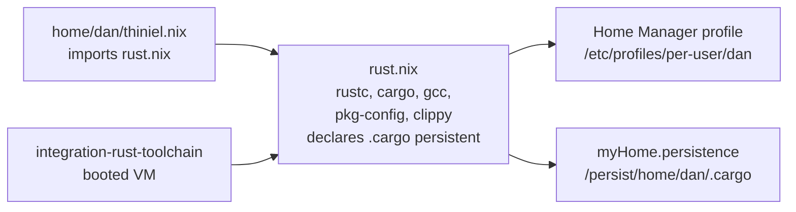

# Design: rust-build-toolchain

## Summary

Add one Home Manager feature module that installs the device's default Rust
toolchain and declares the Cargo home persistent, import it only from the
personal laptop's profile (`home/dan/thiniel.nix`), and prove the behaviour with
host assertions plus a booted VM that creates, builds, runs and lints a Rust
project.

## Use-Case Traceability

| Use-case contract element | Technical decision | Bound verification target |
|---|---|---|
| Rule: a device that builds Rust projects provides one default toolchain (compiler, Cargo, C linker, pkg-config) | Feature module `home/dan/features/development/rust.nix` installs `rustc`, `cargo`, `gcc`, `pkg-config` from the host's package set | `@host:thiniel` (assertion) and `@check:integration-rust-toolchain` (build) |
| Rule: the Cargo home is declared persistent so it survives boots | The same module adds `.cargo` to the user persistence list with `lib.optionalAttrs config.myHome.persistence.enable` | `@host:thiniel` (assertion) |
| Rule: a lint driver belongs to the same toolchain | `clippy` is installed and exercised by the booted build scenario | `@check:integration-rust-toolchain` |
| Interaction: a device builds a Rust project | A VM boots with the module and runs `cargo build`, the produced binary and `cargo clippy` | `@check:integration-rust-toolchain` |
| Capability ownership: `rust-build-toolchain` in `reproduce-working-environment` | New capability in the use-case delta; `thiniel` is the only affected device | `@host:thiniel` |
| Persona: `owner--operator` | The owner develops on `thiniel`; no other Persona is affected | — |

## Technology Decisions

| Decision | Choice | Channel / source | Why |
|---|---|---|---|
| Toolchain source | `pkgs.rustc`, `pkgs.cargo`, `pkgs.clippy` | The host's own package set — `nixpkgs-unstable` for `thiniel` | `thiniel` is built with `nixpkgs-unstable`; `nix eval --raw .#nixosConfigurations.thiniel.pkgs.cargo.version` returns `1.98.1` (observed at review time, 2026-10-17). The Home Manager module receives that same set (`useGlobalPkgs = true`), so `rustc`, `cargo`, `clippy` and the existing `rustfmt` stay on one version. Rejected: a separate stable pin (would make the compiler disagree with the formatter and add a package source for no behavioural gain) and `rustup` (see D1). |
| C build prerequisites | `pkgs.gcc`, `pkgs.pkg-config` | The host's own package set | Cargo's link step invokes a C compiler; `pkg-config` lets `-sys` crates discover system libraries. Neither exists in the laptop's user environment today. |
| Formatter | no new package | — | `formatters.nix` already installs `rustfmt` from the same host set; duplicating it would declare the same concern twice. |
| Module shape | `home/dan/features/development/rust.nix`, plain `home.packages` plus one persistence entry | — | Matches `go.nix`, `nodejs.nix`, `python-tools.nix`; the persistence guard follows `ssh.nix`'s `lib.optionalAttrs config.myHome.persistence.enable` pattern, which does not evaluate the `home.persistence` attribute when the option is off (unlike `lib.mkIf` on an undeclared option). |
| Import scope | imported by `home/dan/thiniel.nix` only | — | The operator asked for `thiniel`; the work MacBook's toolchain is a separate decision. |
| VM guest package set | `unstablePkgs` + `home-manager-unstable` | `nixpkgs-unstable` | The integration test loads a Home Manager module, so Home Manager and the guest package set must share a release (`quiet-configuration-evaluation`, D3). |

## Decisions

- Decides D1: the device's default toolchain comes from the host's package
  set; no `rustup`-managed or project-specific toolchain is installed.
  Realised in `home/dan/features/development/rust.nix` and recorded as out of
  scope in the use-case delta. A project needing another compiler version runs
  in an explicit shell; taking that on stays a separate change.

## Verification Binding

| Scenario title | Binding tag | Bound target (file / check / host) | Targeted run command | Expected RED failure mode |
|---|---|---|---|---|
| The personal laptop provides the Rust compiler and Cargo | `@host:thiniel` | `tests/assertions/thiniel-hm-invariants.nix` → `@host:thiniel` | `nix eval --raw .#nixosConfigurations.thiniel.config.system.build.toplevel.drvPath` | The new assertion names the missing `rustc`/`cargo`/`gcc`/`pkg-config` packages |
| The personal laptop keeps the Cargo home across boots | `@host:thiniel` | `tests/assertions/thiniel-hm-invariants.nix` → `@host:thiniel` | `nix eval --raw .#nixosConfigurations.thiniel.config.system.build.toplevel.drvPath` | The new assertion names the missing `.cargo` persistence entry |
| A booted device builds and runs a Rust project | `@check:integration-rust-toolchain` | `tests/integration/rust-toolchain-test.nix` → flake `checks.integration-rust-toolchain` | `nix build .#checks.$(nix eval --impure --raw --expr builtins.currentSystem).integration-rust-toolchain` | The guest's `cargo`/`cargo-clippy` is absent, so `cargo clippy` reports an unknown subcommand; the check is wired first, with a package-less `rust.nix`, so the RED is a behavioural test failure, not a wiring error |

The persistence scenario is verified as a declaration at evaluation time, the
same way the repository verifies every other impermanence entry (for example
`tests/assertions/thiniel-yazi-invariants.nix`). The mount mechanism itself is
supplied by the impermanence module; a booted persistence test is outside this
change's scope.

## Test Targets Added/Changed

| Target file | Kind | Wired in by | Covers scenarios |
|---|---|---|---|
| `tests/assertions/thiniel-hm-invariants.nix` | assertion | imported by `home/dan/thiniel.nix`, fired on host evaluation | Both `@host:thiniel` scenarios |
| `tests/integration/rust-toolchain-test.nix` | VM (`pkgs.testers.runNixOSTest`) | `tests/integration/default.nix` → flake `checks.<linux-system>.integration-rust-toolchain` | A booted device builds and runs a Rust project |

No unit case is added: the module has no logic beyond a package list and one
persistence entry, and the host assertions read the rendered profile.

## Architecture Impact

- New: `home/dan/features/development/rust.nix` and
  `tests/integration/rust-toolchain-test.nix`.
- Changed: `home/dan/thiniel.nix` (one import),
  `tests/assertions/thiniel-hm-invariants.nix` (assertions),
  `tests/integration/default.nix` (one check entry).
- Untouched: `hosts/thiniel/default.nix`, `hosts/thiniel/hardware.nix`, the
  persistence option module, the Darwin profile, the other Linux hosts.

## Secrets & Safety

- No sops secret is added, read or rendered.
- `system.stateVersion` and `home.stateVersion` are not changed.
- `hosts/thiniel/hardware.nix` is not modified.
- The change adds one directory to the user persistence list; it removes
  nothing and binds no system-critical path.
- The integration test carries no secret and no network dependency: the built
  project has no external crates and is built with `--offline`.

## Deployment & Rollback

The change touches the user persistence list (impermanence), so this section is
mandatory.

- **Apply command:** `sudo nixos-rebuild switch --flake .#thiniel` on the
  laptop (the host's `nrs` alias). Applying with `switch` (not `boot`) first
  lets activation create the persistent source directory before a boot would
  mount it.
- **On-host verification:** `cargo --version`, `rustc --version`,
  `clippy-driver --version`, `gcc --version` and `pkg-config --version`
  resolve; `cargo new --vcs none /tmp/hello && cd /tmp/hello && cargo build && ./target/debug/hello`
  prints `Hello, world!`; `findmnt /home/dan/.cargo` shows
  `/persist/home/dan/.cargo` as the source.
- **Rollback:** `sudo nixos-rebuild switch --rollback` on the laptop (or boot
  the previous generation from systemd-boot). Removing the module import and
  applying again leaves `/persist/home/dan/.cargo` on disk; it can be deleted by
  hand.
- **Risk:** the persistence entry adds a system-level mount unit and activation
  entry for `/home/dan/.cargo`, so the system generation changes as well as the
  user profile. A failure affects that bind, not the boot chain; `nixos-rebuild test`
  first is available via `nrt`, and the previous generation remains bootable.

## Blast Radius

Only `thiniel`'s Home Manager profile imports the module, so no other host
gains the toolchain. The new assertions live in `thiniel-hm-invariants.nix`,
which is scoped by being imported from `home/dan/thiniel.nix` only (it has no
host-name guard and does not need one). The persistence entry is consumed by
the impermanence module, which generates a mount unit and activation entry for
`/home/dan/.cargo`; that is a system-generation change, recoverable through the
previous generation. No boot, network or secret path is touched. Persisted
`~/.cargo/bin` content from earlier manual installs stays on the persistent
volume and is reachable on `sessionPath`; it is listed as a risk in chapter 11.

## Local Runnability

The booted check runs locally on a Linux host with KVM:
`nix build .#checks.x86_64-linux.integration-rust-toolchain`. The check boots
`pkgs.testers.runNixOSTest` with `home-manager-unstable`, so it does not
depend on the laptop being reachable.

## arc42 chapter impact

- `docs/arc42/02-architecture-constraints.md`: the import count for `thiniel`.
- `docs/arc42/05-building-block-view.md`: feature-module and host-import
  counts, the `development/` inventory, a Level-3 entry for the Rust toolchain
  module, and the integration-test inventory.
- `docs/arc42/07-deployment-view.md`: the `thiniel` property table names the
  Rust build toolchain, and the state-model/risk wording reflects the mount
  unit.
- `docs/arc42/11-risks-and-technical-debt.md`: risk for persisted
  `~/.cargo/bin` state.
- `docs/arc42/12-glossary.md`: a "Rust build toolchain" term, and the new
  `integration-rust-toolchain` check in the check inventory.

## Open Technical Questions

None. The only product decision (D1) is resolved above.
