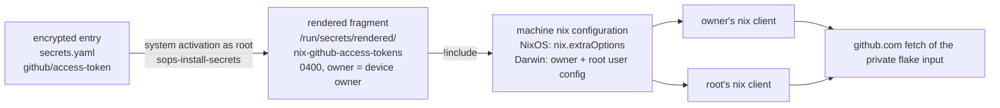

# Design: github-fetch-credential

## Summary

The GitHub credential becomes a declared, per-machine secret that nix reads from
a rendered file instead of from a hand-exported environment variable:

- each build machine declares the credential as secret material in its own
  SOPS file (`github/access-token`);
- sops-nix renders a one-line nix configuration fragment
  (`access-tokens = github.com=<value>`) into a file that is owned by the device
  owner with mode `0400`, so only that account and root can read it;
- the machine's nix configuration *includes* that file, so every nix client on
  the machine — the owner's shells and agents, and root's build and switch
  commands — presents the credential with nothing prepared by hand;
- no host that is not a development or build machine declares any of it.

The render layer differs by platform, for evidence-based reasons: on the Linux
build machine the fragment is written by **system** activation (no session, no
login, available from the first boot), while the work MacBook keeps the
home-manager-level rendering that machine already uses for its other
credentials, because nix-darwin does not manage `nix.conf` there.

## Use-Case Traceability

| Use-case contract element | Technical decision | Bound verification target |
|---|---|---|
| `reproduce-working-environment` goal: the owner resumes usual work on the selected device | the device's own builds and updates resolve the private source without operator preparation | `@host:thiniel`, `@host:J6G6Y9JK7L` |
| Main flow 2: "System establishes needed source/identity access without broadening rights or exposing raw secret material" | the value is decrypted at activation only, rendered to a runtime file (never a store path), mode `0400`, and read through a nix configuration include; the value is never a configuration literal | `@e2e @check:integration-github-fetch-credential` (VM boot) |
| Rule: a device presents only the credential it declares; a device that declares none presents none | per-host opt-in (`mySystem.githubFetchCredential.enable` on NixOS; explicit declarations on the Mac), default off; no shared default declaration | `@host:adlerkopf` (exclusion) |
| Rule: the credential is recorded only encrypted | the per-machine `secrets.yaml` entries; the existing guard refuses unencrypted secrets; the test fixture records no key at all | `@check:private-data-hygiene` (existing, unchanged) |
| Persona impact | `owner--operator` only: the owner's own machines and the credential they present. `family--application-user` is unaffected — no hosted application, shared resource, or access path changes. | n/a |

## Technology Decisions

| Decision | Choice | Channel / source | Why |
|---|---|---|---|
| Secret store and decryption | `sops-nix` (`sops.secrets` + `sops.templates`), from the flake's existing `sops-nix` input | existing pin in `flake.lock` (no version written here) | the repository's only secret mechanism; templates render a file from a decrypted placeholder without exposing the value to evaluation |
| Where the credential lives at rest | one encrypted entry per build machine: `hosts/thiniel/secrets.yaml`, `hosts/J6G6Y9JK7L/secrets.yaml`, key `github/access-token` | `.sops.yaml` creation rules already map these paths (thiniel → `&dan_linux`, the Mac → `&dan`) | this class of credential is already recorded this way (`context7/api-key`, `kagi/api-key`) |
| What nix reads | a rendered fragment `access-tokens = github.com=<value>`, mode `0400`, owned by the device owner | `sops.templates` (NixOS: system activation; Darwin: the owner's session) | `access-tokens` is nix's documented mechanism for the `github:` fetcher; the fragment keeps the value out of every evaluation-time file |
| Reusable surface (Linux) | `modules/nixos/github-fetch-credential` — `mySystem.githubFetchCredential.{enable,user}` (default `false`) | nixpkgs-26.05 module system (no new dependency) | one place declares the key name, the rendered path and the include; the option surface is also what makes the exclusion scenario provable (see Verification Binding). The pair is imported by `hosts/common/global/default.nix`, so **every** NixOS host has the option — required, because the exclusion assertion on `adlerkopf` reads it — while the default `false` means importing it declares nothing; the Mac imports nothing from `hosts/common`. |
| How nix learns of it (Linux) | `nix.extraOptions = "!include /run/secrets/rendered/nix-github-access-tokens"` | NixOS `nix.extraOptions` (the generated `/etc/nix/nix.conf`) | reaches root's client and the owner's client from one declaration; `!include` tolerates a missing or unreadable file (verified: exit 0 for both), so a not-yet-rendered credential cannot break a client |
| How nix learns of it (Darwin) | the owner's user configuration file plus root's, both containing the same include | home-manager `xdg.configFile."nix/nix.conf"` and a nix-darwin activation script | nix-darwin does not manage `nix.conf` on that machine (see "Darwin injection point") |
| Render layer (Linux) | system-level template rendered by system activation as root | sops-nix NixOS module (`sops.templates`) | the file exists from the first boot, before any login, so root's build works immediately and the booted VM check can reach it; no `linger`/session dependency |
| Render layer (Darwin) | home-manager-level secret and template (the machine's existing pattern) | sops-nix home-manager module | that machine already renders its `git/*`, `context7` and `kagi` credentials this way; the darwin-level module writes into `/run`, which is not exercised anywhere upstream |
| Test fixture | a build-time derivation that generates a fresh test key pair and a SOPS file encrypted to it, plus an ordered tmpfiles copy of the key into the guest | `pkgs.sops`, `pkgs.age` (already in the pinned set) | the repository's secret scanners must stay strict: a recorded private key (`AGE-SECRET-KEY-1…`) is refused by the repository's own gitleaks rules, so no key is recorded |

Version freshness: this change introduces **no package, kernel, or channel
choice**. `sops-nix`, `home-manager`, `nixpkgs` and `gitleaks` are the
repository's existing inputs and resolve through `flake.lock`; nothing
version-bearing is written from memory.

### Rejected alternatives

1. **`nix.settings.access-tokens = [ "github.com=<value>" ]`.** The value would
   be interpolated into the generated `/etc/nix/nix.conf`, i.e. into a
   world-readable file and a store path. Rejected: it publishes the credential
   to every local account and into the store.
2. **The session environment variable (today's shape).** `NIX_CONFIG` set by a
   shell: visible in `/proc/<pid>/environ`, absent for root's `sudo` invocation,
   absent after a root wipe, and performed by hand every session. Rejected by
   the approved reach decision (D1).
3. **`netrc-file`.** Nix's `github:` fetcher resolves a reference through the
   GitHub API, which uses `access-tokens`; a netrc file covers HTTP basic auth
   only, so a private `github:` input still fails to resolve. Rejected.
4. **A root-owned file made readable through an existing group.** On the Linux
   build machine there is no group that contains only the owner: `dan`'s group
   is `users`, and the deliberate `test` account is a normal user (`users`) with
   `extraGroups = [ "wheel" ]`; on macOS every standard account shares `staff`.
   Any of those groups hands the credential to a second account. Rejected.
5. **Appending the include to the Mac's `/etc/nix/nix.conf`.** Nix-darwin does
   not manage that file there (`nix.enable = false`, because Determinate Nix
   owns it), so the change would depend on a foreign tool's file layout and
   could be reverted silently by that tool. Rejected in favour of the
   user-level configuration files.
6. **Home-manager-level rendering on the Linux build machine.** That is what the
   MacBook does, but on Linux the home-manager sops module renders from a
   *user* systemd unit which starts with the user's session: the file would be
   absent on a freshly booted machine until the owner logs in, so root's
   `nixos-rebuild` would still fetch unauthenticated — exactly the case D1
   selected option 2 to remove. Rejected for thiniel; system activation renders
   before any login.
7. **A committed test key for the VM fixture** (the shape sops-nix ships in its
   own `test-assets`). This repository runs gitleaks in pre-commit and in CI and
   its default rules include `age-secret-key`, so a recorded
   `AGE-SECRET-KEY-1…` fails the repository's own scan. Rejected: the fixture
   generates its key at build time instead, and no allowlist weakens the scan.
8. **A wrapper function that exports `NIX_CONFIG` from the rendered file.**
   Same environment-variable objections as (2), and it covers interactive shells
   only. Rejected.

### Darwin injection point

`hosts/J6G6Y9JK7L/default.nix` sets `nix.enable = false` — nix-darwin does not
manage `/etc/nix/nix.conf` on that machine, so `nix.extraOptions` is inert there
and Determinate Nix remains the owner of the system file. The include therefore
reaches nix through the two user-level configuration files that nix reads in
every client, including root's:

- the owner's `<home>/.config/nix/nix.conf` — rendered by home-manager
  (`xdg.configFile."nix/nix.conf"`); verified locally that nix reads this file:
  a temporary `~/.config/nix/nix.conf` changed `nix config show`, and removing it
  reverted the value;
- root's `/var/root/.config/nix/nix.conf` — written by a new nix-darwin
  activation script, because `sudo darwin-rebuild switch` fetches the private
  input with root's client.

Root also reads the owner's file when macOS `sudo` preserves `HOME`; writing
root's own file makes the outcome independent of that detail (O1).

The credential file itself on that machine is the home-manager-rendered one
(`~/.config/sops-nix/secrets/rendered/nix-github-access-tokens`, mode `0400`,
owner = the owner), which exists once the owner's session has rendered it. A
root build before that first session fetches unauthenticated rather than
failing; chapter 11 records the residual behaviour (R-029).

The declaration site follows the render layer: `sops.secrets` and
`sops.templates` are declared in `home/dan/J6G6Y9JK7L.nix`, because that
machine's configuration imports only `sops-nix.homeManagerModules.sops` (in the
flake's `sharedModules`) and no nix-darwin sops module — a `sops.*` declaration
in the host module would be an unknown option. The host module carries only the
activation script that writes root's user configuration; it needs no secret
material of its own.

## Decisions

- **Decides D1** (proposal: how far the credential reaches): the whole device,
  restricted to the machines that develop and build this configuration — the
  laptop thiniel and the work MacBook. Realized by the per-host opt-ins
  (`hosts/thiniel/default.nix` for the Linux side; `hosts/J6G6Y9JK7L/default.nix`
  and `home/dan/J6G6Y9JK7L.nix` for the Mac) and by the include reaching both
  clients on each machine. On thiniel the fragment is rendered by system
  activation, so root's reach does not depend on the owner being logged in.
- **Decides D2** (proposal: the repository's evaluation that cannot fetch its
  own input): not decided here — carried with owner *the operator*, to a later
  change or a GitHub settings action. The `secret-scan` workflow keeps failing
  until then (R-027).
- **Decides D3 partly** (proposal: one credential or one per machine): the
  design fixes the secret key name (`github/access-token`), the two secret files
  that carry it, and the rendered path; which token value is used (the existing
  fine-grained token, a new shared one, or one per machine) stays the
  operator's choice when the value is encrypted. The design is independent of
  that choice.
- **Decides the custody refinement** (recorded in `proposal.md`, "Proposed
  Solution", custody bullet: "The file belongs to the owner's own account with
  mode 0400 and root reads it by privilege"): the file is owner-owned with mode
  `0400` on both machines and root reads it by privilege. Rationale: neither
  machine has a group containing only the owner (rejected alternative 4), so a
  root-owned file readable by the owner alone cannot be expressed on both
  platforms; root's read access is a privilege fact, not a mode. The invariant
  that matters — *no account other than root and the device owner can read it* —
  holds and is asserted.

## Verification Binding

One row per scenario in
`givn/changes/github-fetch-credential/specs/reproduce-working-environment/github-fetch-credential.feature`.

| Scenario title | Binding tag | Bound target (file / check / host) | Targeted run command | Expected RED failure mode |
|---|---|---|---|---|
| The laptop declares the credential it presents to the GitHub host | `@host:thiniel` | `tests/assertions/thiniel-invariants.nix` (NixOS level, aggregated by `tests/assertions/default.nix`, imported by `hosts/thiniel/default.nix`): `mySystem.githubFetchCredential.enable`, the declared secret, the template's owner/mode/path, and the `nix.extraOptions` include naming that path | `nix eval --raw .#nixosConfigurations.thiniel.config.system.build.toplevel.drvPath` | evaluation error: `mySystem.githubFetchCredential` does not exist on the current revision, so the assertion module cannot be written against it; after the module exists it is a named assertion failure until the host opts in |
| The work MacBook declares the credential it presents to the GitHub host | `@host:J6G6Y9JK7L` | `tests/assertions/J6G6Y9JK7L-invariants.nix` (home-manager level, imported by `home/dan/J6G6Y9JK7L.nix`: declared secret, template owner/mode/path, the owner's `nix/nix.conf` include) and `tests/assertions/J6G6Y9JK7L-darwin-invariants.nix` (darwin level, imported by `hosts/J6G6Y9JK7L/default.nix`: the activation script that writes root's configuration exists and names the same rendered path) | `nix eval --raw .#darwinConfigurations.J6G6Y9JK7L.config.system.build.toplevel.drvPath` | named assertion failure: the Mac declares no GitHub fetch credential, no template, and no include on the current revision |
| A host that does not build this configuration declares no credential | `@host:adlerkopf` | `tests/assertions/adlerkopf-invariants.nix` (aggregated by `tests/assertions/default.nix`) | `nix eval --raw .#nixosConfigurations.adlerkopf.config.system.build.toplevel.drvPath` | evaluation error: the assertion reads `config.mySystem.githubFetchCredential.enable`, and the option does not exist before the change; after it exists, the assertion holds because the host does not opt in |
| A booted device materialises the declared credential and presents it to the GitHub host | `@e2e @check:integration-github-fetch-credential` | `tests/integration/github-fetch-credential-test.nix`, wired as `checks.integration-github-fetch-credential` | `nix build .#checks.$(nix eval --impure --raw --expr builtins.currentSystem).integration-github-fetch-credential` | the check does not exist on the current revision (`nix build` fails to resolve the attribute); after wiring, the boot assertions fail until the module renders the fragment and the include |

The exclusion scenario's RED is the *declaration surface* being absent, which is
the honest cause: "this host declares none" only becomes checkable once a host
can declare one. No target asserts a behaviour it cannot reach.

The `givn lint` shape advisory on the two per-host scenarios is **accepted**
deliberately: each device's assertion lives in its own assertion module, which is
how this repository proves per-host configuration, and the existing permanent
spec (`permitted-identity-selection`, `current-agent-tooling`,
`managed-file-displacement`) uses the same per-device shape.

## Test Targets Added/Changed

| Target file | Kind | Wired in by | Covers scenarios |
|---|---|---|---|
| `tests/assertions/thiniel-invariants.nix` | assertion (NixOS) | aggregated by `tests/assertions/default.nix`; host evaluation fires it | laptop |
| `tests/assertions/J6G6Y9JK7L-invariants.nix` | assertion (home-manager) | imported by `home/dan/J6G6Y9JK7L.nix` | MacBook |
| `tests/assertions/J6G6Y9JK7L-darwin-invariants.nix` | assertion (darwin) | imported by `hosts/J6G6Y9JK7L/default.nix` | MacBook |
| `tests/assertions/adlerkopf-invariants.nix` | assertion (NixOS) | aggregated by `tests/assertions/default.nix` | exclusion |
| `tests/integration/github-fetch-credential-test.nix` | VM (`pkgs.testers.runNixOSTest`), including its build-time fixture derivation | `tests/integration/default.nix` → flake `checks.integration-github-fetch-credential` | boot |

The VM test follows the shape of
`tests/integration/private-data-separation-test.nix` — it loads no Home Manager
module, so it uses the plain host package set and asserts no Home Manager
release pairing — and it exercises the **Linux** shape, the same one thiniel
uses:

1. a build-time derivation (`pkgs.runCommand` with `pkgs.age` and `pkgs.sops`)
   generates a fresh age key pair, encrypts a dummy YAML value to it, and
   publishes `secrets.yaml` and `keys.txt` **in the store, not in the
   repository**;
2. the guest declares the credential through the module
   (`mySystem.githubFetchCredential.enable`), sets
   `sops.defaultSopsFile` to the derivation's `secrets.yaml`, and sets
   `sops.age.keyFile` to a runtime path; an ordered
   `systemd.tmpfiles.rules` entry copies the key from the derivation into that
   path before the sops service runs, so system activation succeeds on the first
   boot without a user session;
3. `virtualisation.additionalPaths` carries the fixture into the guest's store;
4. the test asserts: the fragment exists at the declared path, mode `0400`,
   owner = the declared account; `nix config show` reports
   `github.com=<fixture value>` for that account **and for root** with nothing
   prepared in the environment; a second, unprivileged account cannot read the
   file (`cat` fails); and the value appears in no configuration file on the
   machine (`/etc/nix/nix.conf`, the owner's user configuration) and nowhere
   outside the runtime secret directory — the check ignores the fixture's own
   store paths, which necessarily carry the dummy value.

Known cost of that fixture: the derivation is not bit-reproducible (a fresh key
pair and a fresh ciphertext per build). Accepted deliberately, because the
alternative — a committed test key — is refused by the repository's own gitleaks
scan (rejected alternative 7). Recorded as TD-016.

## Architecture Impact

New:

- `modules/nixos/github-fetch-credential/options.nix` —
  `mySystem.githubFetchCredential.enable` (bool, default `false`) and `.user`
  (string, the account that must be able to read the fragment).
- `modules/nixos/github-fetch-credential/default.nix` — when enabled: declares
  `sops.secrets."github/access-token"`; renders
  `sops.templates."nix-github-access-tokens"` (`content =
  "access-tokens = github.com=<placeholder>"`, `owner = cfg.user`, `mode =
  "0400"`); appends the include to `nix.extraOptions`.
- `tests/integration/github-fetch-credential-test.nix` and its fixture
  derivation.
- No new overlay, no new package, no new flake input and no option pair for
  Darwin: that machine declares its pieces in its home profile (secret and
  template) and its host module (the root-side activation script), the way it
  declares its other secrets.

Changed:

- `hosts/common/global/default.nix` — imports the new option pair, so every
  NixOS host has `mySystem.githubFetchCredential` (default `false` declares
  nothing) and the exclusion assertion on `adlerkopf` resolves.
- `hosts/thiniel/default.nix` — opts in (one line; the module arrives through
  the shared global import).
- `home/dan/J6G6Y9JK7L.nix` — declares the sops secret and template and the
  owner's `nix/nix.conf` include.
- `hosts/J6G6Y9JK7L/default.nix` — the activation script that writes root's user
  configuration (no secret material of its own).
- `tests/assertions/{thiniel-invariants,J6G6Y9JK7L-invariants,J6G6Y9JK7L-darwin-invariants,adlerkopf-invariants}.nix`
  — the new invariants.
- `tests/integration/default.nix`, `flake.nix` — wire the new check.

Unchanged: every other host profile and every other host module, `hardware.nix`,
`stateVersion`, `.sops.yaml` (both creation rules already cover the two files),
`.pre-commit-config.yaml` and the gitleaks configuration (no allowlist is
needed).

## Secrets & Safety

- **sops key**: `github/access-token`, declared in
  `hosts/thiniel/secrets.yaml` and `hosts/J6G6Y9JK7L/secrets.yaml`, both already
  covered by `.sops.yaml` (`&dan_linux` and `&dan`). No `.sops.yaml` change.
- **Rendered fragment**: `/run/secrets/rendered/nix-github-access-tokens`
  (system level, thiniel) and
  `~/.config/sops-nix/secrets/rendered/nix-github-access-tokens` (home-manager
  level, MacBook), content `access-tokens = github.com=<value>`, mode `0400`,
  owner = the device owner. Both live in runtime secret directories that are
  re-created at activation, never in a store path.
- **Why an owner-scoped system template is readable**: the sops-nix installer
  creates `/run/secrets.d/<generation>` and its secret parent directories with
  mode `0751`, so a non-root account can traverse to a file it owns; the file
  itself is `0400`, so no other account can read it (verified in the pinned
  installer source, `pkgs/sops-install-secrets/main.go`).
- **No secret in evaluation**: no option value, template literal, or generated
  `nix.conf` carries the token; the include names a path only.
- **No recorded test key**: the VM fixture's key pair is generated inside a
  derivation, so the repository's gitleaks rules and the hygiene guard both stay
  strict; nothing about the fixture is recorded in the repository.
- **Operator-only step**: the value is added to the two encrypted files with
  `sops` (human-only in this repository); until then the fragment is absent and
  `!include` leaves nix working unauthenticated rather than broken.
- **`stateVersion` invariants**: neither `system.stateVersion` nor
  `home.stateVersion` changes.
- **`hardware.nix`**: untouched.
- **Recorded risk left open**: the plaintext token file
  (`~/.secret/github-token`, mode 0644) stays outside this change; removing it
  and rotating the exposed value are the operator's actions, tracked in
  `ROTATION-TODO.md` (R-026).

## Local Runnability

- **Evaluate everything**: `nix flake check --no-build --no-write-lock-file`
  (the `verify.command` runner does this plus the assertion sweep).
- **Build a host**: `nixos-rebuild build --flake .#thiniel`.
- **Targeted scenario runs**: the commands in the binding table above.
- **VM boot**: `nix build .#checks.x86_64-linux.integration-github-fetch-credential`
  boots locally on the Linux builder (KVM); this is the `@e2e` evidence, and it
  needs no user session because the Linux shape renders at system activation.
- **Darwin**: the work MacBook's configuration is *evaluated* from any machine
  (`nix eval --raw .#darwinConfigurations.J6G6Y9JK7L.config.system.build.toplevel.drvPath`);
  it cannot be *built* off macOS. No `@e2e` scenario depends on that host: the
  real materialisation is proven by the VM boot on Linux, and the Mac's own
  runtime state is confirmed on the machine (below).
- **Anticipated obstacles and their fixes**:
  - the VM needs a decryptable secret without recording a key → build-time
    fixture derivation + a tmpfiles copy of the key before the sops service
    (above);
  - the guest must be able to reach the fixture path → `virtualisation.additionalPaths`;
  - `sops` is human-only → the value is an operator step, listed in the task
    list rather than performed by an agent;
  - the include must not break clients that cannot read the file → `!include`
    (verified: missing and unreadable both leave exit status 0).

## Deployment & Rollback

Dangerous area: secret wiring. The change is reversible by generation selection,
and the include fails soft.

- **Operator step first** (per machine):
  `sops hosts/thiniel/secrets.yaml` and `sops hosts/J6G6Y9JK7L/secrets.yaml`,
  adding `github/access-token: <value>`. Deploying before this makes activation
  fail on the missing key.
- **Apply**:
  - laptop: `sudo nixos-rebuild switch --flake ~/Projects/nix-config`
    (the `nrs` alias on thiniel);
  - MacBook: `sudo darwin-rebuild switch --flake ~/dev/PRIVATE/nix-config`
    (the `drs` alias).
- **On-host verification**:
  - laptop: `ls -l /run/secrets/rendered/nix-github-access-tokens` → mode
    `-r--------`, owner `dan`;
  - MacBook: `ls -l ~/.config/sops-nix/secrets/rendered/nix-github-access-tokens`
    → same shape, after the owner's session has rendered it;
  - both: `nix config show | grep access-tokens` as the owner and as root → the
    credential for `github.com`, with no environment prepared;
  - both: `nix flake metadata github:kressnerd/givn` as the owner and as root in
    a shell without `NIX_CONFIG` → resolves instead of answering "not found";
  - MacBook only: `sudo cat /var/root/.config/nix/nix.conf` → the include line.
- **Rollback**:
  - laptop: `sudo nixos-rebuild switch --rollback` (or boot the previous
    generation from the systemd-boot menu);
  - MacBook: `sudo darwin-rebuild switch --rollback`;
  - the include is additive and `!include`-tolerant, so a rolled-back or
    partially applied state leaves nix working.

## Blast Radius

- **Hosts**: the laptop thiniel and the work MacBook. No other host changes.
- **What can break**: a malformed rendered fragment would break the clients that
  can read it (owner and root) — all nix invocations on that machine — and is
  recoverable by `--rollback`/generation selection. A missing or unreadable
  fragment does *not* break anything: `!include` tolerates it, so the `test`
  account and any other account keep running nix unchanged, and a machine whose
  secret is not yet rendered builds unauthenticated exactly as today.
- **Timing difference**: on the laptop the fragment exists from the first boot
  (system activation); on the MacBook it exists once the owner's session has
  rendered it, so a root build on a freshly booted, not-yet-logged-in Mac fetches
  unauthenticated (R-029).
- **Blast-radius limiter**: the credential is read from a file, never from a
  configuration literal, so no store path, no generated `nix.conf`, and no
  process environment carries the value.
- **Detection**: the VM check fails loudly on the boot path; the assertion sweep
  fails the host evaluation on a missing or mismatched declaration.

## arc42 chapter impact

Chapters affected and updated by this change (see `arc42.md` for the full
twelve-row assessment and the ADR qualification verdict):

- **Chapter 5 (building block view)** — the new NixOS option pair, the two
  opting-in machines, the seventh integration check and its fixture.
- **Chapter 6 (runtime view)** — the new credential-supply scenario.
- **Chapter 8 (cross-cutting concepts)** — the new "GitHub fetch credential"
  concept (where a credential may enter the system, the reach, the custody
  invariant, and the platform difference in the render layer).
- **Chapter 9 (architecture decisions)** — one candidate row; no ADR.
- **Chapter 10 (quality requirements)** — QS-017.
- **Chapter 11 (risks and technical debt)** — R-026 to R-029 and TD-016.
- **Chapter 12 (glossary)** — the term *GitHub fetch credential*.

Chapters 1, 2, 3, 4 and 7 are unchanged.

## Open Technical Questions

- **O1 — macOS `sudo` and `HOME`.** Whether root's client reads
  `/var/root/.config/nix/nix.conf` or the owner's file depends on whether macOS
  `sudo` resets `HOME`. Both are covered (root's file is written explicitly), so
  this is a confirmation, not a blocker: check
  `sudo cat /var/root/.config/nix/nix.conf` and `sudo printenv HOME` on the
  MacBook.
- **O2 — Determinate Nix drop-ins.** If Determinate Nix offers a supported
  drop-in location or include mechanism for `/etc/nix/nix.conf`, the Mac's
  root-side activation script could be replaced by it. Not required for the
  outcome; revisit only if the activation script proves fragile across
  Determinate upgrades.
- **O3 — Fixture reproducibility.** The VM fixture's derivation produces a fresh
  key pair and ciphertext per build (TD-016). Accepted because every
  deterministic alternative records key material that the repository's scanners
  refuse; if bit-reproducibility is later required, the fixture can be generated
  once by the operator into the private flake instead.
