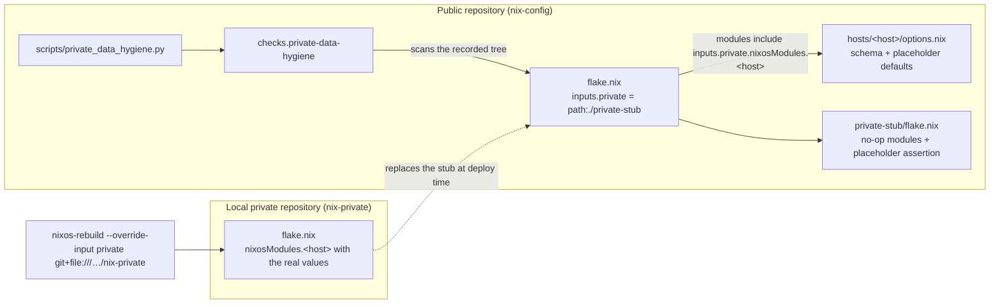

# Design: private-data-remediation

## Overview

The repository keeps its public schema (the option declarations) and gains
documentation-range defaults; the operator's real operational values move out of
the repository into a separate private flake. The public flake declares an
overridable `private` input whose default is an in-tree stub, so `nix flake
check` and CI evaluate with zero private access; the operator's deploy commands
override that input with the private flake. A guard refuses any revision that
would record an operational value, a per-host private-value file, or an
unencrypted secret. The values already recorded in history are removed by a
one-time rewrite the operator runs.

**The forcing constraint.** When a flake lives in a git worktree, `nix flake
check`, `nix build .` and `nixos-rebuild --flake` evaluate through a `git+file://`
source that only sees files in the git index. A gitignored `private.nix` is
therefore invisible to the evaluator the moment it is untracked — every host
build fails with `path '…/private.nix' does not exist`. Values cannot come from
a gitignored file; they must come from an input the evaluator can see and the
operator can override.

Affected hosts: `adlerkopf` and `cupix001` (the two hosts that import a per-host
private file). `thiniel`, `nixos-vm-minimal` and `J6G6Y9JK7L` carry no private
network values and are untouched.

Current state (verified 2026-10-12): `private.md` is already untracked; both
`hosts/*/private.nix` are present in the index as template copies; the host
imports still name `./private.nix`; `flake.nix` has no `private` input;
`hosts/adlerkopf/options.nix` still carries the real LAN values; `nix flake
check` passes today only because the private files sit in the index. There is no
pre-commit configuration and no CI workflow.

## Use-Case Traceability

Owning use-case ID: `publish-infrastructure-configuration` (new; introduced by
this change — see the change's `specs/publish-infrastructure-configuration/usecase.md`)
Confirmed Persona IDs: `owner--operator` — the operator publishes the repository
and deploys the hosts; only the operator evaluates whether both hold.
`family--application-user` is not affected: no hosted application, access path or
shared resource changes.

| Use-case contract element | Technical decision | Bound verification target |
|---|---|---|
| Rule: "Operational values never live in the public repository" | Values come from the `private` flake input; the recorded content and the history carry none | `@check:private-data-hygiene` |
| Rule: "The host network defaults are documentation-range placeholders. A missing private value fails loudly" | `hosts/adlerkopf/options.nix` defaults become RFC 5737 / generic RFC 1918; the stub asserts the placeholders. A forgotten override is *not* caught by evaluation (the stub and a clean clone are the same evaluation) — it is caught by the deploy preflight | `@check:private-data-defaults`; the stub assertion fires in the `verify.command` suite; preflight (process control, see Deployment & Rollback) |
| Rule: "A revision that would record an operational value, a per-host private-value file, or an unencrypted secret is refused, both before it leaves the operator's machine and on CI" | `scripts/private_data_hygiene.py`, run by the flake check, `.pre-commit-config.yaml` and `.github/workflows/secret-scan.yml` | `@check:private-data-hygiene` for the rule; the hook and CI wiring is an unverifiable process control (see below) |
| Main flow 1: "supplies a host's operational values from outside the repository; System builds and deploys that host with exactly those values" | `inputs.private` overridden with `git+file:///home/dan/dev/PRIVATE/nix-private`; the host's `systemd.network` consumes the supplied values | `@e2e @check:integration-private-data-separation` |
| Main flow 4: "a checkout that evaluates and passes its checks without any private value" | the stub is the default `private` input, so a clean clone and CI evaluate with placeholders | `@check:private-data-defaults`, `@check:private-data-hygiene` |
| Main flow 5: "the published history records no operational value" | one-time `git filter-repo` rewrite, run by the operator; a task with operator confirmation, not a repository check (no native target can read git history) | task acceptance (operator), see D2 |
| Capability ownership: `operational-data-separation` | `private-stub/`, the `private` input wiring, `scripts/private_data_hygiene.py`, the placeholder defaults, the sanitized documents | all five scenarios |

## Technology Decisions

| Decision | Choice | Channel / source | Why |
|---|---|---|---|
| How the public flake obtains private values | flake input `private`, default `path:./private-stub`, overridden at deploy with `--override-input private git+file:///home/dan/dev/PRIVATE/nix-private` | nix flakes (no package) | The `git+file://` visibility rule makes a gitignored file unusable; an input is visible to the evaluator and overridable per command. The public `flake.lock` records only the stub path (`./private-stub`), never the private flake's URL, so the lock discloses no private location. |
| The public fallback | `private-stub/flake.nix` exporting `nixosModules.adlerkopf` and `nixosModules.cupix001`; each module asserts the host's declared network values are documentation-range placeholders or empty | in-tree flake | A clean clone and CI must evaluate with zero private access; the assertion makes the fallback provably non-operational and guards the *defaults*. It does **not** detect a forgotten override — the stub evaluation is identical in both cases. |
| Forgotten-override guard | the per-host rebuild alias becomes a preflight that evaluates the host with the override and refuses to deploy when the network values are documentation-range or empty | nix (no package) | Operator decision 2026-10-12: evaluation cannot distinguish a clean clone from a forgotten override, so the guard must sit in the deploy path, before anything is built or applied. |
| Guard value rule | a list of regular expressions for the operator's operational classes — the home-LAN subnet, the WireGuard subnet, the hosting-provider resolver pattern, the edge host's public addresses and hardware address, and the non-standard SSH port — plus structural rules: any recorded `hosts/*/private.nix`/`private.md`, a `./private.nix` entry in a host `imports` list, and any `secrets.y[a]ml` without SOPS metadata and ciphertext values | `python3` from the flake's `nixpkgs` pin | "Any operational value" cannot be a general predicate; the rule matches value *classes* so a new address inside a covered class is caught, and the negative fixture uses an in-class value that is not any literal currently in the tree. |
| Where the real values live | a separate local git repository `~/dev/PRIVATE/nix-private` holding `nixosModules.<host>` with the real values; never pushed to a public remote | local git repo | Keeps the values out of the public repository and out of its history; one repository serves every host. |
| Guard implementation | `scripts/private_data_hygiene.py`, Python standard library only | `python3` from the flake's `nixpkgs` pin | One implementation reused by the flake check, the pre-commit hook and CI. Standard library only, so no new dependency and no `yaml` module (the secret rule is line-based, not YAML-parsed). |
| Guard enforcement points | flake check `private-data-hygiene` (recorded tree); `.pre-commit-config.yaml` (staged paths + `gitleaks`); `.github/workflows/secret-scan.yml` (`nix flake check` + `gitleaks`) | `python3`, `gitleaks` from the flake's `nixpkgs` pin | The proposal requires enforcement before a change leaves the machine and on CI. `gitleaks` adds entropy-based detection; the guard adds the project-specific rules. |
| Placeholder defaults | `hosts/adlerkopf/options.nix`: `lanIPv4` `192.0.2.10`, `gateway4` `192.0.2.1` (RFC 5737 TEST-NET-1), `wgSubnet` `10.0.0.0/24`, `wgServerIPv4` `10.0.0.1` (generic RFC 1918); `interfaceName`, `lanPrefix`, `wgListenPort`, `dns` unchanged (already non-operational) | `nixpkgs` pin | The public default must not identify the network. `hosts/cupix001/options.nix` already defaults to empty strings and needs no change. |
| Document sanitization | replace every operational literal in the affected documents with a documentation-range placeholder; keep the plan document unrecorded | — | See "Document sanitization" below. |

No decision in this change depends on a package version; every tool comes from
the flake's `nixpkgs` pin, which resolves the exact version.

### Document sanitization

Operational literals to remove from recorded documents (verified by
`git grep` on 2026-10-12):

| Literal class | Files |
|---|---|
| the home-LAN /24 (the guard's `home-LAN subnet` class) | `hosts/adlerkopf/options.nix`, `docs/ADLERKOPF-DEPLOY-RUNBOOK.md`, `docs/arc42/07-deployment-view.md`, `docs/plans/adlerkopf/{00-index,01-base-os,02-adguard,03-wireguard,04-mosquitto,05-node-red,06-grafana,X-cross-cutting,risks}.md`, `docs/plans/fix-private-nix-flake-plan.md` |
| the WireGuard /24 (`WireGuard subnet`) | `docs/edge-all.md`, `docs/plans/adlerkopf/03-wireguard.md`, `docs/plans/cupix001/05-wireguard.md`, `docs/plans/cupix001/13-colmena.md`, `.claude/skills/network-security/SKILL.md`, `.opencode/skills/network-security/SKILL.md`, `.roo/skills/network-security/SKILL.md` |
| the non-standard SSH port (`non-standard SSH port`) | `.roo/rules/10-nix-senior-admin.md`, `docs/edge-all.md`, `docs/plans/cupix001/{01-foundation,06-ssh-hardening,15b-netcup-firewall-ssh-and-policies,epic1-architecture-review}.md`, `scripts/README.md`, `scripts/tests/test_netcup_firewall.py` |
| the hosting-provider resolver addresses (`hosting-provider resolver`) | `docs/edge-all.md` |

The class names are the guard's own labels (`scripts/private_data_hygiene.py`);
the literal patterns are deliberately not reproduced here, because this file is
recorded content and the guard refuses operational values.

Replacement rule: a value that must demonstrate a concrete address becomes a
documentation-range placeholder (`192.0.2.0/24`, `198.51.100.0/24`,
`203.0.113.0/24`); a value that only illustrates flexibility becomes the default
(`22`) or a placeholder token (`<SSH_PORT>`). The plan document
`docs/plans/private-data-remediation-plan.md` holds the real values by design
and is added to `.gitignore`; its durable content is this design, the ADR and
`tasks.md`.

The recorded `infra/firewall/lockdown.json` and `infra/firewall/README.md` are
re-checked for real netcup policy IDs; the dated backup files are already gone.

The list was verified by `git grep` on 2026-10-12 and re-verified after the
grilling review, which found the three WireGuard files missing from the first
draft. The sanitization task re-runs `git grep` for each class and does not
consider the table closed until every hit is either replaced or shown to be
non-operational.

## Decisions

- **Decides D1**: this change introduces the permanent use case
  `publish-infrastructure-configuration`, owning the capability
  `operational-data-separation`. Realized in the change's
  `specs/publish-infrastructure-configuration/usecase.md` and
  `operational-data-separation.feature`; the routing decision is recorded in
  `proposal.md`'s Capability Routing table.
- **Decides D2**: this change carries the repository and configuration work
  **and** the history rewrite; the rewrite is an operator-executed task, and
  the task list ends with confirming the published history records no
  operational value. Live provider and host responses (new address, token
  rotation, host-key regeneration, SSH-port move) stay out of scope. Realized
  as the final tasks in `tasks.md`.

## Verification Binding

Suite runner (`verify.command`): `./scripts/givn-verify.sh` — the two new
non-VM checks are built by its step 3, and the host assertion fires in step 4.
`@e2e` runner (`verify.e2e_command`): `./scripts/givn-verify-e2e.sh` builds
`integration-private-data-separation` with every other `integration-*` check.

| Scenario title | Binding tag | Bound target (file / check / host) | Targeted run command | Expected RED failure mode |
|---|---|---|---|---|
| A host declares placeholders when no private source supplies its values | `@check:private-data-defaults` | the check `private-data-defaults`, which evaluates each host's declared network values from the flake's default (stub) input and fails on an operational value | `nix build .#checks.$(nix eval --impure --raw --expr builtins.currentSystem).private-data-defaults` | the check reports the four operational `networking.adlerkopf` defaults (LAN address, gateway, WireGuard subnet, WireGuard server address), listed by option name with their values masked |
| The repository records no operational value | `@check:private-data-hygiene` | `scripts/private_data_hygiene.py` run over the recorded tree by the check `private-data-hygiene` | `nix build .#checks.$(nix eval --impure --raw --expr builtins.currentSystem).private-data-hygiene` | the check reports findings: the operational literals listed above and the two recorded `private.nix` files |
| The hygiene rule rejects recorded content that contains an operational value | `@check:private-data-hygiene` | the same check, against a built-in fixture tree containing an in-class value that is not any literal currently in the tree (a different address inside the home-LAN subnet) | `nix build .#checks.$(nix eval --impure --raw --expr builtins.currentSystem).private-data-hygiene` | the check does not exist yet, so the binding does not resolve; once the check is added without the value rule, the fixture is accepted and the check fails |
| The hygiene rule rejects a recorded per-host private-value file or unencrypted secret | `@check:private-data-hygiene` | the same check, against built-in fixture trees containing a `private.nix` and a plaintext `secrets.yaml` | `nix build .#checks.$(nix eval --impure --raw --expr builtins.currentSystem).private-data-hygiene` | as above: the file and secret rules are absent, so the fixtures are accepted and the check fails |
| A host booted with values supplied from outside the repository uses those values | `@e2e @check:integration-private-data-separation` | `tests/integration/private-data-separation-test.nix` → check `integration-private-data-separation` (a `pkgs.testers.runNixOSTest` boot) | `nix build .#checks.$(nix eval --impure --raw --expr builtins.currentSystem).integration-private-data-separation` | the check does not exist yet; once added without the wiring, the booted interface does not carry `192.0.2.10` and the address assertion fails |

**Scenario 1 binds to a check, not `@host:adlerkopf` — implementation
discovery, 2026-10-12.** `nix eval .#nixosConfigurations.adlerkopf.config.system.build.toplevel.drvPath`
exits 1 for adlerkopf on this repository *before* this change:
`boot.initrd.luks.devices.cryptroot.device` has conflicting definitions
(disko's `disk-nvme0n1-cryptroot` against `hosts/adlerkopf/tpm2.nix`'s
`cryptroot`). `nix flake check` passes because it does not force that option, so
the canonical `@host:` targeted command cannot distinguish a stub-assertion
failure from the pre-existing defect and can never exit 0. The placeholder
obligation therefore binds to `@check:private-data-defaults`, which forces only
the networking options. The stub's assertion stays as the evaluation-time guard
(the `verify.command` suite fires every host's `config.assertions`), but it is
not the bound target. The pre-existing toplevel defect is recorded as R-017 in
[chapter 11](../../../../docs/arc42/11-risks-and-technical-debt.md).

The three `@check:private-data-hygiene` scenarios share one check because the
rule is one implementation with three obligations (the tree is clean; the value
rule rejects; the file and secret rules reject). The check builds its own
fixture trees, so each obligation fails independently. **Accepted limitation**
(grilling finding, 2026-10-12): the trace cannot attribute a RED run to one of
the three scenarios, because a targeted run of any of them is the same command;
splitting the rule into three derivations would add two trivial checks without
new behaviour, so the aggregation is recorded here rather than split.

Scenario 1's RED requires the stub assertion to be authored first: today
`nix eval … .#nixosConfigurations.adlerkopf…` exits 0, because no assertion
checks the defaults. RED is the stub assertion failing on the real defaults;
GREEN is the placeholder defaults.

`cupix001` has no placeholder scenario: its `networking.cupix001.*` defaults are
already empty strings (`hosts/cupix001/options.nix`), which the stub's assertion
accepts as the empty form of a non-operational default, so a scenario there
could not go RED. Its separation obligations are covered by scenario 2 (no
recorded per-host private-value file) and by the untracking step.

The three new checks must be wired into `flake.nix` before the `tasks` and
`review` gates: `scripts/givn-spec-trace.py` hard-fails until
`@check:private-data-defaults`, `@check:private-data-hygiene` and
`@check:integration-private-data-separation` resolve (five findings across the
five scenarios while they do not), which is the repository's "wire it in before
RED" rule, not a defect.

**Process control, not a verified behaviour.** `.pre-commit-config.yaml` and
`.github/workflows/secret-scan.yml` invoke the guard before a commit leaves the
machine and on CI. No native target can prove that a hook or workflow is
installed and runs, and a check that greps those files for a guard invocation
would only test source text. They are therefore recorded as an operator-owned
process control: the guard *rule* is verified by `@check:private-data-hygiene`,
the *wiring* is the operator's responsibility (accepted 2026-10-12).

## Test Targets Added/Changed

| Target file | Kind | Wired in by | Covers scenarios |
|---|---|---|---|
| `scripts/private_data_hygiene.py` | guard (stdlib Python) | invoked by the check, the pre-commit hook and CI | 2, 3, 4 |
| `flake.nix` `checks.private-data-defaults` | lint (`pkgs.runCommand` over the host networking options) | `flake.nix` `checks` for every system | 1 |
| `flake.nix` `checks.private-data-hygiene` | lint (`pkgs.runCommand` + the guard) | `flake.nix` `checks` for every system | 2, 3, 4 |
| `private-stub/flake.nix` | module assertion (placeholder rule) | `inputs.private` default `path:./private-stub`; the module is in each host's `modules` | 1 |
| `tests/integration/private-data-separation-test.nix` | VM (`pkgs.testers.runNixOSTest`) | flake `checks.integration-private-data-separation` via `tests/integration/default.nix` | 5 |
| `.pre-commit-config.yaml` | hook config (process control) | `pre-commit` (operator-installed) | none — invokes the guard before a commit leaves the machine; not verifiable by a native target |
| `.github/workflows/secret-scan.yml` | CI workflow (process control) | GitHub Actions | none — runs `nix flake check` and `gitleaks`; not verifiable by a native target |

No new assertion is added to `tests/assertions/`: the placeholder rule belongs to
the stub, which is the only configuration in which it must hold.

## Architecture Impact

New:

- `private-stub/flake.nix` — the public fallback input: `nixosModules.adlerkopf`
  and `nixosModules.cupix001`, each asserting its host's declared network values
  are documentation-range placeholders or empty.
- `scripts/private_data_hygiene.py` — the guard (value / file / secret rules;
  `--tree DIR` and explicit-path modes).
- `tests/integration/private-data-separation-test.nix` — the VM check.
- `.pre-commit-config.yaml`, `.github/workflows/secret-scan.yml`.
- `docs/arc42/adr/ADR-0001-private-data-strategy.md` — the durable decision record.

Changed:

- `flake.nix` — `inputs.private.url = "path:./private-stub"`; add
  `inputs.private.nixosModules.adlerkopf` / `.cupix001` to the matching host
  `modules` lists; add the `checks.private-data-defaults` and
  `checks.private-data-hygiene` entries; pass the guard into
  `tests/integration/default.nix` if the VM check needs it.
- `hosts/adlerkopf/default.nix`, `hosts/cupix001/default.nix` — remove
  `./private.nix` from `imports`, then `git rm --cached hosts/adlerkopf/private.nix
  hosts/cupix001/private.nix`. Both files are in the git index today (staged
  additions), so without this step the guard's file rule and the
  `private-data-hygiene` check cannot go GREEN. The `.gitignore` entries for them
  stay and only become effective after the untracking.
- `hosts/adlerkopf/options.nix` — placeholder defaults.
- `home/dan/adlerkopf.nix`, `home/dan/cupix001.nix` — a rebuild alias that runs
  the forgotten-override preflight and then deploys with
  `--override-input private git+file:///home/dan/dev/PRIVATE/nix-private`
  (these host profiles have no rebuild alias today).
- `tests/integration/default.nix` — add the new VM check.
- `.gitignore` — add `docs/plans/private-data-remediation-plan.md`; the
  `hosts/*/private.nix` entries stay and take effect once the untracking above
  lands.
- `shell.nix` — add `gitleaks`.
- `hosts/*/private.nix.example` — removed: nothing imports them once the host
  imports go, and the schema stays documented in the public `options.nix` files
  and the private flake.
- Documents listed under "Document sanitization"; `README.md`,
  `.roo/rules/11-repository-conventions.md`, and the arc42 chapters.

## Secrets & Safety

- No sops secret is added, moved or rewired. `hosts/cupix001/secrets.yaml` is
  already SOPS-encrypted and stays tracked, unchanged; `hosts/adlerkopf`,
  `hosts/thiniel` and `hosts/J6G6Y9JK7L` secrets are untouched. The guard's
  secret rule only *reads* whether a `secrets.yaml` carries SOPS metadata and
  ciphertext values.
- `system.stateVersion` and `home.stateVersion` are never changed.
- `hosts/*/hardware.nix` is untouched.
- The private flake's values never enter the public repository's store path: the
  override is a command-line argument, and the public `flake.lock` records only
  the in-tree stub path (`./private-stub`), never the private flake's URL.
- Invariant preserved: every host evaluates and its declared assertions hold,
  both with the stub and with the private override.
- Operational values are separated, not encrypted: the private flake is plain
  text and is protected by living outside the public repository.

## Deployment & Rollback

This change touches `networking` (the host network values now arrive from the
private input) and rewrites a document set, so the dangerous-area record is
mandatory.

- **Apply command** (per host, from the workstation):
  `sudo nixos-rebuild switch --flake .#adlerkopf --target-host dan@<host> --sudo --override-input private git+file:///home/dan/dev/PRIVATE/nix-private`
  (and `.#cupix001` likewise).
- **Forgotten-override guard (operator decision, 2026-10-12).** The stub's
  placeholder assertion does **not** catch a forgotten `--override-input`: a
  clean-clone/CI evaluation and a forgotten-override deploy are the *same* stub
  evaluation, and after this change the defaults *are* placeholders, so the
  assertion passes in both and a placeholder address would be applied. The guard
  therefore lives in the deploy path: the per-host rebuild alias becomes a
  preflight that evaluates the host with the override and refuses to deploy when
  the network values are documentation-range or empty, e.g.
  `nix eval --raw .#nixosConfigurations.adlerkopf.config.networking.adlerkopf.lanIPv4 --override-input private git+file:///home/dan/dev/PRIVATE/nix-private`
  must not start with `192.0.2.`. Nothing is built or applied when the preflight
  fails. The stub assertion still guards the *defaults* (no operational value in
  the public defaults), which is a different obligation.
- **On-host verification:** `ip -4 addr show` reports the host's real LAN
  address and `ip -4 route show default` the real gateway; `nixos-rebuild
  switch` output shows the same store path as before the change for the host
  (Phase 2.8 equivalence check).
- **Rollback:** `sudo nixos-rebuild switch --rollback` restores the previous
  generation. A wrong network value removes the SSH path the remote rollback
  runs over, so the out-of-band path is named for each host: `adlerkopf` is the
  home server and is recovered locally from its systemd-boot menu; `cupix001` is
  not deployed yet, so its provider console (netcup SCP VNC) must be confirmed
  as the out-of-band path before its first deploy — an open input, not an
  assumed guarantee.
- The private repository `~/dev/PRIVATE/nix-private` is the only source of the
  values; keep it backed up independently.

## Blast Radius

Hosts affected: `adlerkopf` and `cupix001`. A wrong or missing private value
changes a host's network configuration and can lock out SSH. Two mechanisms
bound the damage:

1. the deploy path's preflight refuses to deploy when the override supplied no
   values (documentation-range or empty), so a forgotten `--override-input`
   fails before anything is built or applied — the stub assertion alone cannot
   do this, see Deployment & Rollback;
2. the deploy is a `switch` with the previous generation available, so
   `--rollback` recovers a wrong value; a wrong value that removes SSH is
   recovered out of band (adlerkopf's local systemd-boot menu).

The repository-wide changes (guard, defaults, documents, checks) cannot lock out
a host: they change evaluation and recorded content only. `thiniel`,
`nixos-vm-minimal` and `J6G6Y9JK7L` are untouched and remain deployable with the
plain `--flake` command.

The one irreversible step is the history rewrite (D2). It is guarded by a mirror
clone backup and is executed by the operator, not by this change's tasks.

## arc42 Chapter Impact

- **07 Deployment View** — the deployment values now come from the overridable
  private input; the sanitized deployment runbook.
- **08 Cross-cutting Concepts** — new concept: operational-data separation and
  its enforcement layers.
- **09 Architecture Decisions** — new ADR
  `docs/arc42/adr/ADR-0001-private-data-strategy.md` (the `git+file://`
  constraint, the private-input architecture, the rejected alternatives).
- **11 Risks and Technical Debt** — the lockout risk on a wrong/missing private
  value and its bound.
- **12 Glossary** — terms operational value, private-value file, private source,
  documentation-range placeholder, guard.
- **01–06, 10** — no impact.

## Open Technical Questions

None that block the task list. The input wiring, the stub's assertion, the
guard's rules, the placeholder values, the VM check and every bound target are
settled above. Three items are deliberately not settled by a check and are
carried as named open inputs:

- the history rewrite — an operator-confirmed task (D2), because no repository
  check can read git history;
- the pre-commit hook and CI wiring — an operator-owned process control (see
  Verification Binding);
- `cupix001`'s out-of-band console path (netcup SCP VNC) — to be confirmed
  before its first deploy; `cupix001` is not deployed today, so no host is at
  risk in the meantime.
