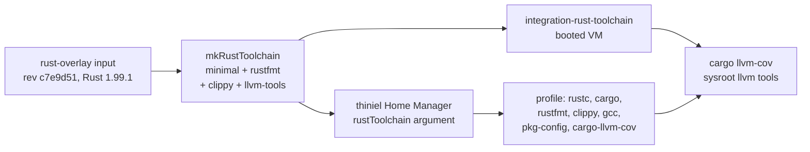

# Design: rust-coverage-toolchain

## Summary

Replace `thiniel`'s individually packaged Rust tools (`rustc`, `cargo`,
`clippy` from the host package set) with one released Rust toolchain that
carries the formatter, the lint driver and the `llvm-tools-preview` coverage
tools of the same release. The toolchain is one derivation instantiated in
`flake.nix` from the `rust-overlay` input and passed explicitly to the Home
Manager module and to the booted check; the check is extended to measure a
covered Rust project.

## Use-Case Traceability

| Use-case contract element | Technical decision | Bound verification target |
|---|---|---|
| Rule: the device's lint driver and formatter belong to the same release as the compiler | The toolchain derivation provides `rustfmt` and `clippy`; the host package set's `rustfmt`/`clippy` no longer enter the profile | `@check:integration-rust-toolchain` — the booted check formats a project and requires the formatter and lint driver under the compiler's sysroot |
| Rule: the toolchain carries the coverage tools of that release, so a profile the compiler writes is measured by tools that accept it | `llvm-tools-preview` extension of the same release; `cargo-llvm-cov` reads the tools from the compiler sysroot | `@check:integration-rust-toolchain` — the booted check builds an instrumented project, merges the profile and reports measured lines |
| Interaction: a device measures a Rust project's test coverage | The booted project's test binary writes a raw profile; `cargo llvm-cov` merges it with the toolchain's `llvm-profdata` and exports Cobertura | `@check:integration-rust-toolchain` |
| Interaction: a device builds a Rust project (existing) | The toolchain replaces the individual packages but keeps the same Cargo home | `@check:integration-rust-toolchain` |
| Capability ownership: `rust-build-toolchain` in `reproduce-working-environment` | Extended, not replaced; `thiniel` remains the only device that imports the module | `@host:thiniel` — the device evaluation asserts the declared toolchain is the installed one |
| Persona: `owner--operator` | The owner measures coverage on `thiniel`; no other Persona is affected | — |

## Technology Decisions

| Decision | Choice | Channel / source | Why |
|---|---|---|---|
| Toolchain source | `rust-overlay`'s `rust-bin.stable.latest.minimal.override { extensions = [ "rustfmt-preview" "clippy-preview" "llvm-tools-preview" ]; }` | New flake input `github:oxalica/rust-overlay/c7e9d512653a35ef4d5879c3df4d44d7b78d0e6d` (revision pinned in the URL), resolved release Rust 1.99.1 with LLVM 23.1.1, observed by building the derivation on 2026-10-27 | The compiler's coverage runtime writes raw profile format 11. The host package set's LLVM tools do not read it: 21.1.8 and 22.1.8 reject the version, 23.1.3 reports zero counters (measured 2026-10-27). Cross-testing two compiler releases (1.99.0 and 1.99.1) showed the same symptom *within* format 11, so the property is same-release instrumentation pairing, not a format number. Only the `llvm-tools-preview` component of the same release reads it. |
| Toolchain instantiation | One derivation per system, built in `flake.nix` from `import nixpkgs-unstable { overlays = [ inputs.rust-overlay.overlays.default ]; }`, passed as `rustToolchain` to the host's Home Manager arguments and to the check | `flake.nix` outputs `let` block; helper `mkRustToolchain` in `lib/helpers.nix` | The host and the booted check consume the same store path, so the check proves the device's declaration rather than a second approximation. The overlay is **not** added to any host's `nixpkgs.overlays`: nothing else needs the `rust-bin` namespace, and the host's `pkgs` stays free of a package-set instance whose only consumer is one argument. |
| Alternative distribution: `fenix` | Rejected for this change | — | It offers the same component-extension model, but this repository already verified the exact `rust-overlay` revision's 1.99.1 derivation and its `llvm-tools` pair at design time; switching distribution would re-run that evidence for no behavioural gain. Revisit only if `rust-overlay` stops packaging a needed release. |
| Version floor | None | — | The contract is "the tools that read a profile come from the release that wrote it", not currency. A floor cannot detect a cross-release mismatch (1.99.0 and 1.99.1 both emit format 11 and still fail), so it would add a signal that does not protect the invariant. |
| Coverage tool availability | `cargo-llvm-cov` from the host package set; it resolves `llvm-cov`/`llvm-profdata` from `rustc --print target-libdir`'s sibling `bin` directory | `nixpkgs-unstable` (`cargo-llvm-cov` 0.9.0, checked with `nix eval` on 2026-10-27) | Verified on 2026-10-27 against the 1.99.1 toolchain: `cargo llvm-cov --cobertura --output-path` produced a report without `--llvm-path`. No wrapper or environment variable is introduced. |
| Formatter ownership on `thiniel` | The toolchain supplies `rustfmt`; `formatters.nix` no longer declares it, and the macOS host declares it directly | rust-overlay `rustfmt-preview`; `nixpkgs-unstable` `rustfmt` for macOS | Two `rustfmt` derivations in one profile collide in the Home Manager profile build. `thiniel` gets the toolchain's release; `J6G6Y9JK7L` has no Rust toolchain of its own, so it keeps a standalone formatter. |
| Lint driver | The toolchain supplies `clippy`/`cargo-clippy`/`clippy-driver`; the standalone `clippy` package is removed | rust-overlay `clippy-preview` | Same collision and same-release reason as the formatter. |
| Toolchain profile | `minimal` + three extensions, not `default` | rust-overlay | `default` adds `rust-docs` (hundreds of MiB) that a build device does not need; the extensions are exactly the tools the rules name. |
| Host assertions | `thiniel-hm-invariants.nix` takes `rustToolchain` (Home Manager `extraSpecialArgs` reach the imported module) and asserts it is in `config.home.packages`; the previous name-substring assertions for `rustc`/`cargo` are removed | `tests/assertions/thiniel-hm-invariants.nix` | The aggregated derivation is named `rust-minimal-<ver>`, so name substrings no longer identify the compiler. Asserting the declared derivation is installed keeps the existing evidence level (the profile's package list) without encoding upstream naming. |
| VM guest package set | unchanged (`unstablePkgs` + `home-manager-unstable`), plus the explicit `rustToolchain` argument | `tests/integration/default.nix`, `flake.nix` checks | The Home Manager release pairing stays as it is (`quiet-configuration-evaluation`, D3), and the guest does not need the overlay because `rust.nix` never references `pkgs.rust-bin`. |

Version freshness: `rust-overlay` is pinned to the revision
`c7e9d512653a35ef4d5879c3df4d44d7b78d0e6d` that produced the design-time
evidence (fetched and built 2026-10-27); its `stable.latest` resolves Rust
1.99.1 at that revision. `cargo-llvm-cov` 0.9.0 comes from the
`nixpkgs-unstable` pin. No other version is asserted.

## Decisions

- Decides D1: the device takes one released Rust toolchain that ships its own
  coverage tools instead of pairing the host package set's compiler with LLVM
  tools from another build, and instead of a `rustup`-managed toolchain.
  Realised in `flake.nix` (input and `rustToolchain` derivation),
  `lib/helpers.nix` (`mkRustToolchain`) and
  `home/dan/features/development/rust.nix`.
- Recorded, not separate questions: the distribution alternative (`fenix`), the
  revision pin, the absence of a version floor, and the single shared
  derivation are decided in the technology table above.

## Verification Binding

| Scenario title | Binding tag | Bound target (file / check / host) | Targeted run command | Expected RED failure mode |
|---|---|---|---|---|
| A booted device builds and runs a Rust project | `@e2e @check:integration-rust-toolchain` | `tests/integration/rust-toolchain-test.nix` → flake `checks.<system>.integration-rust-toolchain`; the host assertion in `tests/assertions/thiniel-hm-invariants.nix` | `nix build .#checks.$(nix eval --impure --raw --expr builtins.currentSystem).integration-rust-toolchain` | The guest resolves `rustc --print sysroot` and requires `rustfmt` and `clippy-driver` under it; with the current profile those binaries come from `formatters.nix`/the package set and are absent from the compiler's sysroot, so `test -x` fails. The host evaluation separately fails the new assertion that the declared toolchain is installed |
| A booted device measures coverage of a Rust project | `@e2e @check:integration-rust-toolchain` | `tests/integration/rust-toolchain-test.nix` → flake `checks.<system>.integration-rust-toolchain` | `nix build .#checks.$(nix eval --impure --raw --expr builtins.currentSystem).integration-rust-toolchain` | The added step requires `llvm-profdata` under the compiler sysroot and `cargo llvm-cov`; at this point the toolchain carries only the formatter and lint-driver extensions and `cargo-llvm-cov` is not installed, so the step fails on the missing command and the missing profiler |

RED/GREEN sequencing is deliberate: the formatter/lint-driver extensions land
with the build scenario, and `llvm-tools-preview` plus `cargo-llvm-cov` land
with the measurement scenario. A single combined change would make the second
scenario's target already green.

## Test Targets Added/Changed

| Target file | Kind | Wired in by | Covers scenarios |
|---|---|---|---|
| `tests/integration/rust-toolchain-test.nix` | VM (`pkgs.testers.runNixOSTest`) | `tests/integration/default.nix` → flake `checks.<linux-system>.integration-rust-toolchain` (existing wiring) | Both scenarios |
| `tests/assertions/thiniel-hm-invariants.nix` | assertion | imported by `home/dan/thiniel.nix`, fired on host evaluation | The existing package assertions are replaced by one assertion on the declared toolchain; gcc/pkg-config and persistence assertions stay |

No unit case is added: the module remains a package list plus one persistence
entry, and the release identity is proven by running the tools, not by
comparing derivation names.

## Architecture Impact

- New: `rust-overlay` flake input; `mkRustToolchain` helper in
  `lib/helpers.nix`; `rustToolchain` argument in the Rust feature module and in
  the VM test.
- Changed: `flake.nix` (input, shared toolchain derivation, thiniel Home
  Manager arguments, checks' toolchain argument),
  `home/dan/features/development/rust.nix` (toolchain argument, coverage tool
  package, no standalone `clippy`),
  `home/dan/features/development/formatters.nix` (no `rustfmt`),
  `home/dan/J6G6Y9JK7L.nix` (standalone `rustfmt` for the macOS host),
  `tests/assertions/thiniel-hm-invariants.nix`,
  `tests/integration/default.nix` and `tests/integration/rust-toolchain-test.nix`.
- Untouched: `hosts/*`, persistence options and the `.cargo` persistence entry,
  Home Manager release pairing, all other hosts' package sets.

## Secrets & Safety

- No sops secret is added, read or rendered.
- `system.stateVersion` and `home.stateVersion` are not changed.
- `hosts/thiniel/hardware.nix` is not modified.
- The existing `.cargo` persistence entry is unchanged; the change removes no
  persisted path.
- The overlay adds no module option, service, mount or activation step; it only
  produces one derivation consumed as a package.

## Deployment & Rollback

Not a dangerous-area change (no boot, networking, filesystem, kernel or secret
wiring). Operator steps on the real hosts:

- **Lock the input first:** `nix flake lock` after adding the pinned input, so
  the repository's gate (`nix flake check --no-build --no-write-lock-file`) can
  evaluate the new input.
- **Apply on the laptop:** `nrs` (the host's alias:
  `sudo nixos-rebuild switch --flake ~/Projects/nix-config --override-input givn github:kressnerd/givn`).
  The override is required: without it `givnAvailable` is false and the
  generation loses the givn overlay that the host normally carries.
- **Apply on the MacBook:** `dars` (its alias, with the same `givn` override)
  at the next opportunity. `formatters.nix` no longer declares `rustfmt`, and
  the Mac's direct declaration only takes effect after its own rebuild;
  until then the Mac's `~/.cargo` is untouched and nothing breaks.
- **On-host verification (laptop):** after the shim step below,
  `command -v rustc` resolves under `/etc/profiles/per-user/dan/bin`, and
  `rustc --print sysroot` contains `bin/rustfmt`, `bin/clippy-driver` and
  `lib/rustlib/*/bin/llvm-profdata`; `cargo llvm-cov` in a Rust project
  produces a Cobertura report with non-zero covered lines.
- **Stale shim quarantine (required once, reversible):**
  `$HOME/.cargo/bin` precedes the Home Manager profile on the session path
  (risk R-030). A `rustup` installation there shadows the declared toolchain and
  its downloaded toolchains cannot run on NixOS. Move the shim files aside
  (`~/.cargo/bin.pre-toolchain/`) rather than deleting them, keeping other
  `cargo install` binaries in place, then prove `command -v rustc` points at the
  profile. `nixos-rebuild switch --rollback` restores the previous generation
  but cannot restore deleted files, which is why the shims are kept.
- **Rollback:** `sudo nixos-rebuild switch --rollback` on the laptop, or boot
  the previous generation from systemd-boot.

## Blast Radius

Only `thiniel` imports `rust.nix`. The macOS host loses `rustfmt` from
`formatters.nix` and gains it directly, so its intended package set is
unchanged and it never imports `rust.nix`; its `emacs-doom.nix` `cargo`/`rustc`
are macOS-only and untouched. The shared toolchain derivation is built for the
current system by `nix flake check`; the aarch64-linux checks only evaluate on
that builder, so a broken aarch64 `rust-overlay` evaluation would surface there
rather than on the laptop. The device's Rust release now moves with the
`rust-overlay` pin rather than with `nixpkgs-unstable`; a project pinning
another compiler still builds with the device's release, as before.

## Local Runnability

- **Evaluate and gate the repository:**
  `python3 scripts/givn-spec-trace.py && nix flake check --no-build && nix build .#checks.x86_64-linux.unit-helpers`
  (the first is the cheapest complete evaluation of the flake's outputs).
- **Booted check:** `nix build .#checks.x86_64-linux.integration-rust-toolchain`
  (needs KVM; also part of `scripts/givn-verify-e2e.sh`). `/dev/kvm` is present
  on `thiniel` and the daemon advertises `system-features = kvm nixos-test`.
- **Toolchain alone:** `nix build --impure --expr` with the pinned overlay
  revision — the command used for the design-time evidence below.
- **Anticipated obstacles:** the guest has no network, so the covered project
  has no external crates and the test sets `CARGO_NET_OFFLINE=true`; the
  covered project is a `--lib` crate whose `#[test]` calls the covered function,
  written explicitly instead of relying on the `cargo new` template; the
  coverage report is written to a file and parsed on the test-driver side, not
  inside the guest.

Design-time evidence (2026-10-27): with the 1.99.1 toolchain built from the
pinned overlay revision, `rustc -C instrument-coverage` plus the toolchain's
`llvm-profdata merge` produced a profile with measured lines, and
`cargo llvm-cov --cobertura` produced a Cobertura report; the host package set's
LLVM tools rejected the same raw profile, and the 1.99.1 tools rejected a
1.99.0 profile with the same "number of counters is zero" symptom.

## arc42 chapter impact

- `docs/arc42/02-architecture-constraints.md`: new constraint row — a toolchain
  whose components must be same-release is taken whole from a distribution
  input; no version floor, with the reason.
- `docs/arc42/03-context-and-scope.md`: the technical-context flake-input row
  names `rust-overlay` (already present as a transitive lock node through
  lanzaboote) and the hash-pinned component fetch.
- `docs/arc42/04-solution-strategy.md`: new technology row for the Rust
  build-and-coverage toolchain.
- `docs/arc42/05-building-block-view.md`: the `lib/helpers.nix` row gains
  `mkRustToolchain`; the `rust.nix` Level-3 entry changes packages and drops the
  "rustfmt stays in formatters" sentence; the integration-test inventory states
  measurement.
- `docs/arc42/07-deployment-view.md`: the `thiniel` Rust row names the release
  toolchain and its coverage tools.
- `docs/arc42/08-crosscutting-concepts.md`: the package-source concept gains a
  fifth source: one device's whole Rust distribution from `rust-overlay`.
- `docs/arc42/11-risks-and-technical-debt.md`: R-030 moves from latent to
  observed and gains the reversible quarantine step; new R-035 records the
  `cargo-llvm-cov` release skew and the release skew against project pins.
- `docs/arc42/12-glossary.md`: the Rust build toolchain term gains the release
  identity and coverage tools. The check list needs no change.

## Open Technical Questions

None. D1 is resolved; distribution alternative, pin, floor and derivation
identity are recorded above.
