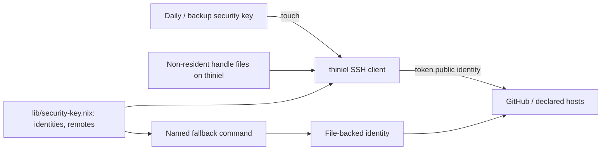

# Design: security-key-remote-identity

Status: revised 2026-10-20 after the design review. The review's blockers are addressed at the design level; design-review sign-off is pending. D1–D6 and D8 are decided; D7 is carried to a later recovery change. No implementation yet.

## Use-Case Traceability

| Use-case contract element | Technical decision | Bound verification target |
|---|---|---|
| `authenticate-to-remote-host` — the owner authenticates with the personal identity through a valid credential | The daily and backup token identities are an ordered `myHome.ssh.tokenIdentityFiles` list; the file-backed identity remains `myHome.ssh.personalIdentityFile` and is reachable only through the named fallback | `@host:thiniel`, `@check:unit-security-key-identity`, `@check:security-key-fleet-authorizations`, `@check:integration-security-key-authentication` |
| Rule: token-preferred, no file-key substitution | The normal entries use the token list; `personalIdentityFile` is not on them when a token list is declared; `ssh-file-fallback`/`git-file-fallback` are the only file-key path | `@host:thiniel`, `@check:unit-security-key-identity`, `@check:integration-security-key-authentication` |
| Rule: non-resident handles, touch only | Enrollment uses `ssh-keygen -t ed25519-sk` (fallback `ecdsa-sk`) without `-O resident` and without `-O verify-required`; the handle file is required | `@check:integration-security-key-authentication` and the real-token manual acceptance |
| Rule: one key represents the user on every declared host | `lib/security-key.nix` carries the daily/backup public keys and the declared remote set; `hosts/common/users/dan.nix` authorizes them on every host that accepts the user's SSH key | `@check:security-key-fleet-authorizations` |
| `recover-lost-security-key` — every remote that authorized the lost public identity stops accepting it | Revocation is a declaration edit in `lib/security-key.nix`, redeploy of each affected host with the remaining credential, GitHub removal, then per-remote verification; the fleet check asserts the currently declared identities | `@host:thiniel`, `@check:unit-security-key-identity`, `@check:integration-security-key-revocation`, and the manual real-remote acceptance |
| Rule: a failed revocation is not success | `revocationPlan` returns each remote separately; the operator records failed/unreachable remotes; the VM test proves the success path | `@check:unit-security-key-identity`, `@check:integration-security-key-revocation` |
| Rule: encrypted handle-file backup and restore drill | The operator records the medium and a restore under 15 minutes in the change's `backup-drill.md`; archive waits for it | Manual acceptance gate (not a Gherkin scenario) |
| Persona impact | None — host configuration, not a rendered application; owner/operator is the review lens | — |

## Technology Decisions

| Decision | Choice | Channel / source | Why |
|---|---|---|---|
| FIDO2 device access on `thiniel` | `services.udev.packages = [ pkgs.libfido2 ]`; `environment.systemPackages` adds `pkgs.libfido2` for `fido2-token` diagnostics | nixpkgs 26.05 (`flake.lock` pin) | `libfido2` supplies the generic FIDO2 udev rules; no vendor daemon. `solo2-cli` is not a runtime dependency (D4). The store rule covers 24 vendor IDs generically; the actual iShield visibility is an enrollment preflight. |
| SSH client/server | Existing NixOS/Home Manager OpenSSH, no override | nixpkgs 26.05; declared hosts evaluate to `10.5p1`; local `ssh -V` reports `OpenSSH_10.5p1` | FIDO `-sk` support exists since 8.2; the declared fleet is far above that. |
| Option model | `personalIdentityFile` remains the file-backed identity for every host; add `tokenIdentityFiles` (ordered list, default `[]`) | `modules/home-manager/ssh/options.nix` | Preserves the work Mac and the promoted `permitted-identity-selection` contract. A host with no token list keeps its file identity. |
| Normal SSH entries | `github-personal` and explicit Host blocks for `adlerkopf`, `nixos-vm-minimal`, and `thiniel` use `tokenIdentityFiles` when declared; otherwise `personalIdentityFile`; `IdentitiesOnly = true` | `home/dan/features/cli/ssh.nix` | Token-only normal path on `thiniel`; without explicit server Host blocks, the default client identities would include the file key. The Mac has no token list and keeps its file path. |
| Unit mocks | `tests/unit/hm-cli-modules-test.nix` declares `tokenIdentityFiles = [ ]` in its raw config attrsets; modules also read the option with `or [ ]` | `tests/unit/hm-cli-modules-test.nix`, `home/dan/features/cli/{ssh,git}.nix` | The unit harness imports modules with a plain attrset, so module defaults are not applied. |
| VM check gating | The two integration checks are defined only for `x86_64-linux` | `flake.nix`/`tests/integration/default.nix` | Fidorium/TPM/uhid and the test plan are x86_64; aarch64 must not define a check it cannot run. |
| Revocation consumer | `packages.security-key-revocation-plan` prints `lib/security-key.nix`'s per-remote checklist | `flake.nix`, `lib/security-key.nix` | Gives the pure `revocationPlan` a production consumer and a documented operator command. |
| Git identity | `git.nix` uses the token list when declared, otherwise `personalIdentityFile`; the fallback wrapper overrides with `personalIdentityFile` | `home/dan/features/cli/git.nix` | The shared `core.sshCommand` must not silently pin the file key on `thiniel`, and the Mac must keep its current command. |
| Fallback | `ssh-file-fallback` and `git-file-fallback` use `myHome.ssh.personalIdentityFile`; `git-file-fallback` sets `GIT_SSH_COMMAND` | `home/dan/features/cli/ssh.nix` | The file key is reachable only by a named command. No `fallbackIdentityFile` option is needed. |
| Remote authorization | `lib/security-key.nix` declares `dailyPublicKey`, `backupPublicKey`, `activeIdentities`, and `remotes`; `hosts/common/users/dan.nix` adds the active public keys to `users.users.dan.openssh.authorizedKeys.keys` | `lib/security-key.nix`, `hosts/common/users/dan.nix` | One data source for the common user module, the SSH feature, and both checks. Public keys are not secret; the private handle files are not committed. |
| Host set | `thiniel`, `adlerkopf`, `nixos-vm-minimal`; `cupix001` has no `services.openssh` and is excluded | `hosts/*/default.nix`, `flake.nix` | D1 is "every host that accepts the user's SSH key"; cupix001 does not. |
| Key generation | `ssh-keygen -t ed25519-sk -C "user@thiniel-tokenN" -f ~/.ssh/id_ed25519_sk_tokenN`, fallback `ecdsa-sk`; no `-O resident`, no `-O verify-required` | Operator procedure; `~/.ssh` is persisted | Nix does not generate private keys. The enrollment preflight records `fido2-token -L -I`, the model, and the key type. |
| Virtual authenticator | `pkgs/fidorium` (test-only Rust derivation) presents a virtual FIDO2 HID device via `/dev/uhid`, backed by the VM's TPM; a pinentry wrapper approves or denies user presence | `pkgs/fidorium/`, `tests/integration/security-key-*-test.nix` | The VM e2e is repeatable and exercises the real OpenSSH `-sk` path. Fidorium supports P-256 only, so the VM uses `ecdsa-sk`; the real token still tests `ed25519-sk` first. |
| Verification targets | `@check:unit-security-key-identity`, `@check:security-key-fleet-authorizations`, `@check:integration-security-key-authentication`, `@check:integration-security-key-revocation`, `@host:thiniel` | `flake.nix`, `tests/` | The repeatable e2e is a VM; the real-token and backup checks are manual acceptance gates. |

## Architecture



Files affected or added:

- `modules/home-manager/ssh/options.nix` — add `tokenIdentityFiles` (list, default `[]`).
- `home/dan/features/cli/ssh.nix` — token list on normal entries; fallback wrappers; no file key on the normal path when tokens are declared.
- `home/dan/features/cli/git.nix` — token list for `core.sshCommand` on `thiniel`; file key otherwise.
- `home/dan/thiniel.nix` — declare `tokenIdentityFiles` (daily, backup) and keep `personalIdentityFile` as the file fallback.
- `hosts/common/users/dan.nix` — authorize the active public keys from `lib/security-key.nix`.
- `hosts/thiniel/default.nix` — `services.udev.packages = [ pkgs.libfido2 ]`; `environment.systemPackages` with `libfido2`.
- `lib/security-key.nix` — public keys, active identities, remotes, selection, revocation plan.
- `pkgs/fidorium/default.nix` — test-only virtual authenticator.
- `tests/unit/security-key-identity.nix` — unit cases.
- `tests/unit/hm-cli-modules-test.nix` — add `tokenIdentityFiles = [ ]` to the raw mocks (module defaults do not apply to plain attrset imports).
- `tests/assertions/thiniel-security-key-invariants.nix` — host assertions, guarded by `lib.mkIf (config.networking.hostName == "thiniel")`.
- `tests/assertions/thiniel-invariants.nix` — update the old file-key identity assertions to the token list and named fallback; keep the Mac assertions unchanged.
- `tests/integration/security-key-authentication-test.nix` — VM e2e with fidorium.
- `tests/integration/security-key-revocation-test.nix` — VM e2e for revocation.
- `flake.nix` — checks `unit-security-key-identity`, `security-key-fleet-authorizations`, `integration-security-key-authentication`, `integration-security-key-revocation`; the two integration checks are guarded to `x86_64-linux`.
- `packages.security-key-revocation-plan` (or a small `scripts/security-key-revocation-plan` wrapper) — prints the per-remote revocation checklist; the consumer of `revocationPlan`.
- `tests/assertions/default.nix`, `tests/integration/default.nix` — wiring.
- `revocation-drill.md` — per-remote real revocation record (GitHub, `adlerkopf`, `nixos-vm-minimal`, `thiniel`).

## Decisions

- **Decides D1 (seed: remote inventory):** one key from `thiniel` represents the user; the declared SSH hosts are `thiniel`, `adlerkopf`, `nixos-vm-minimal`, plus personal GitHub. `cupix001` has no `services.openssh` and is excluded. Realized in `lib/security-key.nix` and `hosts/common/users/dan.nix`.
- **Decides D2 (seed: Swissbit model/key type):** iShield Key 2 family; base FIDO2 variant sufficient; try `ed25519-sk`, fallback `ecdsa-sk`; preflight records the model and key type. Realized in the enrollment procedure and the manual real-token acceptance.
- **Decides D3 (seed: OpenSSH version):** declared hosts and local client use OpenSSH `10.5p1`; no override. Realized by the existing package.
- **Decides D4 (seed: Solo 2 package):** `libfido2` is the runtime dependency; `solo2-cli`/iKMcli are one-off management tools. Realized in `hosts/thiniel/default.nix`.
- **Decides D5 (seed: credential selection):** normal connections use the ordered token list (daily, then backup); the file-backed identity is only through the named fallback. A rejected daily token may be followed by the backup; the file key is never automatic. Realized in `ssh.nix`, `git.nix`, and the unit selection cases.
- **Decides D6 (seed: native target):** repeatable e2e uses `@check:integration-security-key-authentication` and `@check:integration-security-key-revocation` (VM with fidorium); configuration/selection use `@host:thiniel`, `unit-security-key-identity`, and `security-key-fleet-authorizations`. The real-token authentication, backup-token proof, GitHub revocation, and backup restore are manual acceptance gates recorded in `backup-drill.md`; archive waits for them.
- **Carried D7 (seed: later recovery):** the mechanism that removes the file key belongs to a later recovery change; owner `owner--operator`; no later change has been proposed yet.
- **Decides D8 (seed: handle backup):** encrypted backup plus a restore drill is a completion gate. The operator records the medium, the restored handle file, and a successful backup-token authentication in `backup-drill.md`; the target is under 15 minutes. The design does not store the backup in the repository.

## Verification Binding

| Scenario title | Binding tag | Bound target (file / check / host) | Targeted run command | Expected RED failure mode |
|---|---|---|---|---|
| The device declares support for both security keys and the fallback | `@host:thiniel` | `tests/assertions/thiniel-security-key-invariants.nix` | `nix eval --raw .#nixosConfigurations.thiniel.config.system.build.toplevel.drvPath` | The assertion fails because the current config lacks `libfido2`, the token list, and the fallback. |
| A recognized security key is not authorized until its public identity is granted | `@e2e @check:integration-security-key-authentication` | `tests/integration/security-key-authentication-test.nix` | `nix build .#checks.x86_64-linux.integration-security-key-authentication` | The VM test fails because the unauthorized public identity is accepted. |
| Every declared host authorizes the personal token public identities | `@check:security-key-fleet-authorizations` | `flake.nix` check | `nix build .#checks.x86_64-linux.security-key-fleet-authorizations` | The check fails because `lib/security-key.nix` has no active public keys. |
| The identity declaration records both token credentials and the fallback order | `@check:unit-security-key-identity` | `tests/unit/security-key-identity.nix` | `nix build .#checks.x86_64-linux.unit-security-key-identity` | The case fails because the declaration order is wrong. |
| The daily key authenticates at the designated test remote after enrollment and authorization | `@e2e @check:integration-security-key-authentication` | `tests/integration/security-key-authentication-test.nix` | `nix build .#checks.x86_64-linux.integration-security-key-authentication` | The VM test fails because no virtual authenticator/key path exists. |
| Normal connections use the daily token and not the file-backed identity | `@host:thiniel` | `tests/assertions/thiniel-security-key-invariants.nix` | `nix eval --raw .#nixosConfigurations.thiniel.config.system.build.toplevel.drvPath` | The assertion fails because the normal entry still names the file key. |
| The daily token is selected when it is available | `@check:unit-security-key-identity` | `tests/unit/security-key-identity.nix` | `nix build .#checks.x86_64-linux.unit-security-key-identity` | The selection case fails because the helper does not prefer the daily token. |
| An absent daily token uses the backup token | `@check:unit-security-key-identity` | `tests/unit/security-key-identity.nix` | `nix build .#checks.x86_64-linux.unit-security-key-identity` | The case fails because it selects the file key or nothing. |
| Both tokens unavailable require the named fallback | `@check:unit-security-key-identity` | `tests/unit/security-key-identity.nix` | `nix build .#checks.x86_64-linux.unit-security-key-identity` | The case fails because it selects the file key automatically. |
| A rejected daily credential may use the backup token | `@check:unit-security-key-identity` | `tests/unit/security-key-identity.nix` | `nix build .#checks.x86_64-linux.unit-security-key-identity` | The case fails because it stops after the daily rejection or selects the file key. |
| The personal device reaches private repositories with the identity it holds | `@host:thiniel` | `tests/assertions/thiniel-invariants.nix` (updated) | `nix eval --raw .#nixosConfigurations.thiniel.config.system.build.toplevel.drvPath` | The old assertion still expects `~/.ssh/id_ed25519` and fails against the token list. The permanent `J6G6Y9JK7L` scenario remains the Mac regression guard; no delta scenario is needed. |
| A token connection succeeds only with a touch | `@e2e @check:integration-security-key-authentication` | `tests/integration/security-key-authentication-test.nix` | `nix build .#checks.x86_64-linux.integration-security-key-authentication` | The VM test fails because the pinentry approval path is absent. |
| A token connection without a touch is rejected | `@e2e @check:integration-security-key-authentication` | `tests/integration/security-key-authentication-test.nix` | `nix build .#checks.x86_64-linux.integration-security-key-authentication` | The VM test fails because the deny path is not implemented. |
| A token without its handle file does not authenticate | `@e2e @check:integration-security-key-authentication` | `tests/integration/security-key-authentication-test.nix` | `nix build .#checks.x86_64-linux.integration-security-key-authentication` | The VM test fails because the token authenticates without the handle. |
| A rejected daily credential is not retried with the file-backed identity | `@e2e @check:integration-security-key-authentication` | `tests/integration/security-key-authentication-test.nix` | `nix build .#checks.x86_64-linux.integration-security-key-authentication` | The VM test fails because the file key is offered after rejection. |
| The identity declaration names the public identities and the remotes that authorize them | `@host:thiniel` | `tests/assertions/thiniel-security-key-invariants.nix` | `nix eval --raw .#nixosConfigurations.thiniel.config.system.build.toplevel.drvPath` | The assertion fails because the declaration has no public identities or remote list. |
| A lost daily key is revoked at every remote while the backup is retained | `@check:unit-security-key-identity` | `tests/unit/security-key-identity.nix` | `nix build .#checks.x86_64-linux.unit-security-key-identity` | The plan case fails because it targets the wrong identity. |
| Both lost keys are revoked and the file-backed identity remains | `@check:unit-security-key-identity` | `tests/unit/security-key-identity.nix` | `nix build .#checks.x86_64-linux.unit-security-key-identity` | The plan case fails because it omits one lost identity. |
| A failed revocation is not reported as removed | `@check:unit-security-key-identity` | `tests/unit/security-key-identity.nix` | `nix build .#checks.x86_64-linux.unit-security-key-identity` | The result case fails because a failure is reported as success. |
| A lost public identity is revoked at the designated test remote and no longer authenticates | `@e2e @check:integration-security-key-revocation` | `tests/integration/security-key-revocation-test.nix` | `nix build .#checks.x86_64-linux.integration-security-key-revocation` | The VM test fails because the lost identity remains authorized. |
| A lost public identity is removed from the declaration and the remaining identity stays authorized | `@host:thiniel` | `tests/assertions/thiniel-security-key-invariants.nix` | `nix eval --raw .#nixosConfigurations.thiniel.config.system.build.toplevel.drvPath` | The assertion fails because the declaration still names the lost key. |

## Manual acceptance gates

The following are not Gherkin scenarios; they are operator-run gates recorded in `backup-drill.md` and the change review. The archive waits for them.

- **Real-token authentication:** enroll the Swissbit with `ed25519-sk` (fallback `ecdsa-sk`), authenticate to `localhost` and `adlerkopf` with a touch; no-touch fails; `ssh-keygen -K` returns no keys.
- **Backup token:** the Solo 2, with its own handle file, authenticates independently.
- **Revocation:** revoke a test public identity at every real remote that authorized it (GitHub, `adlerkopf`, `nixos-vm-minimal`, `thiniel`) and record each result in `revocation-drill.md`; a failed or unreachable remote is reported and not treated as success.
- **Backup and restore:** create the encrypted handle-file backup, restore a handle file, authenticate with the restored file, and record the elapsed time (target under 15 minutes) in `backup-drill.md`.

## Test Targets Added/Changed

| Target file | Kind | Wired in by | Covers scenarios |
|---|---|---|---|
| `tests/unit/security-key-identity.nix` | unit (`lib.debug.runTests`) | `flake.nix` check `unit-security-key-identity` (direct import; not the `unit-helpers` aggregate) | Declaration, selection, backup, revocation-plan cases. |
| `tests/assertions/thiniel-security-key-invariants.nix` | assertion | `tests/assertions/default.nix`, imported by `hosts/thiniel/default.nix`; guarded by `hostname == "thiniel"` | `thiniel` configuration and declaration cases. |
| `flake.nix` check `security-key-fleet-authorizations` | check | flake `checks` output; evaluates `self.nixosConfigurations` and filters `services.openssh.enable` | Declared-host authorization. |
| `tests/integration/security-key-authentication-test.nix` | VM (`pkgs.testers.runNixOSTest`) | flake check `integration-security-key-authentication`; `tests/integration/default.nix` | Daily token, touch/no-touch, missing handle, rejected credential. |
| `tests/integration/security-key-revocation-test.nix` | VM (`pkgs.testers.runNixOSTest`) | flake check `integration-security-key-revocation`; `tests/integration/default.nix` | Lost public identity revocation. |
| `pkgs/fidorium/default.nix` | test-only package | imported by the two VM tests | Virtual FIDO2 HID authenticator. |

## Secrets & Safety

- No SOPS secret is added or changed.
- No private key or handle file is committed. The public keys may live in `lib/security-key.nix`; they are not secret. Handle files live under `~/.ssh` and are already retained by the existing Home Manager persistence.
- The backup file is not committed. `backup-drill.md` records the fact of the backup and the drill, never the handle contents or passphrase.
- `system.stateVersion` and `home.stateVersion` are unchanged; `hosts/thiniel/hardware.nix` is untouched.
- The new options default to `[]`/`null` so hosts without tokens (the work Mac) evaluate unchanged.

## Deployment & Rollback

Deploy order: `adlerkopf` and `nixos-vm-minimal` first with the existing key (the authorized-key change is additive), then `thiniel`. Use the host's `rebuild` alias so the `private` and `givn` overrides are supplied; the design does not drop the `givn` input.

On-host verification:

```bash
ssh -G github-personal | grep -Ei 'identityfile|identitiesonly'
ssh-file-fallback -G github-personal | grep -i identityfile
ssh-keygen -K   # expect no keys
```

Rollback: select the previous NixOS generation, or `sudo nixos-rebuild switch --rollback`. The remote hosts' added public keys are harmless if `thiniel` is rolled back; the file-backed identity and `ssh-file-fallback` remain available. The change does not alter boot, networking, file systems, persistence, kernel, or secrets.

## Blast Radius

- `thiniel` SSH/Git client: a wrong token/fallback configuration can break GitHub and server access from that device. The user can log in locally and use `ssh-file-fallback` or `ssh -i ~/.ssh/id_ed25519`.
- `adlerkopf`/`nixos-vm-minimal`: the change is additive to `authorized_keys`; existing keys remain.
- The work Mac and work identities are unchanged; the shared module falls back to `personalIdentityFile` when no token list is declared.
- The real-token and backup gates are operator-run; a failure is detected before archive, not in CI. The VM e2e is repeatable in CI.

## arc42 chapter impact

- `docs/arc42/03-context-and-scope.md` — security-key SSH interface.
- `docs/arc42/05-building-block-view.md` — `lib/security-key.nix`, SSH option, VM tests.
- `docs/arc42/06-runtime-view.md` — security-key authentication and revocation flows.
- `docs/arc42/08-crosscutting-concepts.md` — security-key identity and named fallback.
- `docs/arc42/10-quality-requirements.md` — QS-018 and the VM e2e status.
- `docs/arc42/11-risks-and-technical-debt.md` — handle/file theft, CI/manual gates, model/key-type risks.
- `docs/arc42/12-glossary.md` — already current; no new term.

## Local runnability

- `./scripts/givn-verify.sh` — spec traceability, flake evaluation, unit/lint checks, host assertions.
- `nix build .#checks.x86_64-linux.integration-security-key-authentication` and `...-revocation` — VM e2e.
- `nix build .#checks.x86_64-linux.unit-security-key-identity` and `...security-key-fleet-authorizations` — unit/fleet checks.
- The real-token and backup gates are operator-run on `thiniel`; they are not in CI and are recorded in `backup-drill.md`.

## Open Technical Questions

- `pkgs/fidorium` packaging: pin the source revision and `Cargo.lock`; include `tpm2-tss`/`libtss2-esys` as build/runtime inputs and `pinentry` in the test PATH; confirm `/dev/uhid`, the `uhid` kernel module, and `virtualisation.tpm.enable` in the VM test; provide a pinentry wrapper that can approve and deny.
- Exact public-key values: inserted into `lib/security-key.nix` after enrollment; the checks fail with a named assertion until then.
- D7 remains carried to a later recovery change.
- D8 is decided as a gate; the medium is the operator's choice and is recorded in `backup-drill.md`.
