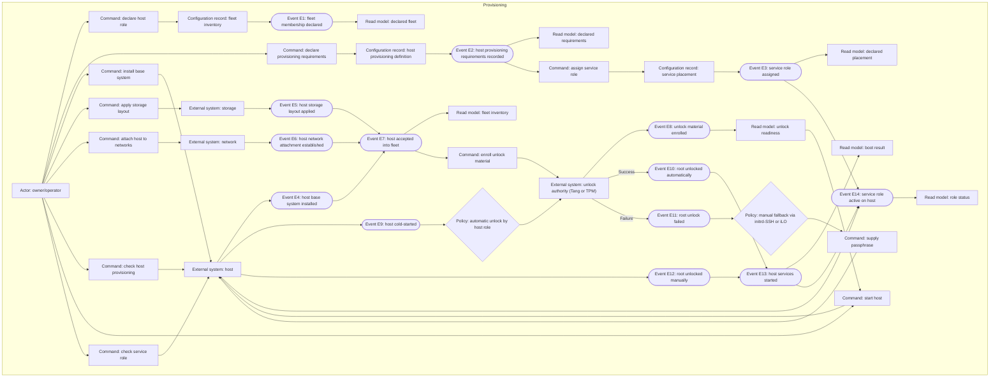
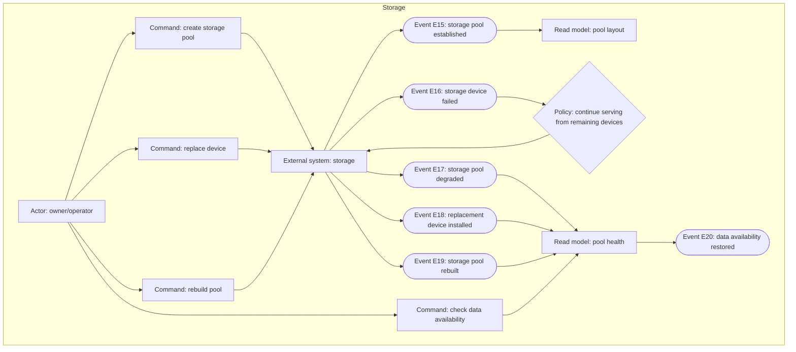
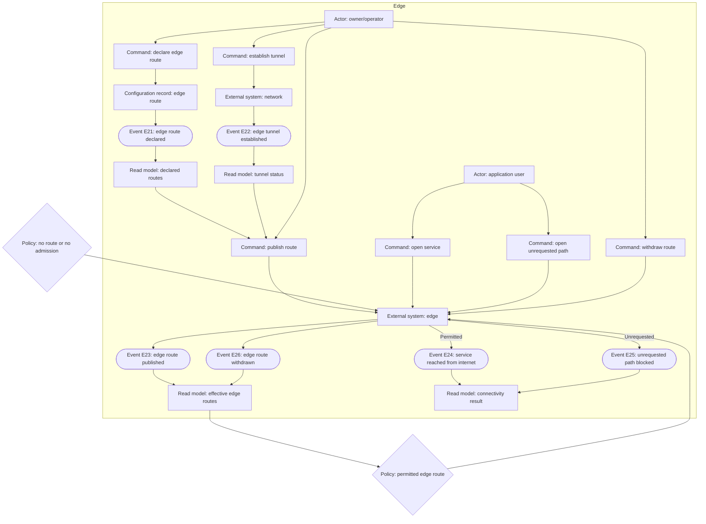
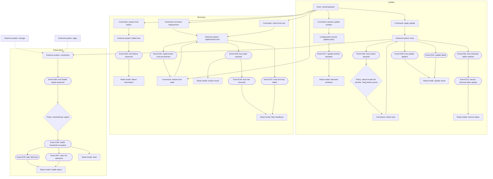

# Event Storming: operating the home datacenter fleet

Status: complete for phase review 2026-10-17. The model covers the three named
hosts (`pronix`, `tinix001`, `cupix001`) and treats `adlerkopf` as a separate
fourth host outside the topic (Q1). It is a proposed event chain, not observed
runtime behavior.

## Scope and evidence

The chain follows the user's 2026-10-17 architecture handover: host roles,
storage pools, boot and unlock, edge reachability, service placement, update
windows, host recovery and health observation. Application behavior, family
sharing logic and the user-facing behavior of DNS, mail, Headscale, Authentik
or the hosted applications remain outside this chain. Their **placement** is
modeled as a service role on a host; their **user outcome** belongs to the
application or to `infrastructure-growth`.

The Frame's hardware, VLAN/IP plan, assumptions A1–A8 and verification points
P1–P10 are constraints, not verified facts. No host was provisioned, unlocked,
exported, updated, failed over or monitored for this model.

`adlerkopf` is not part of this chain. It serves the separate `adlerhorst` LAN
(local applications and DNS) and is reachable only through Tailscale over a
slow internet connection (Q5). It is not a second authority inside the trio's
LAN. No `adlerkopf` change is modeled.

## Kinds and consistency boundaries

The durable glossary declares no repository-owned aggregate. This chain
introduces none. Every target is named by its kind:

- **Actor** — a human role that issues a command.
- **Command** — an intention the actor expresses.
- **Configuration record** — a declaration in the repository; not an
  aggregate.
- **External system** — a host, storage, network, edge, unlock authority,
  monitoring system or failed/replacement host; not owned by this repository.
- **External interaction** — a human-to-human exchange.
- **Event** — a past-tense domain fact.
- **Policy** — a reaction rule that selects the next behavior.
- **Read model** — information the actor needs to inspect.

A **host** is an external system here; the durable glossary's `Host` term
(one declared machine configuration under `hosts/<host>/`) names the
declaration, not the running machine. A **storage pool**, **edge route**,
**unlock material**, **update window**, **host recovery**, **health signal**
and **service role** are candidate domain terms, not aggregates. They are
recorded in `domain-terms.md` with collision evidence.

## Event partners

| ID | Past-tense event | Actor and command | Target and kind | Reacting policy | Actor's read model |
|---|---|---|---|---|---|
| E1 | Fleet membership declared | Owner/operator: declare host role | Fleet inventory — configuration record | A host has one declared role in the fleet | Declared fleet |
| E2 | Host provisioning requirements recorded | Owner/operator: declare provisioning requirements | Host provisioning definition — configuration record | Requirements are host-specific; they reference the unlock and service roles | Declared requirements |
| E3 | Service role assigned | Owner/operator: assign service role | Service placement — configuration record | A family-facing role has one intended host; `adlerkopf` serves the separate `adlerhorst` LAN (Q4/Q5) | Declared placement |
| E4 | Host base system installed | Owner/operator: install base system | Host — external system | Install from the declared provisioning definition | Provisioning result |
| E5 | Host storage layout applied | Owner/operator: apply storage layout | Storage — external system | Declared pool layout; no undeclared pool | Provisioning result |
| E6 | Host network attachment established | Owner/operator: attach host to networks | Network — external system | Declared VLAN/IP plan and host role | Provisioning result |
| E7 | Host accepted into fleet | Owner/operator: check host provisioning | Host — external system | Base system, storage and network are present; a partial host is not accepted | Fleet inventory |
| E8 | Unlock material enrolled | Owner/operator: enroll unlock material | Unlock authority (Tang or TPM) — external system | The host role selects Tang or TPM; the passphrase slot remains a fallback | Unlock readiness |
| E9 | Host cold-started | Owner/operator: start host | Host — external system | — | Boot result |
| E10 | Root unlocked automatically | Unlock authority for the owner/operator: unlock root | Host — external system | Automatic unlock by host role | Boot result |
| E11 | Root unlock failed | Unlock authority for the owner/operator: unlock root | Host — external system | Automatic unlock did not produce a usable root | Boot result |
| E12 | Root unlocked manually | Owner/operator: supply passphrase | Host — external system | initrd-SSH or iLO serial console; the passphrase slot is retained | Boot result |
| E13 | Host services started | Host — external system | Host — external system | Start the declared service roles after the root is usable | Boot result |
| E14 | Service role active on host | Owner/operator: check service role | Host — external system | The declared role answers on its intended network; a configured unit is not proof | Role status |
| E15 | Storage pool established | Owner/operator: create storage pool | Storage — external system | Declared pool layout and RAID level | Pool layout |
| E16 | Storage device failed | Storage — external system | Storage — external system | Report the failure; do not equate it with data loss | Pool health |
| E17 | Storage pool degraded | Storage — external system | Storage — external system | Continue serving from the remaining devices; do not claim full redundancy | Pool health |
| E18 | Replacement device installed | Owner/operator: replace device | Storage — external system | The replacement belongs to the declared pool | Pool health |
| E19 | Storage pool rebuilt | Owner/operator: rebuild pool | Storage — external system | Redundancy is restored only when the rebuild completes | Pool health |
| E20 | Data availability restored | Owner/operator: check data availability | Storage — external system | The pool is healthy and the declared data is readable | Pool health |
| E21 | Edge route declared | Owner/operator: declare edge route | Edge route — configuration record | Only selected services are admitted; a route is not a resource grant | Declared routes |
| E22 | Edge tunnel established | Owner/operator: establish tunnel | Network — external system | Static edge link between `cupix001` and `tinix001` | Tunnel status |
| E23 | Edge route published | Owner/operator: publish route | Edge — external system | Declared route, authentication boundary and backend | Effective edge routes |
| E24 | Service reached from internet | Application user: open service | Edge — external system | A permitted edge route admits the request | Connectivity result |
| E25 | Unrequested path blocked | Application user: open unrequested path | Edge — external system | No declared route or no admission; reachability grants no resource rights | Connectivity result |
| E26 | Edge route withdrawn | Owner/operator: withdraw route | Edge — external system | The route stops admitting requests | Effective edge routes |
| E27 | Update window declared | Owner/operator: declare update window | Update policy — configuration record | Host-specific window and reboot order | Declared windows |
| E28 | Host update applied | Owner/operator: apply update | Host — external system | Apply within the declared window | Update result |
| E29 | Host reboot required | Host — external system | Host — external system | A kernel, module or initrd change requires a reboot | Update result |
| E30 | Host rebooted within window | Owner/operator: reboot host | Host — external system | Reboot only inside the window; respect the Tang-before-pronix order | Update result |
| E31 | Service returned after update | Host — external system | Host — external system | Declared service roles answer again | Service status |
| E32 | Update failed | Host — external system | Host — external system | Report the failure; do not present a partial update as complete | Update result |
| E33 | Host failure observed | Owner/operator: assess host | Failed host — external system | Distinguish failure from planned maintenance | Failure information |
| E34 | Replacement host provisioned | Owner/operator: provision replacement | Replacement host — external system | Reuse the declared provisioning definition | Replacement readiness |
| E35 | Host state restored | Owner/operator: restore host state | Replacement host — external system | Restore declared persistent system state and bootstrap; application data is a dependency, not part of this claim | Restore result |
| E36 | Host role resumed | Owner/operator: check host role | Host — external system | The declared role and service placement answer again | Fleet readiness |
| E37 | Host recovery failed | Owner/operator: check host role | Host — external system | Report the failure; do not claim fleet readiness | Fleet readiness |
| E38 | Host health signal observed | Monitoring — external system | Monitoring — external system | Collect host, pool and edge signals | Health status |
| E39 | Health threshold exceeded | Monitoring — external system | Monitoring — external system | Apply the declared threshold per signal | Alert |
| E40 | Alert delivered | Monitoring — external system | Owner/operator — external interaction | Deliver to the owner through the declared channel | Alert |
| E41 | Alert not delivered | Monitoring — external system | Owner/operator — external interaction | Record the delivery failure; a silent non-delivery is not health | Alert |

## Canvas 1 — provision and boot a host

The host is accepted only when base system, storage layout, network attachment
and declared roles are present. Enrollment happens before the first unattended
cold start. A failed automatic unlock falls back to the retained passphrase
slot; it does not silently claim a successful boot.

## Canvas 2 — restore storage redundancy after a device failure

A failed device makes the pool degraded, not absent. Data availability is
restored only after the replacement is installed and the rebuild completes.
`degraded` is never treated as full redundancy.

## Canvas 3 — expose a selected service through the edge

A declared route is not a resource grant. Reaching an endpoint is separate
from permission to use an application resource. The edge admits only the
selected route; everything else is blocked.

## Canvas 4 — keep current, recover and observe

Recovery restores the host role and declared system state. Application data
and application-specific access restoration remain with
`infrastructure-growth`; a recovered host is not a recovered application.
Alert delivery is part of the health claim: a monitoring system that cannot
deliver an alert has not established that the owner knows.

## Reverse narrative

Which events must have happened for **a service to be reached from the
internet**? E24 requires E23 (route published), which requires E22 (tunnel
established) and E21 (route declared), which assemble E21's configuration
record from E1/E2/E3 (host role, provisioning requirements, service
placement). E24 also requires E13 (host services started), which requires E9
(host cold-started) and either E10 (automatic unlock) or E12 (manual unlock);
both require E8 (unlock material enrolled), which requires E7 (host accepted)
and E4/E5/E6 (base system, storage, network). The chain starts at E1 (fleet
membership declared) and E2 (provisioning requirements recorded).

Which events must have happened for **data availability to be restored**?
E20 requires E19 (pool rebuilt), which requires E18 (replacement installed)
after E16 (device failed) and E17 (pool degraded). E17 requires E15 (pool
established). A pool that was never established cannot be degraded; a
replacement that was not rebuilt does not restore redundancy.

Which events must have happened for **host role resumed**? E36 requires E35
(state restored) and E34 (replacement provisioned). E35 requires a surviving
state source and a supported restore procedure; a fresh install alone does not
restore declared system state. E34 reuses E2's provisioning definition, not a
new architecture.

Which events must have happened for **an alert to be delivered**? E40
requires E39 (threshold exceeded), which requires E38 (signal observed) and a
declared threshold. E38 requires the monitoring system to observe the host,
pool or edge. An undelivered alert (E41) is recorded as a failure, not as
health.

## Coverage check

| Slice | Events | Use-case candidate |
|---|---|---|
| Provisioning | E1–E7, E14 | Provision a host into the fleet |
| Unattended boot | E8–E13 | Keep an encrypted host bootable without on-site intervention |
| Storage redundancy | E15–E20 | Restore storage redundancy after a device failure |
| Edge reachability | E21–E26 | Make a selected home service reachable from the internet |
| Updates | E27–E32 | Keep the fleet current within its declared windows |
| Host recovery | E33–E37 | Resume a host's role after loss |
| Health observation | E38–E41 | Know when a host, pool or edge path is unhealthy |

The cut is provisional; Use Case Definition applies the sizing rules and may
merge or split. Application user outcomes for mail, DNS, Headscale, Authentik
and the hosted applications are not separate leaves here: their placement is
E3/E14, their reachability is E21–E26, and their user behavior belongs to the
application or `infrastructure-growth`.

## Persona reactions — advisory review lenses

- **Owner/operator:** the chain separates a declared host from an accepted
  host, and a degraded pool from restored redundancy. The risky points are
  the ones the handover already names: P1/P2 (pronix boot and NVMe), P4
  (Clevis retry), P5 (TPM), P6/P9 (Headscale), P10 (iLO prompt). The model
  does not let a green job, a configured unit or a same-host snapshot stand in
  for a reached service, a rebuilt pool or a resumed role.
- **Application user:** the chain preserves the existing boundary: reachability
  is not a grant, and a family-facing edge route does not expose other
  applications. An application user does not operate the fleet or decide its
  topology. Host recovery is not application recovery; a user's photos or
  documents are covered by the application-state topic, not by a fresh host.

## Open questions and term state

- Q4 and Q5 are closed: `adlerkopf` serves the separate `adlerhorst` LAN;
  the trio serves its own LAN and the public edge. The service placement in
  E3/E14 therefore assigns no family-facing role to `adlerkopf`, and the edge
  routes in E21–E26 belong to the trio. Cross-LAN access remains a Tailscale
  dependency, not a shared local authority.
- Candidate terms and collision checks are in `domain-terms.md`. No term is
  confirmed; no durable glossary entry is changed.

## Rendering verification — 2026-10-17

All four Mermaid sources rendered with Mermaid CLI 12.0.0 using Chromium
155.0.8059.79 from nixpkgs. Each SVG was opened in headless Chromium and
captured at 2200×2200; the four screenshots were visually inspected. Every
actor, command, configuration record, external system, policy, event and read
model label was visible, including the kind prefixes and E-numbers. The
prerequisite edges added after the first inspection (unlock readiness before
cold start, role assignment before active role, route/tunnel before
publication, replacement before state restore, storage/edge signals before
monitoring) are present in the final captures.

This is diagram syntax/layout proof, not host, storage, edge, update,
recovery or monitoring behavior. The temporary SVG/PNG render surface lives
under `/tmp/fleet-render` and is not part of the repository.
