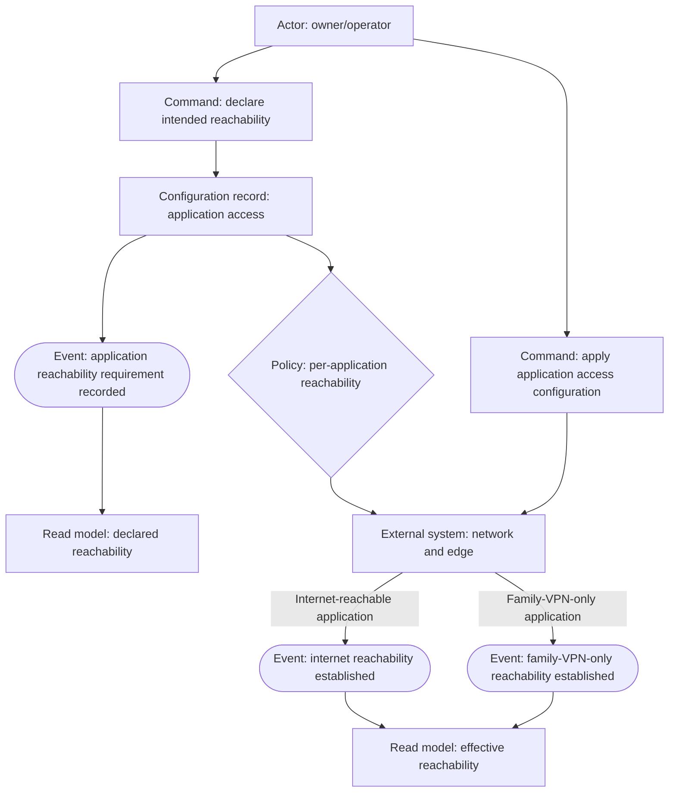
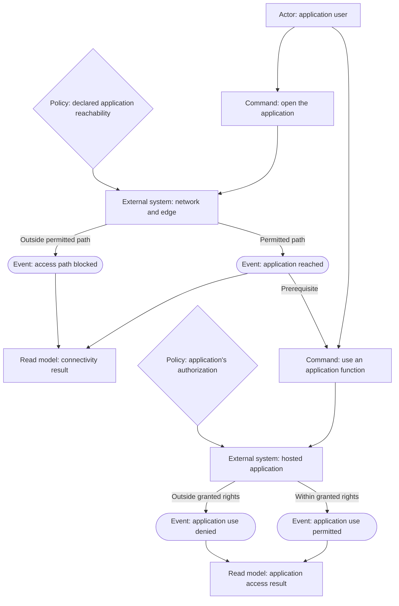
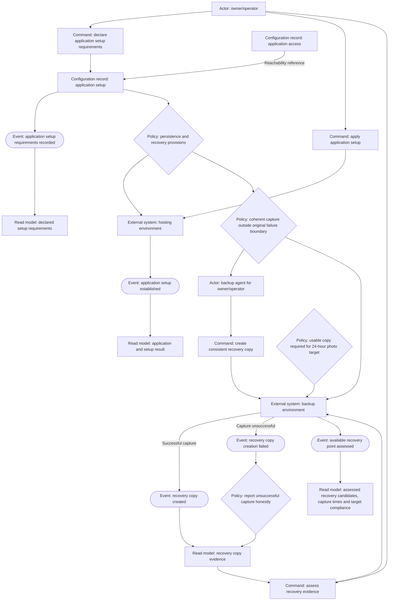
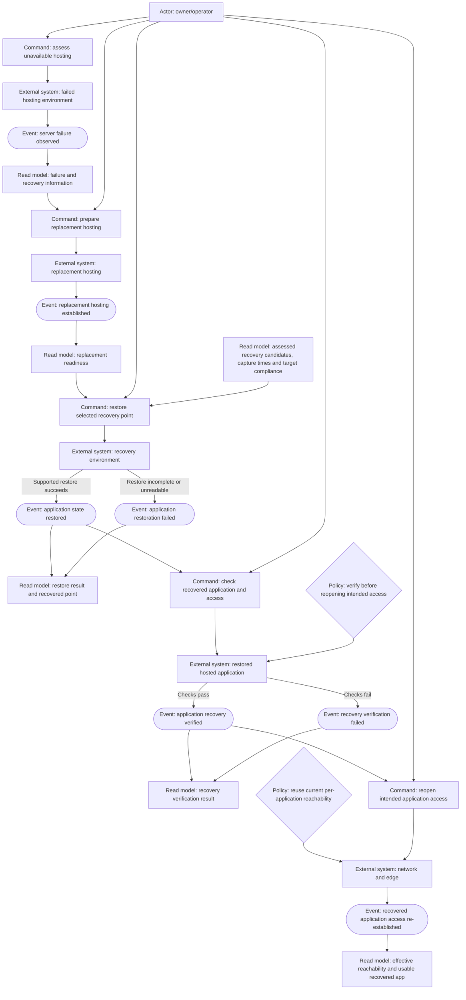
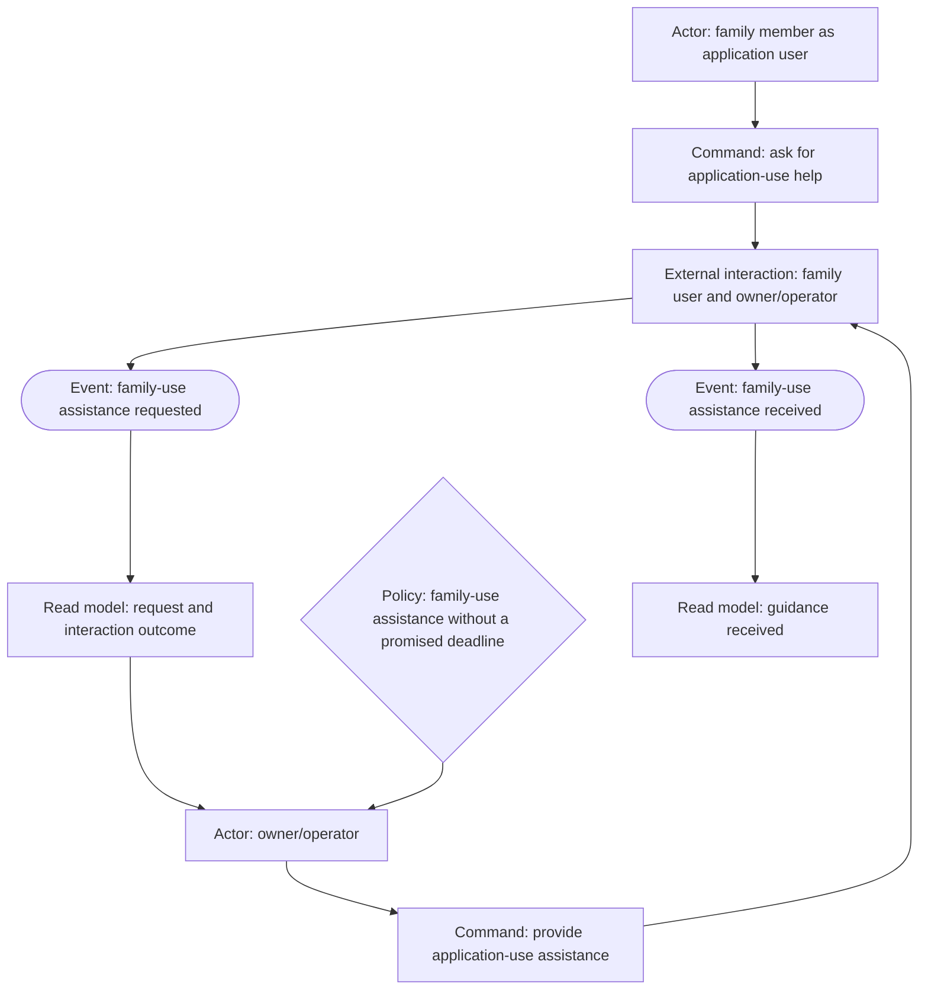
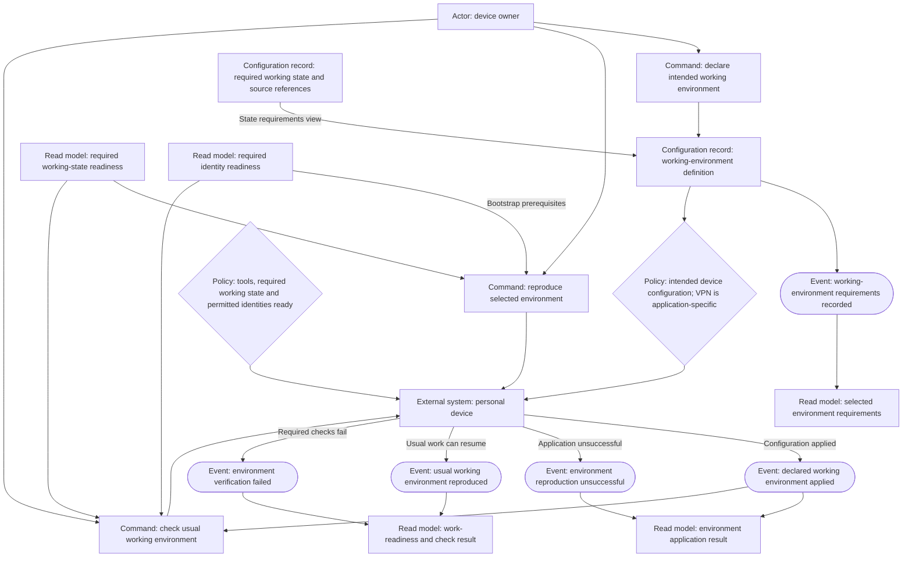
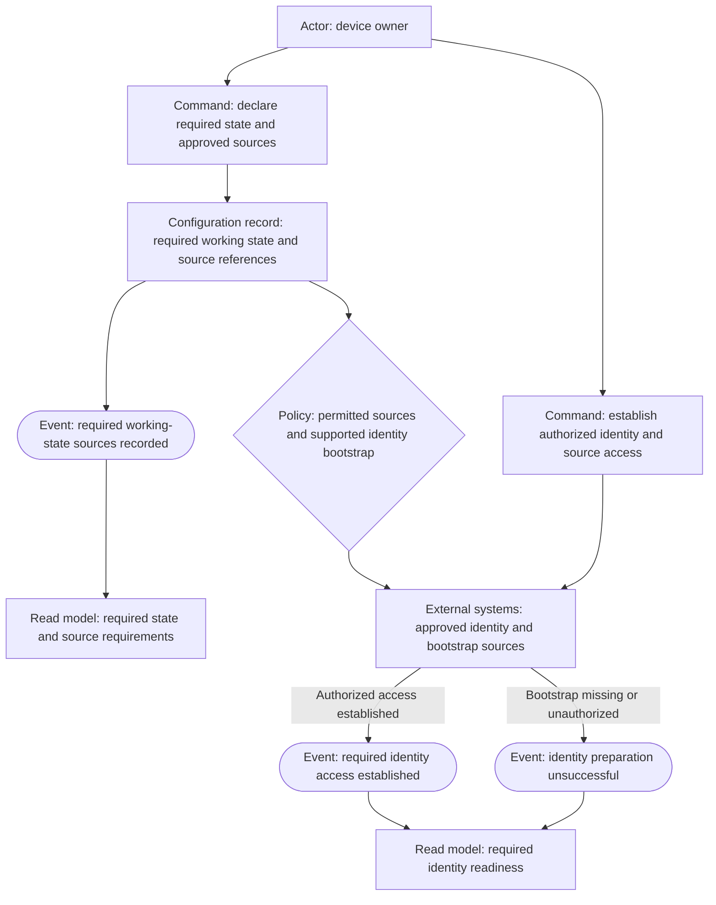
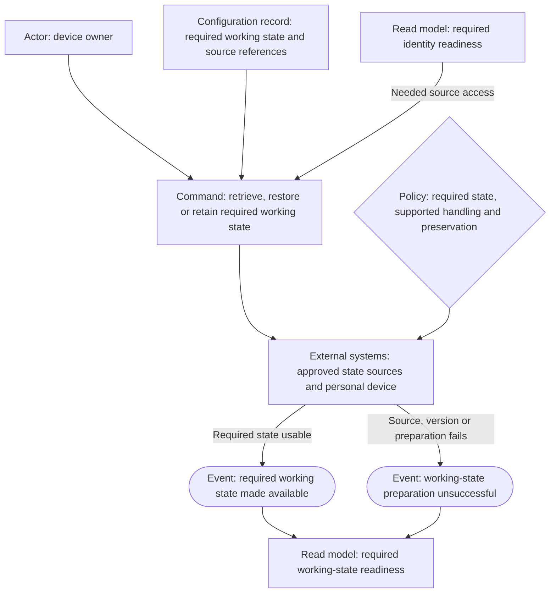

# Event Storming: growing personal infrastructure

Status: Event Storming complete for all currently named outcomes — fresh-context review passed after current stance/resume integration and updated render proof. Required personal state/identity availability is part of work readiness (Q15). Per-application reachability is the named network outcome (Q6); no extra topology is invented. Approved-source operating bindings remain open in Q16, not an unimplemented readiness downgrade or a tested recovery claim.

## Scope and evidence

This canvas models infrastructure enabling hosted applications, not software to implement album sharing. It follows the user's per-application reachability clarification in the persona revision (Q14), the selected guest audience (Q12), and ordinary internet guest reachability (Q13). The hosted photo application owns invitations and album authorization.

These are proposed, operator/user-observable event relationships, not observations of deployed behavior or a chosen configuration API. Read models mean information the actor needs to inspect, not a requirement to build dashboards. The access slice presupposes a hosted application; the provisioning and recovery slices below supply that prerequisite conceptually without claiming an implemented backup system.

### Kinds and consistency boundaries

Every node names its kind: Actor, Command, Configuration record, External system, External interaction, Event, Policy, or Read model. The permanent glossary declares no repository-owned aggregate. This slice introduces none: configuration records, network/edge infrastructure, hosted applications, and human interactions are not relabeled as aggregates. Commands target records, external systems, or external human interactions; the application's internal consistency boundaries are outside this repository's implementation scope. Any later repository-owned aggregate must be introduced and confirmed before a canvas relies on it.

The application-access record is the single conceptual declaration point for reachability. The application-setup record references that same requirement alongside persistent application state and recovery provisions; the two canvases do not require duplicate reachability settings or two implementation files. These are views of intended setup, not a selected configuration API.

## Event partners

| Past-tense event | Actor and command | Target and kind | Reacting policy | Actor's read model |
|---|---|---|---|---|
| Application reachability requirement recorded | Owner/operator: declare intended reachability | Application access configuration — configuration record, not aggregate | Reachability is selected per application; no global internet/VPN persona | Declared application reachability |
| Internet reachability established | Owner/operator: apply application access configuration | Network and edge — external infrastructure system | Enable the required internet-facing path for this application; do not equate it with resource authorization | Effective application reachability |
| Family-VPN-only reachability established | Owner/operator: apply application access configuration | Network and edge — external infrastructure system | Admit the family-VPN path and do not expose this application on ordinary internet paths | Effective application reachability |
| Application reached | Application user: open the application | Network and edge — external infrastructure system | Deliver requests arriving through a permitted path | Connectivity result |
| Access path blocked | Application user: open the application | Network and edge — external infrastructure system | Do not admit a request outside the application's declared path; no specific error wording or reject/drop mechanism is selected | Connectivity result |
| Application use permitted | Application user: use a granted application function | Hosted application — external system | Apply the application's supported authorization rules; selected photo recipients need no general family-application access | Application access result |
| Application use denied | Application user: use an application function | Hosted application — external system | Do not grant use outside application permissions; network reachability alone grants no resource rights | Application access result |

## Canvas: establish application reachability

Internet reachability is not a grant to view every application resource. Family-VPN-only is a boundary for the selected application, not a rule requiring all application users to join a VPN. No internet-versus-VPN implementation product or default exposure policy is selected.

## Canvas: use an application through its permitted path

The same application-user actor role covers family members and invited recipients. Their actual resource permissions differ by application; no blanket family access, guest rights, or infrastructure-administration authority is inferred. In the photo example, the permitted guest path is ordinary internet access, and the hosted app determines access to the selected album. Application internals and their failure modes are external dependencies, not new custom guest-sharing capabilities.

## Reverse narrative

For application use to have been permitted, the user must have reached the application and satisfied its supported authorization rules. Reaching it required an admitted access path, applied from the operator's per-application requirement. Making the application available required its hosting, persistent application state, and recovery provisions to be established. Recovering it after failure requires replacement hosting, a surviving consistent copy, a successful supported restore, and checks before intended access is re-established. A copy must exist before recovery can use it; declaring a backup schedule alone establishes none of those facts.

## Persona reactions — assistant-applied review lenses

These are advisory assessments using the confirmed personas, not quotes from human interviews.

- **Owner/operator:** per-application reachability preserves reuse without forcing one exposure policy. Setup includes persistent application state and recovery provisions, not only service start-up. The photo recovery-point target is now 24 hours under delegation; actual copy age, recoverability, independent survival, and restore checks matter more than a job's green status. Backup tooling and evidence of real restoration are still absent from this ideation.
- **Application user:** the actor remains nonadministrative across family and invited-recipient use. Internet guests are not required to join the private network for the photo example, while VPN-only applications remain private. Being able to reach an endpoint is separate from permission to use its resources. Family assistance remains in scope; no outsider support commitment is inferred.

## Open scope and next action

Application setup/access, data protection, recovery, family assistance, and complete personal work readiness are modeled. Fresh full-phase review found the model sound; its remaining render and in-flight stance/resume items are now addressed. Technical state inventories/source bindings and application-specific procedures must be supplied during the corresponding proposal/design, with missing required state preventing readiness. Proceed to Use Case Definition without inventing a new topology or a source product.

## Rendering verification — 2026-10-11

The initial two access Mermaid sources were rendered with Mermaid 11 in an isolated headless Firefox profile. Observed both SVG canvases and inspected a full-document screenshot: all kind labels and relationships were visible. This was access-slice syntax/layout proof, not production behavior or a completed phase review. Managed Chromium was unavailable; direct Firefox automation supplied the visual proof. The initial service/profile and smoke surface were removed. Updated whole-artifact rendering evidence is recorded at the end of this file.

## Delegated recovery-point assumption

The user delegated a sensible choice in the photo-data guarantee question (Q3). The assistant selected a **24-hour maximum recovery-point age** for the photo application, with manual recovery and no strict recovery-duration deadline. This is not a user-supplied numerical tolerance, a zero-loss promise, or a target assigned to every future application.

- A usable copy must be application-consistent and survive complete loss of the original server/storage; a same-server persistence area or snapshot does not establish that survival.
- Preserve the nonreconstructible state required by the application's supported restore procedure, including photo originals and needed application metadata/credentials. Exact contents depend on the selected application's documentation; no product, directory layout, or backup implementation is chosen here.
- The point at which the copied state was captured determines possible loss, not merely the backup-job finish time. If failure occurs at 18:00, meeting the target requires a restorable recovery point from 18:00 the previous day or later.
- Recent uploads/edits after that point may be lost, including sole-copy photos. A missing, failed, unreadable, incomplete, or older copy must not be represented as meeting the target.
- A daily-backup-oriented operating baseline motivates the assumption; the eventual schedule must account for capture time, completion, and failures. No retention duration, monitoring product, alert channel, or retry design is selected.
- Restored application metadata can predate recent changes, including sharing permissions. Before reopening intended external access, the operator checks restored application/access behavior using its supported mechanisms; this does not invent custom guest authorization or promise automatic reconciliation.

## Event partners: setup, protection, recovery, and assistance

| Past-tense event | Actor and command | Target and kind | Reacting policy | Actor's read model |
|---|---|---|---|---|
| Application setup requirements recorded | Owner/operator: declare application setup requirements | Application setup — configuration record | Reference the single application-access requirement; include intended users, persistent application state, and recovery provisions; the photo target is a planning assumption | Declared setup requirements |
| Application setup established | Owner/operator: apply the application setup | Hosting environment — external system | Use the intended configuration and establish persistence and recovery provisions; a configured backup is not a created copy | Application/setup result |
| Recovery copy created | Backup agent for the Owner/operator: create a consistent recovery copy | Backup environment — external system | Follow supported application-state capture and retain the copy outside the original failure boundary | Recovery copy evidence |
| Recovery copy creation failed | Backup agent for the Owner/operator: create a consistent recovery copy | Backup environment — external system | Report the unsuccessful operation honestly; any surviving earlier copy is assessed on its own age/consistency | Recovery copy evidence |
| Available recovery point assessed | Owner/operator: assess available recovery evidence | Backup environment — external system | Claim the photo target only for a usable, surviving, consistent recovery point no older than 24 hours; the first copy must exist before protection is claimed | Assessed recovery candidates, capture times, and target compliance |
| Server failure observed | Owner/operator: assess the unavailable hosting environment | Failed hosting environment — external system | Distinguish the observed failure from deliberate deletion; no command here is said to cause a hardware failure | Failure/recovery information |
| Replacement hosting established | Owner/operator: prepare replacement hosting | Replacement hosting — external system | Re-establish intended configuration and the access/credentials needed for supported restore | Replacement readiness |
| Application state restored | Owner/operator: restore the selected consistent recovery point | Recovery environment — external system | Restore the application's required coherent state, not only a directory labeled backup | Restore result and recovered point |
| Application restoration failed | Owner/operator: restore the selected consistent recovery point | Recovery environment — external system | Do not represent incomplete or unreadable restoration as success or reopen intended access on that basis | Restore result and recovered point |
| Application recovery verified | Owner/operator: check the recovered application and intended access | Restored hosted application — external system | Check recovered data and supported access behavior before reopening intended paths; do not infer preservation of post-backup changes | Recovery verification result |
| Recovery verification failed | Owner/operator: check the recovered application and intended access | Restored hosted application — external system | Keep intended external access closed until the relevant verification succeeds; no automatic retry or reconciliation tool is assumed | Recovery verification result |
| Recovered application access re-established | Owner/operator: reopen intended application access | Network and edge — external infrastructure system | Reuse the current per-application internet/VPN-only rule; do not expose private applications or administrative interfaces as a side effect of recovery | Effective reachability and usable recovered application |
| Family-use assistance requested | Family member acting as application user: ask for help using an application | Family user and owner/operator — external interaction | Owner/operator may support family application use; no help-desk product or response deadline is implied | Request/interaction outcome |
| Family-use assistance received | Owner/operator: provide application-use assistance | Family user and owner/operator — external interaction | Guidance concerns application use; do not turn the recipient into an infrastructure administrator or promise that every underlying fault is solved | Guidance received |

## Canvas: establish setup and create recovery copies

The backup agent is a delegated actor for the owner/operator, not a new stakeholder or selected software service. The setup declaration supplies the application's backup requirements; a newly established setup is not thereby proven protected. Assessment distinguishes a usable sufficiently fresh copy from missing/stale/failed evidence. There is no new custom event bus, dashboard, alerting platform, or scheduling API implied by this canvas.

The assessed-candidates read model includes surviving older copies when a newer attempt failed or is unusable; restore selection reads that same assessment. A best-effort restore from an older usable point can bring an application back while missing the photo target. Report the actual point and target miss; do not turn that fallback into a claim of compliance or an undisclosed weaker guarantee.

## Canvas: recover a failed hosted application

Failure causes are external; the operator's assessment records the observation rather than causing it. The restore command depends on a copy created in the previous canvas. The intended current reachability policy is retained during recovery; the application still owns its permissions. Neither a successful copy operation nor a successful file restore substitutes for the recovery check. Recent state missing under the 24-hour assumption is disclosed rather than silently treated as recovered.

## Canvas: support family application use

This is the user's existing human support relationship, not a custom support application or a promise of resolution within a deadline. Whether guidance resolves a particular problem is an example still to be supplied when elaborating that flow. Outside-recipient support is not inferred from family assistance.

## Advisory review of current coverage — 2026-10-11

An earlier fresh-context reviewer found no fabrication or contradiction of the decisions then recorded. Its four mechanical corrections were applied: external-interaction kinds, one assessed-candidates restore source, explicit capture/independence and restored-reachability policies, and a single-source relationship between access/setup records. At that review the personal-state boundary was still open. The later state-inclusive decision below requires a fresh full-phase review; this earlier advisory report is not that gate.

## Updated rendering verification — 2026-10-11

After integrating the advisory review corrections, all five Mermaid sources rendered successfully in isolated headless Firefox with Mermaid 11. Observed five SVG results; inspected separate screenshots of setup/backup, restoration/verification, and family assistance, with node-kind labels and relationships visible. The access canvases also rendered successfully; their layouts had already been inspected. This is diagram syntax/layout proof, not evidence of a live backup, 24-hour recovery-point compliance, application restore, or deployed network isolation. The browser service/session, temporary profile, HTML smoke surface, and screenshot files were removed. No permanent verification script, application configuration, or deployment was added.

## Reproduce the usual personal working environment

The user names this as the laptop/workstation outcome (Q7). Existing `docs/ARCHITECTURE.md:52-79` describes per-host user-feature composition with platform-specific overrides; `docs/impermanence-migration-plan.md:33-65` separately inventories personal state such as project directories and key material. These are documented patterns, not evidence that the full environment has been rebuilt or all personal state is recoverable.

Use the existing owner/operator persona: choosing and evaluating a personal setup shares its configuration authority and technical judgment; no device-specific persona is introduced. The actor here is the device owner. The selected device's usual environment can differ across platforms/roles; reproducing it does not mean identical installations on every machine.

VPN is an application/network requirement, not a mandatory prerequisite of every base working environment. A selected application's requirements may still cause its VPN software/configuration to be present on a device. No VPN product, enrollment method, or always-enabled client is selected by this personal-device goal.

### Event partners: declared environment reproduction

| Past-tense event | Actor and command | Target and kind | Reacting policy | Actor's read model |
|---|---|---|---|---|
| Working-environment requirements recorded | Device owner: declare intended working environment | Working-environment definition — configuration record | Include intended tools/settings, required working files/application state, permitted identities, approved sources, and platform differences | Selected environment requirements |
| Declared working environment applied | Device owner: reproduce selected environment | Personal device — external system | Apply the intended configuration; VPN belongs to selected application requirements, not a generic base gate | Environment application result |
| Environment reproduction unsuccessful | Device owner: reproduce selected environment | Personal device — external system | Do not treat failed/partial application as a reproduced environment; no automatic retry or rollback is selected | Environment application result |
| Usual working environment reproduced | Device owner: check usual working environment | Personal device — external system | Claim readiness only when intended tools/settings work, required working state is usable, and needed identity access is established through approved methods | Work-readiness and check result |
| Environment verification failed | Device owner: check usual working environment | Personal device — external system | Do not claim work readiness when configuration, state, or authorized access is missing; preserve already available working data | Work-readiness and check result |

### Canvas: reproduce and check a declared environment

Configuration success alone does not establish work readiness. The state/identity read models are produced by the preparation canvases below and consumed by application/verification where needed; bootstrap does not assume the completed environment already exists. Required datasets and their approved versions/points must be specified by the owner; unavailable required state is a failure, not a claim that configuration recreated it. Use approved sources and supported re-establishment rather than blanket credential cloning. The photo target imposes no personal-data recovery-point or completion-time target.

### Persona reaction — assistant-applied owner/operator lens

The accepted personal-device outcome is usual work readiness with needed files/state and permitted identities, not merely a configured shell/editor. Source/identity preparation stays inside that goal, with platform-specific supported handling and visible failure when inputs cannot be supplied. VPN remains application-specific. This advisory owner/operator lens reaction is not a human interview or proof of real device recovery.

### Personal-environment rendering verification — 2026-10-11

Rendered the new personal-environment Mermaid source with Mermaid 11 in isolated headless Firefox and inspected its full-document screenshot: actor, command, record/system, policy, success/failure event, and read-model labels were visible. This verifies the added diagram only; no real device was rebuilt or personal state restored. The previous five canvases retain their earlier recorded proof. Removed the temporary browser session/service, profile, HTML smoke surface, and screenshot. No permanent verification script or device configuration was changed.

### Required state and source references

The state requirements/source-reference record is a view of the single working-environment definition, not a second independent setup declaration, a new aggregate, or a new secret store. It identifies the owner's required working files, necessary mutable application state, allowed source/version or recovery point, and identity prerequisites; it does not embed plaintext credentials or assert that a backup exists. Some state may be retrieved from an authoritative source or already be present, rather than restored from a backup. The selected mechanism must preserve owner-authorized scope and supported platform semantics.

### Event partners: identity and working-state preparation

| Past-tense event | Actor and command | Target and kind | Reacting policy | Actor's read model |
|---|---|---|---|---|
| Required working-state sources recorded | Device owner: declare required state and approved sources | Working-state/source references — configuration-record view of the environment definition | Identify necessary state, allowed sources/versions and identity prerequisites; do not equate source references with a surviving copy | Required state/source requirements |
| Required identity access established | Device owner: establish authorized identity/source access | Approved identity and bootstrap sources — external systems | Use supported retrieval or re-establishment with permitted bootstrap material; do not clone credentials blindly or grant extra access | Required identity readiness |
| Identity preparation unsuccessful | Device owner: establish authorized identity/source access | Approved identity and bootstrap sources — external systems | Missing, unusable, or unauthorized bootstrap material does not satisfy readiness; status contains no raw secret | Required identity readiness |
| Required working state made available | Device owner: retrieve/restore or retain required working state | Personal device and approved state sources — external systems | Supply the specified usable state through supported procedures; retain already available required state and do not silently overwrite it | Required working-state readiness |
| Working-state preparation unsuccessful | Device owner: retrieve/restore or retain required working state | Personal device and approved state sources — external systems | Missing, unreadable, unauthorized, or wrong-version required state means not ready; do not invent data or hide a failed restore | Required working-state readiness |

### Canvas: establish permitted identity and source access

Re-establishment may require manual owner action or provider-supported enrollment; no copied key, account migration, hardware-bound credential export, or automated secret-store implementation is implied. Required bootstrap inputs must be independently available when the chosen workflow needs them. Declarations cannot regenerate a lost private credential by referring to its path.

### Canvas: make the required working state usable

The external-systems grouping is not a consistency aggregate or new application to build. It represents permitted source access and the target device's supported state handling. The command may retain correctly present data, retrieve it from an authoritative source, or restore it from an appropriate copy. It does not promise current lost work can be reconstructed from unavailable data or import the photo application's loss window. Readiness is checked against the actual required state, not merely the existence of a populated directory or a green copy job.

## Full Event Storming phase gate — 2026-10-11

The fresh-context full-phase reviewer found all named goals and command/event/policy/read-model partners represented, honest noncircular bootstrap inputs, preserved permissions/data, no fake aggregates, app-owned sharing, application-specific reachability, and manual assistance without a support-product/SLA invention. Its two remaining integration items were render evidence for the newest preparation diagrams and the current accepted-Q15 stance/resume; both are complete. Earlier pending-Q15 persona entries remain append-only historical records, superseded by the accepted state-inclusive stance.

Rendered the changed work-readiness canvas and both new identity/state-preparation canvases with Mermaid 11 in isolated Firefox. Inspected all three screenshots; corrected an obscured dependency label and restored its full read-model kind/name, then re-rendered and inspected the changed canvas. The unchanged first five sources retain prior proof, giving rendering coverage for all eight current canvases. This is syntax/layout proof only, not actual file retrieval, identity bootstrap, backup survival, app recovery, or real device reproduction. Temporary browser/service/profile/HTML/screenshots were removed.

Actual source inventory is recorded in the Frame's personal-state evidence section. It establishes declarations and local retention/sync patterns, not provider authentication, external escrow, or off-device copies. Q16 remains an operating/design input for the future environment change. No confirmed term or persona was promoted, no givn change was started, and no production configuration was altered.
