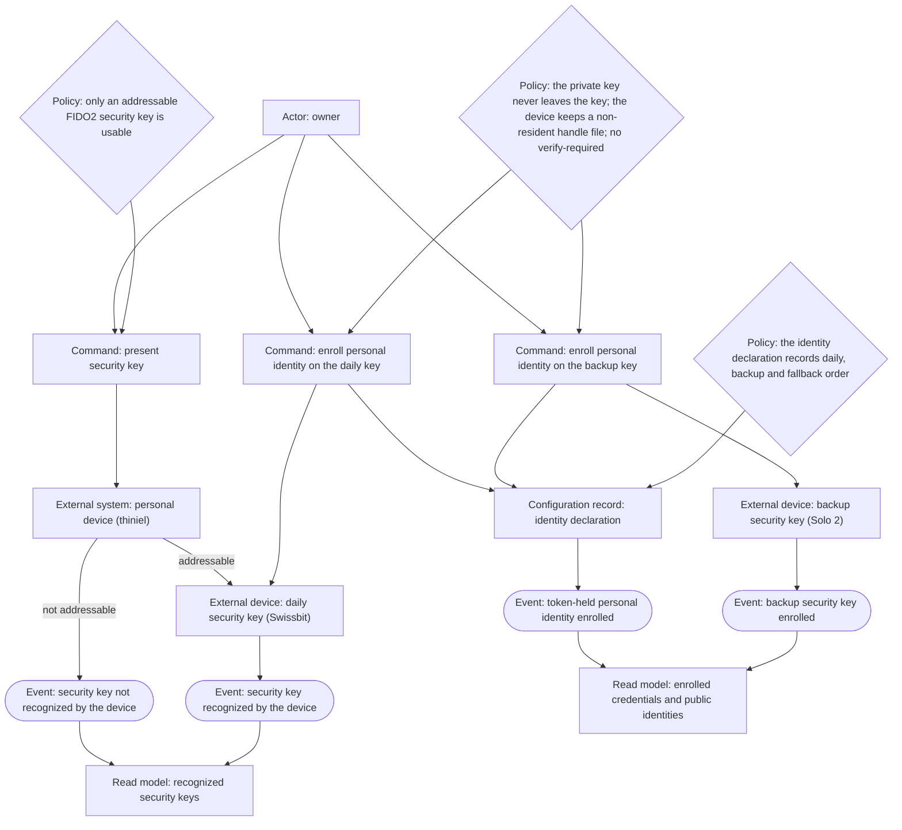
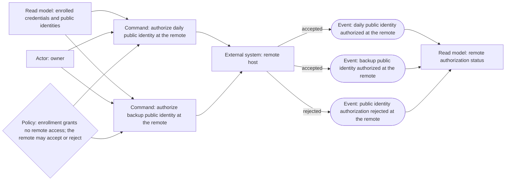
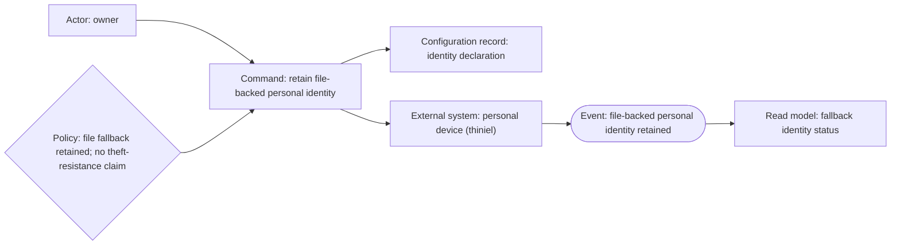
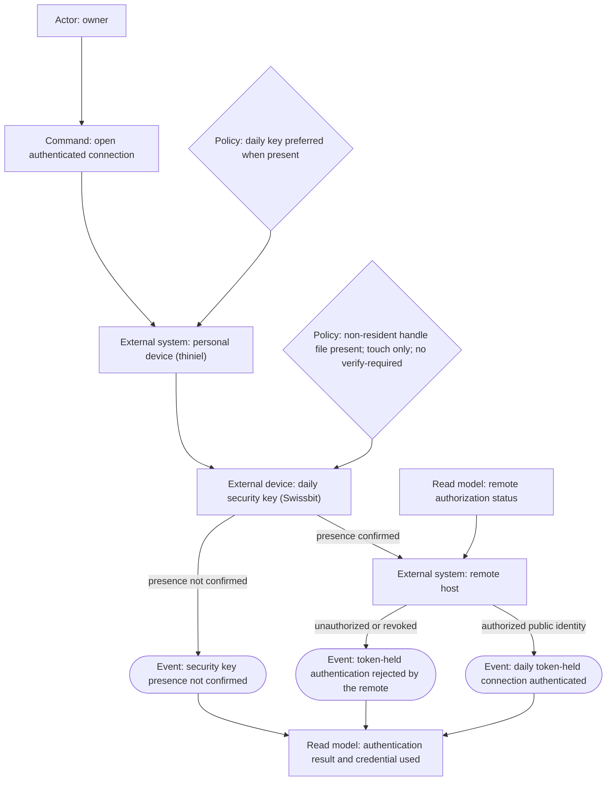
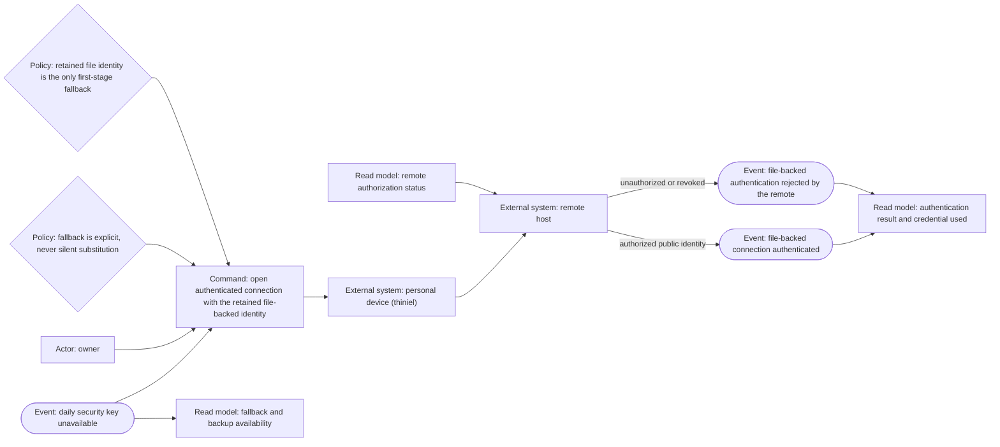
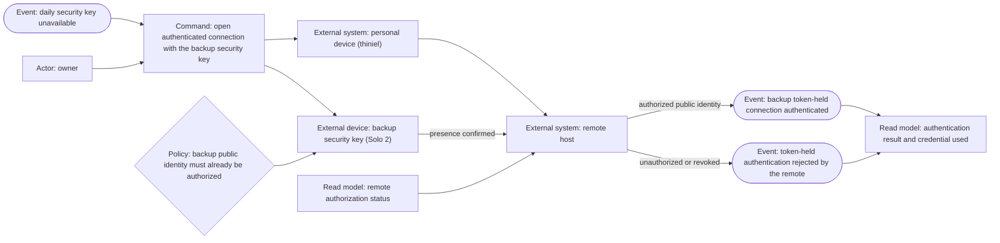
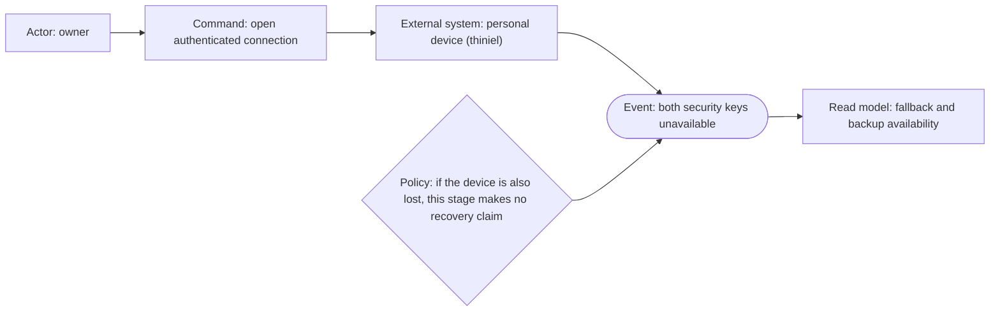
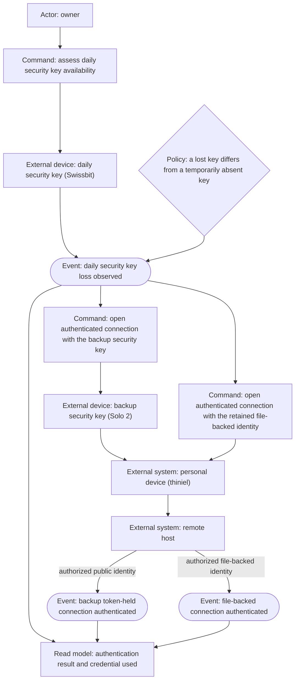
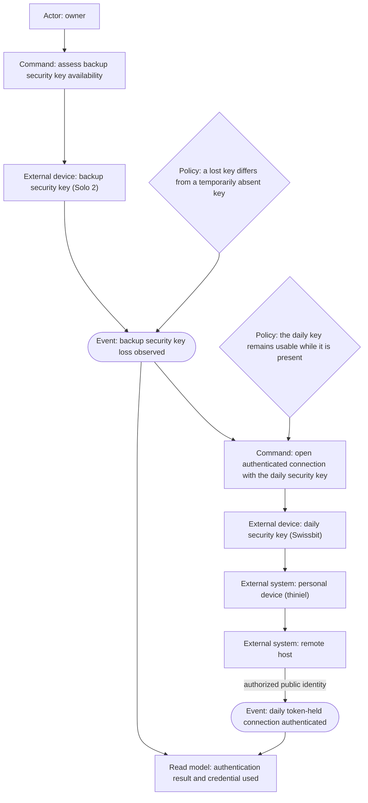
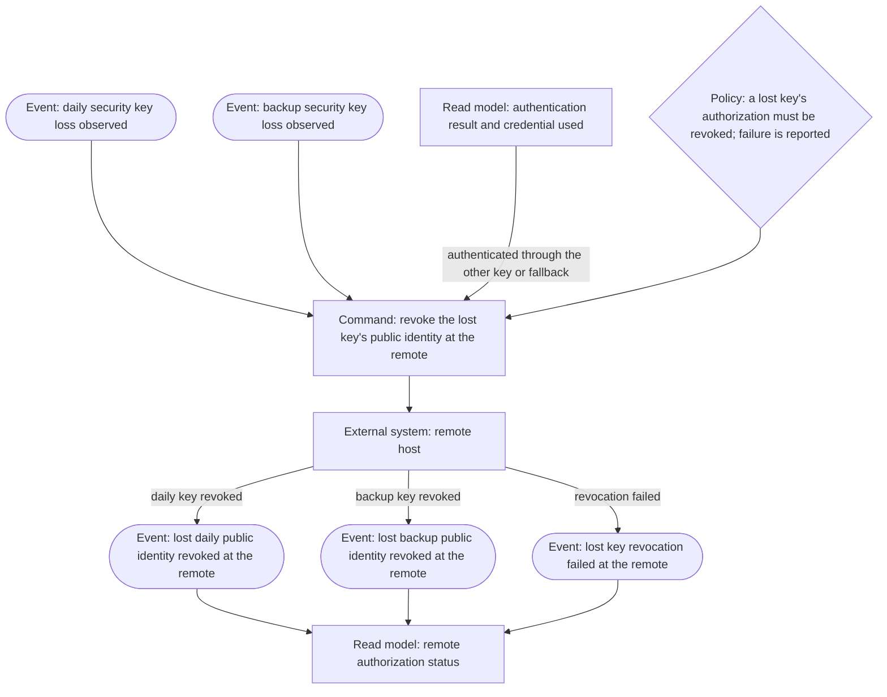

# Event Storming: secure token keys

Status: reviewed 2026-10-17 — models the confirmed first stage only (remote identity on `thiniel`, Swissbit daily, Solo 2 backup, file key fallback). The fresh-context phase review's correctness findings are applied; the terms are confirmed and promoted; Q8's non-resident handle policy is applied. Later token surfaces are not modeled here.

## Scope and evidence

This canvas models the owner's first-stage authentication behavior, not a configuration API and not observed runtime behavior. The sources are the confirmed Frame (Q1–Q7), `permitted-identity-selection` (a device reaches private repositories with the identity material it declares), the current SSH feature module, and the supplied FIDO2 research. No security key has been enrolled, no token-held key has authenticated, and no remote has authorized one; all events are proposed relationships.

The later surfaces — device privilege authentication, web-account authentication, and secret/disk unlock — are staged behind this one. They are not modeled as events here because their scoping decisions are not confirmed beyond the Frame. The first stage must ship without depending on them.

## Kinds and consistency boundaries

Every node names its kind: Actor, Command, Configuration record, External device, External system, Event, Policy, or Read model.

The permanent glossary declares no repository-owned aggregate. This slice introduces none. The security keys, the personal device, and the remote hosts are external devices/systems; the **identity declaration** (the durable glossary term for a host's statement of which identity material it holds, specialized here to include the token-held credential) is a configuration record; a remote authorization is a grant. Commands target those, not an aggregate. A later repository-owned aggregate must be introduced as a domain term and confirmed before a canvas relies on it.

Node IDs are canvas-local and prefixed by their canvas letter (`a`, `b`, …). Cross-reference a node by its label, not by its ID.

## First-stage handle policy (Q8)

The handle is **non-resident**. Each security key gets its own key and handle file; the token holds the device key, and the handle file exists only on the device. There is no `-O resident` and no `-O verify-required`. Daily use is touch-only.

- A stolen token alone cannot authenticate without its handle file.
- A stolen token plus its handle file is protected by touch only.
- A lost or unreadable handle file makes that token's credential unusable even when the token is present; the other token and the encrypted handle-file backup are the recovery path.
- `ssh-keygen -K` with either token must return no keys; that is the residency check.
- The first stage does not claim stolen-laptop resistance; the file-backed personal identity remains on `thiniel`.

## Event partners

| Past-tense event | Actor and command | Target and kind | Reacting policy | Actor's read model |
|---|---|---|---|---|
| Security key not recognized by the device | Owner: present security key | Personal device and security key — external device/system | Only an addressable FIDO2 security key is usable; an unrecognized key is neither enrolled nor authorized | Recognized security keys |
| Security key recognized by the device | Owner: present security key | Personal device and security key — external device/system | Recognition does not enroll or authorize anything | Recognized security keys |
| Token-held personal identity enrolled | Owner: enroll personal identity on the daily security key | Daily security key — external device; identity declaration — configuration record | The private key never leaves the key; the device keeps a non-resident handle file; no `verify-required`; the declaration records the daily credential and preference | Enrolled credentials and public identities |
| Daily public identity authorized at the remote | Owner: authorize the daily public identity | Remote host — external system | Enrollment grants no access; the remote may accept or reject the authorization | Remote authorization status |
| Public identity authorization rejected at the remote | Owner: authorize the daily or backup public identity | Remote host — external system | A remote may refuse the authorization; the local enrollment remains, but no access is granted | Remote authorization status |
| Backup security key enrolled | Owner: enroll personal identity on the backup security key | Backup security key — external device; identity declaration — configuration record | The backup is a separate credential, never a copy; the declaration records the backup credential and fallback order | Enrolled credentials and public identities |
| Backup public identity authorized at the remote | Owner: authorize the backup public identity | Remote host — external system | The backup must be authorized independently at each remote | Remote authorization status |
| File-backed personal identity retained | Owner: retain the existing file-backed identity | Personal device — external system; identity declaration — configuration record | The file-backed identity stays authorized as the first-stage fallback; no theft-resistance claim follows | Fallback identity status |
| Daily token-held connection authenticated | Owner: open authenticated connection | Personal device, daily security key, and remote host — external systems | The daily key is preferred when present; user presence is required; the remote accepts the authorized public identity | Authentication result and credential used |
| Security key presence not confirmed | Owner: open authenticated connection | Personal device and security key — external systems | No token-held authentication occurs without user presence | Authentication result |
| Daily security key unavailable | Owner: open authenticated connection | Personal device — external system | The device may use the retained file-backed identity or the backup key; no silent replacement by another identity | Fallback and backup availability |
| File-backed connection authenticated | Owner: open authenticated connection with the retained file-backed identity | Personal device and remote host — external systems | The fallback is explicit; the remote's authorization still applies; it does not prove theft resistance | Authentication result and credential used |
| File-backed authentication rejected by the remote | Owner: open authenticated connection with the retained file-backed identity | Remote host — external system | An unauthorized or revoked file-backed public identity is rejected; no silent substitution | Authentication result |
| Backup token-held connection authenticated | Owner: open authenticated connection with the backup security key | Personal device, backup security key, and remote host — external systems | The backup must already be authorized; user presence is required | Authentication result and credential used |
| Token-held authentication rejected by the remote | Owner: open authenticated connection with a token-held identity | Remote host — external system | An unauthorized or revoked token-held public identity is rejected; the device does not substitute a different identity silently | Authentication result |
| Daily security key loss observed | Owner: assess daily security key availability | Daily security key — external device | Distinguish a lost key from a temporarily absent key; a lost key's authorization must be revoked | Key availability |
| Lost daily public identity revoked at the remote | Owner: revoke the lost key's public identity | Remote host — external system | A lost key's authorization is removed so it cannot authenticate if recovered by someone else; revocation may fail | Remote authorization status |
| Backup security key loss observed | Owner: assess backup security key availability | Backup security key — external device | Distinguish a lost backup from a temporarily absent one; a lost backup's authorization must be revoked | Key availability |
| Lost backup public identity revoked at the remote | Owner: revoke the lost key's public identity | Remote host — external system | A lost backup's authorization is removed; revocation may fail | Remote authorization status |
| Lost key revocation failed at the remote | Owner: revoke the lost key's public identity | Remote host — external system | A failed revocation leaves the authorization in place and must be reported, not treated as removed | Remote authorization status |
| Both security keys unavailable | Owner: open authenticated connection | Personal device — external system | The retained file-backed identity is the only first-stage fallback on `thiniel`; if the device is also lost, this stage makes no recovery claim | Fallback availability |

## Canvas: recognize and enroll the credentials

## Canvas: authorize the public identities at the remote

## Canvas: retain the file-backed fallback

## Canvas: authenticate with the daily security key

## Canvas: authenticate with the retained file-backed identity

## Canvas: authenticate with the backup security key

## Canvas: both security keys unavailable

## Canvas: recover from a lost daily security key

## Canvas: recover from a lost backup security key

## Canvas: revoke the lost key's public identity

## Reverse narrative

For a daily token-held connection to have authenticated, the owner must have presented the daily key, enrolled a personal identity on it, authorized its public identity at the remote, and confirmed presence. The device must have recognized the key and selected it; the remote must have accepted the authorized public identity. For the backup to authenticate, the backup must have been separately enrolled, separately authorized, and its presence confirmed. For the file-backed connection to authenticate, the existing file-backed identity must have been retained and the remote must still authorize it. For a lost key's public identity to have been revoked, the owner must have observed the loss, reached the remote through the other key or the retained fallback, and the remote must have accepted the revocation. A remote authorization cannot exist before the public identity was enrolled; an enrollment cannot exist before the device recognized a usable key. A recognized key does not imply an enrolled credential, and an enrolled credential does not imply a remote authorization.

## Persona reactions — assistant-applied review lenses

- **Owner/operator (`owner--operator`):** the first stage proves the token path without removing the fallback the owner chose. It distinguishes recognition from enrollment, enrollment from remote authorization, a lost key from an absent key, and a failed revocation from a successful one. The stage does not claim theft resistance; that claim waits for the later removal of the file-backed identity. The owner must still carry the Swissbit for daily token use and retrieve the Solo 2 when the daily key is lost.
- **Family application user (`family--application-user`):** no direct effect. The family user does not administer infrastructure or use the owner's SSH identities, and the first stage changes no application access. No family token-enrollment or support obligation is inferred.

## Open inputs and exclusions

- Q8 settles the first stage on non-resident handle files without `verify-required`; resident-key capacity is not relevant to this stage. The Swissbit model and its FIDO2/PIV/TOTP/HMAC-secret capabilities are still needed before later stages.
- Whether the Swissbit supports `ed25519-sk` (fallback `ecdsa-sk`) and whether client and servers run OpenSSH ≥ 8.2 with FIDO support remain unverified design inputs.
- The exact udev rules and whether the Solo 2 needs `solo2-cli` in addition to `libfido2` are design inputs, not events.
- The first stage does not include PAM/login, WebAuthn, SOPS age, disk unlock, the work Mac, or work identities.
- The first stage does not claim that a stolen device or copied home directory yields no usable SSH identity. The file-backed identity remains on `thiniel`.
- No remote account recovery, third token, or offline recovery key is selected. The retained file-backed identity is the both-tokens-lost path while `thiniel` remains available.
- Backup loss is modeled symmetrically with daily loss in this stage: the daily key remains usable, and the lost backup's public identity is revoked at each remote. Revocation failure is reported rather than treated as removal.

## Rendering verification — 2026-10-17

All ten Mermaid sources were rendered with Mermaid CLI 12.0.0 and Chromium 155.0.8059.79 from nixpkgs (`nix shell nixpkgs#mermaid-cli -c mmdc -i <source>.mmd -o <output>.png`). Each render completed without a syntax error, and the PNGs were inspected: every node-kind label is visible, the actor/command/external-system/configuration-record/event/policy/read-model shapes are distinguishable, and no edge label is obscured. The canvases were split from three dense diagrams into ten focused ones after the first render showed overlapping labels. The event-partner table and the canvases cover the same events, commands, and read models; policy rows that are slice-wide invariants are recorded in the table and are not all duplicated as nodes. Node IDs are canvas-local, as stated above. This is syntax and layout proof only, not a security-key enrollment or authentication run. After Q8, the enrollment and daily-authentication canvases were re-rendered and inspected; their non-resident-handle and touch-only policy labels are visible. Temporary render files were outside the repository and removed.

## Event Storming phase review — 2026-10-17

A fresh-context reviewer returned "pass with findings" and no blocker. Applied: backup enrollment now records the backup credential in the identity declaration; authorization, fallback, and backup canvases route through the personal device and remote host and use the authentication-result read model; the daily canvas orders the remote acceptance before the authenticated event; canvases no longer introduce commands absent from the table; losing the backup key is modeled symmetrically with losing the daily key; failure partners exist for recognition, authorization, file-backed rejection, and revocation; the term file defines public identity and reuses the durable identity declaration; session state no longer retains the superseded Q5 first-stage claim. The table and canvases cover the same 21 events; policy rows that are slice-wide invariants are recorded in the table and not all duplicated as nodes; node IDs are canvas-local. The user confirmed all eleven terms after the review.

## Next action

Handoff is complete. The ready seed `security-key-remote-identity` carries this event chain and the Q8 non-resident handle policy. No givn change has been started.
